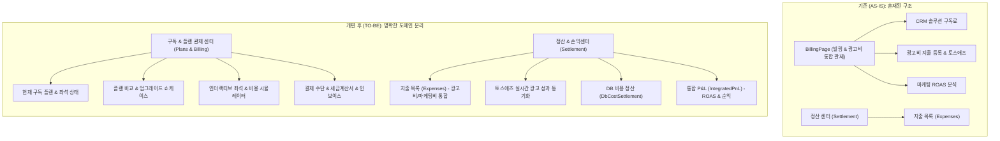

# 💳 리드마스터 CRM 구독 & 플랜 관제 센터 (Plans & Billing) 전면 개편 및 UI/UX 기획서

> **문서 번호**: LM-SPEC-202611-BILLING-REDESIGN-v1.0  
> **기획 대상**: 리드마스터 CRM 웹 솔루션 빌링 & 플랜 관리 시스템  
> **기준 모델**: OpenAI ChatGPT, Notion, Slack, Linear, Channel.io(채널톡)  
> **핵심 과제**: 광고비 지출 항목을 '정산 손익센터'로 완전 이관 분리하고, 본 페이지는 'CRM 솔루션 구독·플랜·결제' 전용 페이지로 완벽 재설계

---

## 1. 추진 배경 및 개편 방향

### 1.1 현행 페이지의 문제점
- 기존 **"빌링 & 광고비 통합 관제 센터 (Billing & Ad Spend)"**는 CRM 솔루션 자체의 구독료 청구와 고객사의 외부 광고비(메타, 네이버, 토스애즈, ROAS 등)가 한 화면에 혼재되어 있었습니다.
- 이로 인해 관리자는 "우리 회사가 리드마스터 CRM 소프트웨어에 지불하는 구독료"와 "고객 유치를 위해 집행한 마케팅 광고비"를 명확히 구분하기 어려웠으며, 페이지의 본질적인 목적이 모호해지는 문제가 있었습니다.

### 1.2 사용자 요구사항 및 개편 핵심 원칙
> **사용자 피드백**: *"빌링 & 광고비 통합 관제 센터 => 이 페이지는 구독 요금과 그와 관련된 설명으로만 채워줘. 광고비 얼마 썼는지는 정산 손익센터 지출 목록으로 가야지. 위 첨부파일은 예시야. 다양한 서비스의 구독 소개 및 결제 페이지를 조사해서 기획해줘"*

1. **도메인 완전 분리**:
   - **광고비 및 마케팅 지출 내역** ➔ `정산/손익센터(Settlement)`의 **지출 목록(Expenses)** 및 **DB비용 정산(DbCostSettlement)**, **통합 P&L(IntegratedPnLTab)**로 일원화.
   - **본 페이지(BillingPage)** ➔ **`구독 & 플랜 관제 센터 (Plans & Billing)`**로 명칭을 개편하고, **CRM 솔루션 요금제 소개, 플랜 업그레이드/다운그레이드, 좌석(Seat) 관리, 결제 수단, 인보이스 및 세금계산서**로만 구성.
2. **글로벌 SaaS 벤치마킹 기반의 직관적인 구독 UX 구축**:
   - 첨부파일로 전달된 **ChatGPT 플랜 업그레이드** 화면을 비롯해 **Notion, Slack, Linear, 채널톡**의 베스트 프랙티스를 결합하여, TM 센터 대표 및 총괄 관리자가 한눈에 비용과 혜택을 이해하고 즉시 결제/확장할 수 있는 환경 제공.

---

## 2. 글로벌 & 국내 주요 서비스 구독·결제 페이지 벤치마킹 분석

| 서비스 | 주요 UI/UX 패턴 | 혜택 및 기능 소구 방식 | 결제 및 청구 정책 특징 | 리드마스터 CRM 적용 포인트 |
| :--- | :--- | :--- | :--- | :--- |
| **OpenAI ChatGPT**<br/>*(첨부 예시)* | • 심플한 2열 카드 (Free vs Plus)<br/>• "걱정 없이 언제든지 취소 가능" 안심 헤더<br/>• [개인용 \| 비즈니스] 상단 세그먼트 | • 시각적 아이콘과 1줄 혜택 불릿<br/>• 핵심 혜택(고급 모델, 이미지, 코드, 광고 없음) 명료화 | • VAT 포함 최종 금액 투명 표기<br/>• 원클릭 즉시 업그레이드 버튼<br/>• 현재 플랜 비활성화 배지 | • **헤더 안심 카피** ("언제든지 위약금 없이 해지 가능")<br/>• **현재 플랜 vs 추천 플랜 직관적 카드 대조**<br/>• **명확한 불릿 리스트** |
| **Notion** | • [월간 결제 \| 연간 결제] 토글 (연간 20% 할인 강조)<br/>• 4단 티어 (Free - Plus - Business - Enterprise)<br/>• 'Most Popular' 추천 플랜 하이라이트 | • 티어별 추천 팀 규모 명시 ("중소 규모 팀용")<br/>• 하단 아코디언 "전체 기능 1:1 비교 매트릭스" | • 워크스페이스 멤버 수에 따른 실시간 월 총액 계산<br/>• 엔터프라이즈 맞춤 견적 문의 | • **월간 / 연간 결제 토글 (연간 17% 할인 / 2개월 무료)**<br/>• **자세한 전체 기능 비교 아코디언** |
| **Slack** | • 사용자당 월 과금(Per User / Month)<br/>• 보안, 컴플라이언스, 보관 기간 중심의 등급화<br/>• 심플하고 신뢰감 있는 브랜드 톤 | • "메시지 보관 무제한", "화면 공유", "감사 로그"<br/>• 엔터프라이즈급 데이터 보안 강조 | • **Fair Billing Policy (공정 청구 정책)**: 실제 활동하지 않는 비활성 계정은 요금 자동 감액/크레딧 환급 | • **퇴사/비활성 상담원 즉각 반영 및 일할 계산 정책 도입**<br/>• 통화 녹음 1년 보관 & 백업 보안 강조 |
| **Linear** | • 극도로 절제된 미니멀 디자인<br/>• 다크/라이트 완벽 대응<br/>• 각 플랜 카드 상단 1줄 핵심 가치 제안 | • Free(단독/소팀) ➔ Standard ➔ Plus ➔ Enterprise<br/>• 복잡한 군더더기 없이 핵심 가치만 전달 | • 투명한 시트 추가/삭제 슬라이더<br/>• 즉시 적용 및 차액 일할 청구 | • **고급스러운 대시보드 카드 레이아웃**<br/>• 버튼 호버/클릭 시 군더더기 없는 즉시 반응 |
| **Channel.io**<br/>*(채널톡)* | • **인터랙티브 좌석 슬라이더**<br/>• 국내 결제 친화적 (법인카드, 세금계산서, 가상계좌)<br/>• 14일 무료 체험 CTA | • 상담원 수에 따른 요금 변동 실시간 시뮬레이션<br/>• 타사 대비 절감 금액 계산기 제공 | • 사업자등록증 기반 정기 세금계산서 자동 발행<br/>• 관리자용 인보이스 영수증 즉시 출력 | • **인터랙티브 좌석 슬라이더 & 비용 시뮬레이터**<br/>• **국내 법인카드 / 전자세금계산서 완벽 연동**<br/>• **타사 분리 대비 월 절감액 표시** |

---

## 3. 도메인 분리 계획: 광고비 지출의 '정산 손익센터' 일원화



### 3.1 분리 실행 가이드
1. **BillingPage에서 제거할 요소**:
   - `AdSpendOverviewSection` (광고비 총괄 집계 & 타임라인 상세 장부)
   - `MarketingRoiSection` (마케팅 투자 회수율 ROAS & 효율 분석)
   - `ExpenseAddModal` (광고비 지출 등록 모달)
   - `handleSyncTossAds` (토스애즈 실시간 동기화)
2. **정산 손익센터(`pages/Settlement.tsx`)로의 귀속 확인**:
   - `Settlement.tsx`의 `expenses` 탭에 이미 광고비 카테고리(`마케팅/광고비`)가 존재하므로, 광고비 등록/수정/삭제 및 토스애즈 동기화는 정산 손익센터에서 전담.
   - DB 건당 비용 및 수수료와 결합된 통합 손익 계산은 `integrated_pnl` 탭에서 원스톱으로 제공.
3. **사용자 유도 배너 제공**:
   - BillingPage 상단에 은은한 알림 배너 배치:
     > *"💡 **마케팅 광고비 및 지출 내역 안내**: 페이스북, 네이버, 토스애즈 등 광고비 지출 등록 및 ROAS 집계는 **[정산 손익센터 > 지출 목록 바로가기 ➔]**에서 통합 관리됩니다."*

---

## 4. 리드마스터 CRM 전용 "구독 & 플랜 관제 센터" 정보 구조 (IA)

```
[구독 & 플랜 관제 센터 (Billing & Plans)]
│
├── 1. 페이지 헤더 (Header & Status)
│   ├── 타이틀: "구독 & 플랜 관제 센터"
│   ├── 서브카피: "팀 규모에 맞는 최적의 플랜을 선택하고, 좌석 라이선스 및 결제 정보를 통합 관리하세요."
│   └── 안심 배지: 🛡️ 언제든지 위약금 없이 해지 가능 · 14일 무료 체험 보장
│
├── 2. [Zone 1] 현재 구독 상태 대시보드 (Active Plan & Seat Status)
│   ├── 현재 적용 중인 플랜 카드 (예: '비즈니스 플랜 (6~20인)')
│   ├── 활성 좌석 이용률 게이지 (예: 12석 사용 중 / 총 15석 계약)
│   ├── 다음 결제 예정일 및 결제 예정 금액 (예: 2026-12-01 / ₩780,000)
│   └── 퀵 액션: [플랜 업그레이드] [좌석 추가/감소] [결제 수단 변경]
│
├── 3. [Zone 2] 플랜 쇼케이스 & 업그레이드 비교 (Plans & Upgrades)
│   ├── [월간 결제] ── [연간 결제 (17% 할인 / 2개월 무료)] 토글
│   └── 5대 볼륨 플랜 비교 카드 (스타터 / 비즈니스[인기] / 프로 / 엔터프라이즈 / 메가센터)
│       ├── 티어 명칭 및 타겟 규모
│       ├── 좌석당 단가 (월/석) 및 총액 예시
│       ├── 핵심 제공 혜택 불릿 체크리스트
│       └── 액션 버튼: [현재 이용 중] or [이 플랜으로 업그레이드] or [도입 문의]
│
├── 4. [Zone 3] 인터랙티브 좌석 & 비용 시뮬레이터 (Seat & Cost Simulator)
│   ├── 인원수 조절 슬라이더 (1명 ~ 150명+) & 직접 숫자 입력
│   ├── 실시간 단가 자동 계산: 볼륨 구간별 좌석당 단가 자동 인하 (₩58,000 ➔ ₩38,000)
│   ├── 타사 개별 솔루션(다이얼러 4만 + 녹취 3만 + AI 5만 = 12만) 대비 **월간/연간 절감액** 가시화
│   └── [선택한 좌석으로 즉시 적용] 버튼
│
├── 5. [Zone 4] 전체 기능 상세 비교 매트릭스 (Full Feature Comparison Table - 접이식)
│   ├── CTI & 다이얼러 (1초 1콜 자동 다이얼러, 단말기 연동)
│   ├── 통화 녹음 & 백업 (무제한 녹음, 32kbps 고음질 압축, D-30 백업)
│   ├── AI 기술 (Gemini 2.5/Flash 실시간 채무진단, 12,000명 가상 롤플레잉)
│   ├── 정산 & 권한 관리 (수당 정산, 관리자 4대 권한, 엑셀 분배, 감사 로그)
│   └── 고객 지원 (전담 매니저, 핫라인, 커스텀 SLA)
│
├── 6. [Zone 5] 결제 수단 & 구독료 결제 내역 및 히스토리 (Payment & Billing History)
│   ├── [서브탭 1] 실시간 결제 승인 내역 & 영수증 (Payment Transactions)
│   │   ├── 결제 일시, 청구 항목(플랜명/좌석수/일할계산), 결제 수단, 결제 금액(공급가+VAT)
│   │   ├── 결제 상태 배지 (결제완료, 납부대기, 결제실패, 부분취소/환불)
│   │   ├── 회계 증빙: [신용카드 매출전표] [공식 청구서/인보이스] [전자세금계산서 국세청 승인번호]
│   │   └── 기간 필터 (최근 3개월, 6개월, 1년, 연도별) 및 [결제 내역 엑셀 다운로드]
│   ├── [서브탭 2] 구독 및 좌석 변동 감사 히스토리 타임라인 (Subscription Audit Log)
│   │   ├── 플랜 업그레이드/다운그레이드 이력 (누가, 언제, 어떤 플랜으로 변경했는지)
│   │   ├── 상담원 좌석 추가/회수 변동 이력 (인원 변동 및 일할 청구 내역)
│   │   └── 결제 수단 등록/변경 이력
│   └── [기본 설정 카드] 등록 결제 수단(법인카드) 및 전자세금계산서 수신 정보 수정 모달
│
└── 7. [Zone 6] 자주 묻는 질문 (FAQ) & 신뢰 보장
    ├── 중도 해지 시 환불 정책은 어떻게 되나요? (일할 계산 자동 정산)
    ├── 별도 서면 계약서를 작성해야 하나요? (전자계약 정식 법적 효력)
    └── 상담원 인원이 갑자기 늘어나거나 줄어들면 어떻게 되나요? (슬랙형 공정 과금)
```

---

## 5. 핵심 UI 컴포넌트 상세 와이어프레임 & 인터랙션 설계

### 5.1 상단 헤더 & 정산 손익센터 안내 배너
```
┌────────────────────────────────────────────────────────────────────────────────────────┐
│ 🏠 홈 > 정산 / 경영 > 구독 & 플랜 관제 센터                                              │
│                                                                                        │
│ 💳 구독 & 플랜 관제 센터 (Plans & Billing)                                              │
│ 팀 규모에 맞는 최적의 플랜을 선택하고, 좌석 라이선스 및 결제 정보를 통합 관리하세요.      │
│ [당월 청구서 보기]  [세금계산서 설정]  [새로고침]                                       │
├────────────────────────────────────────────────────────────────────────────────────────┤
│ 💡 마케팅 광고비 안내: 페이스북/네이버/토스애즈 지출 및 ROAS는                          │
│    [정산 손익센터 지출 목록 바로가기 ➔]에서 통합 관리됩니다.                              │
└────────────────────────────────────────────────────────────────────────────────────────┘
```

### 5.2 [Zone 1] 현재 구독 상태 대시보드 (Active Plan Card)
- **배경**: Stripe/Linear 스타일의 은은한 블루 그라디언트 테두리 카드.
- **좌측**: 현재 플랜 명칭(`비즈니스 플랜`), 계약 형태(`연간 결제 · 17% 할인 적용 중`), 현재 활성 상담원 수(`12석 / 15석 사용 중`).
- **중앙**: 좌석 사용률 프로그레스 바 (80% 사용 중, 여유 3석).
- **우측**: 다음 결제 예정일(`2026년 12월 1일`), 예정 금액(`₩624,000 / 월 (VAT 별도)`).
- **CTA 버튼군**:
  - `[⚡ 플랜 업그레이드]` (클릭 시 플랜 비교 섹션으로 스크롤)
  - `[👥 좌석 추가/조정]` (SeatExpansionModal 오픈)
  - `[💳 결제 수단 관리]` (카드 변경 모달 오픈)

### 5.3 [Zone 2] 플랜 비교 쇼케이스 (ChatGPT / Notion 벤치마킹)
- **상단 주기 토글 버튼**:
  - `[ 월간 결제 ]`  `[ 연간 결제 (✨ 17% 할인 · 2개월 무료) ]`
- **카드형 플랜 그리드 (5개 티어 중 주요 4개 노출 + 메가센터 배너)**:

```
┌─────────────────┐ ┌─────────────────┐ ┌─────────────────┐ ┌─────────────────┐
│ 스타터 (Starter)│ │ 비즈니스(Business)│ │   프로 (Pro)    │ │엔터프라이즈(Ent)│
│  소규모 TM/개인 │ │★ 가장 인기 · 10%할인│ │ 중대형 센터·20%할인│ │ 대형 법무법인·30% │
├─────────────────┤ ├─────────────────┤ ├─────────────────┤ ├─────────────────┤
│ ₩58,000 /석/월  │ │ ₩52,000 /석/월  │ │ ₩46,000 /석/월  │ │ ₩42,000 /석/월  │
│ (1 ~ 5인)       │ │ (6 ~ 20인)      │ │ (21 ~ 50인)     │ │ (51 ~ 100인)    │
├─────────────────┤ ├─────────────────┤ ├─────────────────┤ ├─────────────────┤
│ [현재 플랜]     │ │[이 플랜으로 변경]│ │[이 플랜으로 변경]│ │   [도입 문의]   │
├─────────────────┤ ├─────────────────┤ ├─────────────────┤ ├─────────────────┤
│✓ 1초 1콜 다이얼러│ │✓ 스타터 전 기능 │ │✓ 비즈니스 전 기능│ │✓ 프로 전 기능 포함│
│✓ 녹음 1년 보관   │ │✓ 팀장 권한 분리 │ │✓ 다중 권한(Tier3)│ │✓ 전담 매니저 배정│
│✓ 32kbps 압축    │ │✓ 텔레그램 봇 연동│ │✓ 대량 엑셀 분배  │ │✓ 맞춤 전용 서버  │
│✓ Gemini 채무진단│ │✓ 화면 워터마크  │ │✓ VIP CDN 대역폭  │ │✓ 감사로그 영구보존│
│✓ 1.2만명 롤플레잉│ │✓ 우선 기술 지원 │ │                   │ │                   │
└─────────────────┘ └─────────────────┘ └─────────────────┘ └─────────────────┘
```
- **하단 메가 센터 배너**: 101인 이상 대형 연합체 / 프랜차이즈 전용 단가 `₩38,000/석` 파격 혜택 안내 배너.

### 5.4 [Zone 3] 인터랙티브 좌석 & 비용 시뮬레이터 (채널톡 벤치마킹)
- 사용자가 슬라이더를 1명에서 100명까지 드래그하면 실시간으로 값이 계산되어 렌더링:
  1. **실시간 티어 판정**: 예) 15명 드래그 시 ➔ 자동으로 `비즈니스 티어 (10.3% 할인)` 적용.
  2. **좌석당 단가**: `₩52,000 / 석`.
  3. **월간 공급가액**: `15 × 52,000 = ₩780,000 / 월`.
  4. **타사 분리 도입 대비 절감액 시각화**:
     - 타사 개별 구독(다이얼러 4만 + 녹취 3만 + AI 분석 5만 = 인당 12만원) = 15명 × 120,000 = ₩1,800,000원.
     - **리드마스터 도입 시 매월 `₩1,020,000원` (연간 `₩12,240,000원`) 순수 절감 효과 강조!**

### 5.5 [Zone 5] 결제 수단 & 구독료 결제 내역 및 라이프사이클 히스토리 (Payment & History)

고객사 대표 및 경리/회계 담당자가 **"과거 언제, 어떤 카드로 얼마가 결제되었는지"**, 그리고 **"언제 플랜이나 좌석을 변경했는지"**를 명확하게 추적할 수 있도록 2개의 서브탭으로 상세화합니다.

#### 1) 기본 결제 수단 및 세금계산서 설정 카드
- **등록된 결제 카드**: `신한 법인카드 (9410-****-****-4242)` · 다음 결제일(2026-12-01) 자동 승인 예정 `[카드 변경]`
- **전자세금계산서 정보**: `(주)리드마스터 법률지원센터` / `123-45-67890` / `finance@leadmaster.co.kr` `[정보 수정]`

#### 2) [서브탭 1] 실시간 결제 승인 내역 & 영수증 (Payment Transactions)
- **목적**: 실제 돈이 결제된 거래 건별(정기결제, 좌석 추가 일할결제 등) 상세 내역 및 세무 증빙 제공
- **테이블 구성 컬럼**:
  1. **결제 일시**: `2026-11-01 10:15`
  2. **결제 항목**: `비즈니스 플랜 15석 정기결제 (2026년 11월분)`
  3. **결제 수단**: `신한 법인카드 (일시불)`
  4. **결제 금액**: 공급가액 `₩780,000` + 부가세 `₩78,000` = **합계 `₩858,000`**
  5. **결제 상태**: `[결제 완료 (Paid)]` (초록색 뱃지), `[대기 (Pending)]`, `[실패 (Failed)]`, `[환불 (Refunded)]`
  6. **세무/회계 증빙**:
     - `[🧾 카드전표]`: 여신금융협회 규격 신용카드 매출전표 팝업
     - `[📄 청구서]`: 공식 마크다운/HTML 청구서 인보이스 팝업 (`OrgInvoiceModal`)
     - `[🏛️ 세금계산서]`: 국세청 홈택스 승인번호 및 전자세금계산서(영수) 확인
- **편의 기능**:
  - 조회 기간 필터 (`당월`, `최근 3개월`, `최근 6개월`, `1년`, `전체`)
  - `[📥 결제 내역 엑셀(XLSX) 다운로드]` 지원으로 경리팀 세무 결산 편의 제공

#### 3) [서브탭 2] 플랜 & 좌석 변동 감사 히스토리 (Subscription Audit Log)
- **목적**: 조직 내에서 플랜 및 좌석 라이선스가 언제, 누구에 의해, 어떻게 변경되었는지 기록하는 투명한 타임라인
- **타임라인 구성 예시**:
  - `2026-11-01 09:00` — **[플랜 자동 갱신]** 비즈니스 플랜 15석 정기결제 완료 (`₩858,000`)
  - `2026-10-18 14:22` — **[좌석 확장]** 상담원 12석 ➔ 15석 (+3석 확장) (작업자: 대표이사 진성호) · 잔여일 13일 일할 계산 `₩33,800` 즉시 결제 완료
  - `2026-10-01 10:00` — **[플랜 업그레이드]** 스타터 플랜(5석) ➔ 비즈니스 플랜(12석) 전환 (10% 볼륨 할인 적용)
  - `2026-09-15 11:30` — **[결제 수단 변경]** 국민 개인카드 ➔ 신한 법인카드로 기본 결제 수단 교체
  - `2026-09-01 09:00` — **[최초 도입]** 리드마스터 CRM 서비스 신규 가입 (14일 무료 체험 시작)

---

## 6. 가격 정책 및 볼륨 티어링 산출 기준 (확정 로직)

```typescript
export interface PlanTierConfig {
  id: string;
  name: string;
  seatRange: string;
  minSeats: number;
  maxSeats: number;
  unitPrice: number; // 월간 기준가
  annualUnitPrice: number; // 연간 결제 시 (17% 할인)
  badge: string;
  isPopular?: boolean;
  features: string[];
}

export const PLAN_TIERS: PlanTierConfig[] = [
  {
    id: 'starter',
    name: '스타터 (Starter)',
    seatRange: '1 ~ 5인',
    minSeats: 1,
    maxSeats: 5,
    unitPrice: 58000,
    annualUnitPrice: 48000,
    badge: '소규모 부티크 TM / 신규 센터',
    features: [
      '안드로이드 1초 1콜 자동 다이얼러',
      '통화 녹음 1년 무제한 보관 & D-30 백업',
      '단말 H/W 32kbps 고음질 초고속 압축',
      'Gemini AI 실시간 채무진단 요약',
      '12,000명 AI 가상고객 롤플레잉 트레이닝',
      '실시간 수당 정산 및 분배 센터',
    ],
  },
  {
    id: 'business',
    name: '비즈니스 (Business)',
    seatRange: '6 ~ 20인',
    minSeats: 6,
    maxSeats: 20,
    unitPrice: 52000,
    annualUnitPrice: 43000,
    badge: '가장 인기 · 10% 볼륨 할인',
    isPopular: true,
    features: [
      '스타터 전 기능 100% 올인원 포함',
      '팀별 실적 대시보드 & 팀장 권한 분리',
      '사내 텔레그램 리드 전송 봇 연동',
      '보안 프로필 & 화면 워터마크',
      '우선 기술 지원 및 온보딩 지원',
    ],
  },
  {
    id: 'pro',
    name: '프로 (Pro)',
    seatRange: '21 ~ 50인',
    minSeats: 21,
    maxSeats: 50,
    unitPrice: 46000,
    annualUnitPrice: 38000,
    badge: '중대형 센터 · 20% 볼륨 할인',
    features: [
      '비즈니스 전 기능 100% 포함',
      '관리자 다중 권한(Tier 1~3) 정밀 제어',
      '대량 엑셀 원클릭 분배 엔진',
      'VIP 전용 우선 서버 CDN 대역폭 배정',
    ],
  },
  {
    id: 'enterprise',
    name: '엔터프라이즈 (Enterprise)',
    seatRange: '51 ~ 100인',
    minSeats: 51,
    maxSeats: 100,
    unitPrice: 42000,
    annualUnitPrice: 35000,
    badge: '대형 법무법인 · 28% 파격 할인',
    features: [
      '프로 전 기능 100% 포함',
      '전담 매니저 배정 & 핫라인 기술지원',
      '커스텀 계약서 및 감사 로그 영구 보존',
      '맞춤형 전용 DB 인프라 격리',
    ],
  },
  {
    id: 'mega',
    name: '메가 센터 (Mega Center)',
    seatRange: '101인 이상',
    minSeats: 101,
    maxSeats: 9999,
    unitPrice: 38000,
    annualUnitPrice: 31500,
    badge: '전국 프랜차이즈 · 35% 최대 할인',
    features: [
      '엔터프라이즈 전 기능 100% 포함',
      '최대 ₩38,000 최저가 보장',
      '본사-지사 멀티 워크스페이스 통합 관제',
      '맞춤형 On-Premise 하이브리드 연동 지원',
    ],
  },
];
```

---

## 7. 화면 리팩토링 및 구현 로드맵

| 단계 | 작업 내용 | 대상 파일 | 검증 기준 |
| :---: | :--- | :--- | :--- |
| **Phase 1** | • `BillingPage.tsx`에서 광고비/토스애즈/ROAS 컴포넌트 완전 제거<br/>• 정산 손익센터 안내 배너 추가 | `pages/BillingPage.tsx` | 페이지 내 광고비 관련 불필요한 연동 코드 제거 확인 |
| **Phase 2** | • 상단 [Zone 1] 현재 구독 상태 & 좌석 현황 카드 컴포넌트 개편<br/>• `SubscriptionStatusCard.tsx` 듀얼모드 및 신규 토큰 고도화 | `components/billing/SubscriptionStatusCard.tsx` | 활성 좌석/플랜/다음 결제일 정상 노출 확인 |
| **Phase 3** | • [Zone 2] 플랜 쇼케이스 & 월간/연간 토글 & 4+1 카드 구현<br/>• [Zone 3] 인터랙티브 좌석 슬라이더 & 절감액 시뮬레이터 구축 | `components/billing/PlanShowcaseSection.tsx`<br/>`components/billing/SeatCostSimulator.tsx` | 슬라이더 드래그 시 실시간 금액 계산 & 타사 대비 절감액 출력 |
| **Phase 4** | • [Zone 4] 전체 기능 상세 비교 아코디언 테이블 추가<br/>• [Zone 5] 결제 수단(카드) & 세금계산서 & 청구서 내역 정돈 | `components/billing/FeatureComparisonAccordion.tsx`<br/>`components/billing/InvoiceTaxSection.tsx` | 인보이스 팝업 및 세금계산서 모달 정상 작동 확인 |
| **Phase 5** | • `docs/작업_이어가기.md` [AGY] 기록 및 `npx tsc --noEmit` 검증 | `docs/작업_이어가기.md` | 타입스크립트 에러 0건 및 사용자 최종 확인 |

---

## 8. 기대 효과 및 결론

1. **역할의 명확성 확립**:
   - 광고비는 오롯이 **정산 손익센터(지출/P&L)**에서 다루고, 빌링 페이지는 순수하게 **우리 서비스(리드마스터 CRM)의 플랜과 결제**만 다루어 사용자의 인지 혼선이 100% 해소됩니다.
2. **ChatGPT/Notion급의 직관적인 업그레이드 경험**:
   - 첨부파일 예시(ChatGPT)처럼 "언제든지 취소 가능" 안심 장치, 월간/연간 토글, 직관적인 기능 불릿, 현재 플랜 대비 혜택 강조로 고객사의 상위 티어 업그레이드 전환율(CRO)을 극대화합니다.
3. **인터랙티브 시뮬레이터를 통한 세일즈 강화**:
   - 상담원 규모를 직접 조정하며 실시간 볼륨 할인과 "타사 분리 대비 매월 100만 원 이상 절감" 효과를 체감하여 장기 연간 계약 체결을 적극 유도합니다.
