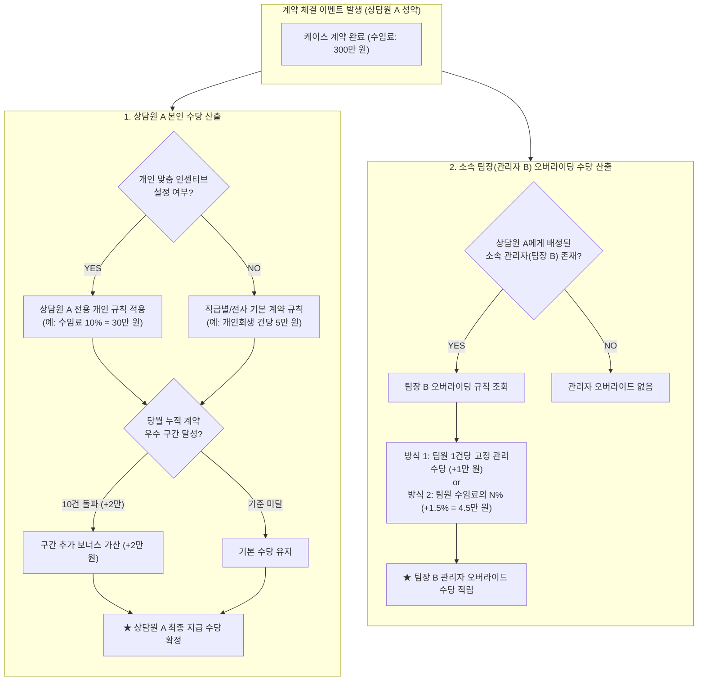

# 🏆 차세대 다계층 맞춤형 인센티브 & 관리자 오버라이드 정산 시스템 기획서

> **문서 번호**: LM-SPEC-202611-INCENTIVE-CUSTOM-v1.0  
> **기획 대상**: 리드마스터 CRM 팀 관리 (`TeamPage`) 및 성과 패널 (`AgentPerformancePanel`), 수당 정산 (`AgentCommissionTab`)  
> **요청 핵심**: 
> 1. 직원마다·직급마다 인센티브 방식 차등화 및 개인별 유연한 변동 지원  
> 2. 관리자(팀장/실장)가 소속 상담원 1건 계약마다 인센티브를 받는 **관리자 오버라이딩(Overriding)** 도입  
> 3. 성과 우수 상담원을 위한 **구간별 추가 인센티브(슬라이딩 스케일) 및 마일스톤 보너스** 도입

---

## 1. 추진 배경 및 현실 TM 영업 조직 분석

### 1.1 현행 시스템의 한계 (첨부 이미지 화면 분석)
- **단일 전사 규칙(Flat Rule)**: 현재 모달(`인센티브 다원화 및 정산 지급일 설정`)은 "개인회생 건당 5만원", "개인파산 건당 7만원"처럼 **모든 직원이 동일한 금액**만 받도록 제한되어 있습니다.
- **관리자 인센티브 부재**: 팀장/실장이 소속 팀원을 교육·코칭하고 팀 전체 계약을 견인하지만, 팀원의 계약 성과에 대한 **관리자 오버라이드(Overriding) 수당**이 시스템에 없어 수기 정산해야 하는 비효율이 존재합니다.
- **동기부여 한계**: 1건을 한 직원이나 월 30건을 한 최고 에이스나 건당 단가가 동일하여, 고성과자에 대한 **구간별 단가 인상(슬라이딩 스케일)** 동기부여가 어렵습니다.
- **고용 형태 다변화 미지원**: 기본급이 높은 정규직 상담원과 수임료 비율(10~20%)로 정산받는 프리랜서형 상담원이 공존하는 현실을 반영하지 못합니다.

### 1.2 개편 목표
1. **3계층 인센티브 우선순위(Cascade Priority)**:
   - `[1순위: 개인별 맞춤 인센티브]` ➔ `[2순위: 직급별 표준 템플릿]` ➔ `[3순위: 전사 기본 정책]`
2. **관리자 오버라이딩 수당 자동화**:
   - 소속 팀원이 계약을 체결할 때마다 담당 팀장에게 건당 N원 또는 수임료 N%가 실시간 자동 합산.
3. **성과 구간별 추가 인센티브(Sliding Scale)**:
   - 월 5건 이하: 기본 단가 ➔ 6~10건: +2만원 ➔ 11건 이상: +5만원 등 계단식 단가 인상 및 마일스톤 보너스.

---

## 2. 다계층 맞춤형 인센티브 아키텍처 (Architecture)



---

## 3. 핵심 UI/UX 전면 개편 명세

### 3.1 [화면 1] 전사 인센티브 설정 모달 고도화 (4개 탭 구조)
기존 모달(`AgentPerformancePanel.tsx` 내 설정 모달)을 아래 4대 탭으로 확장 개편합니다.

```
┌────────────────────────────────────────────────────────────────────────────────────────┐
│ ⚙️ 인센티브 다원화 및 관리자 정산 체계 설정                                              │
│ 직급별 기본급/비율, 관리자 오버라이딩, 고성과자 추가 보너스 및 정산 주기를 통합 관리합니다.│
├────────────────────────────────────────────────────────────────────────────────────────┤
│ [1. 계약별 기본 인센티브]  [2. 관리자 오버라이딩]  [3. 성과구간 추가보너스]  [4. 정산일 & 지급주기] │
└────────────────────────────────────────────────────────────────────────────────────────┘
```

#### 탭 1: 계약 종류별 기본 인센티브 (현재 화면 유지 & 고도화)
* 개인회생(5만), 개인파산(7만), 워크아웃(3만), 일반소송(수임료 5%) 등 계약 종류 등록.
* **적용 대상 기본값**: "개인별 별도 지정이 없는 일반 상담원에게 기본 적용됩니다."

#### 탭 2: 👔 관리자(팀장) 오버라이딩 수당 설정 (신규)
> *"관리자는 상담원이 한 명이 계약할 때마다 인센을 받을 수 있어."*
* **오버라이딩 지급 방식 선택**:
  1. **[방식 A] 팀원 계약 1건당 고정 관리수당 (원)**:  
     - 예: 소속 상담원이 계약 체결 시 건당 **`₩10,000`**원 (또는 ₩20,000원) 팀장 계정 자동 적립.
  2. **[방식 B] 팀원 계약 수임료의 비율 (%)**:  
     - 예: 소속 상담원이 유치한 수임료 매출의 **`1.5%`** (수임료 300만원 계약 시 45,000원 적립).
  3. **[방식 C] 계약 종류별 차등 오버라이딩**:  
     - 회생: 10,000원 / 파산: 15,000원 / 일반소송: 수임료 1.0%.
* **팀 목표 초과 달성 관리자 보너스 (Team Target Bonus)**:
  - 소속 팀원들의 당월 합산 계약이 **30건 돌파 시**: 팀장 특별 관리 성과급 **`₩500,000`**원 일시 지급.

#### 탭 3: 🚀 성과 우수 상담원 구간별 추가 인센티브 (신규 슬라이딩 스케일)
> *"그리고 성과가 좋은 상담원은 추가 인센을 받을 수 있고."*
* **월간 계약 건수별 계단식 단가 인상 (Sliding Scale)**:
  * **구간 1 (1 ~ 5건)**: 기본 인센티브 100% (추가금 0원)
  * **구간 2 (6 ~ 10건)**: 건당 **`+₩20,000`**원 추가 지급 (예: 5만 ➔ 7만원으로 상승)
  * **구간 3 (11 ~ 20건)**: 건당 **`+₩50,000`**원 추가 지급 (예: 5만 ➔ 10만원으로 상승)
  * **구간 4 (21건 이상)**: 건당 **`+₩70,000`**원 최고 우대 (예: 5만 ➔ 12만원으로 상승)
* **마일스톤 달성 축하금 (Milestone Bonus)**:
  * 당월 10건 최초 달성 시: 축하금 **`₩200,000`**원
  * 당월 20건 최초 달성 시: 축하금 **`₩500,000`**원
* **센터 Top 3 랭킹 포상금**:
  * 1위: `₩300,000`원 / 2위: `₩200,000`원 / 3위: `₩100,000`원

#### 탭 4: 📅 정산 기간 & 지급일 스케줄 (기존 유지)
* 월간 정산(익월 10일) / 주간 정산(차주 금요일) / 건별 즉시 정산

---

### 3.2 [화면 2] 상담원 개인별 맞춤 인센티브 설정 (Individual Custom Modal)
> *"상담원마다 인센 형식이 변동 가능하게"*

팀 관리 페이지(`TeamPage`) 및 성과 패널(`AgentPerformancePanel`)의 팀원 행 우측에 **`[💰 인센티브 맞춤 설정]`** 버튼 제공:

```
┌────────────────────────────────────────────────────────────────────────────────────────┐
│ 👤 상담원 맞춤 인센티브 설정 — [이지은 상담원 (시니어)]                                 │
├────────────────────────────────────────────────────────────────────────────────────────┤
│ 🔘 [전사 기본 인센티브 정책 준용]                                                       │
│ 🔘 [★ 이 상담원 전용 맞춤 인센티브 적용]                                                │
├────────────────────────────────────────────────────────────────────────────────────────┤
│ [맞춤 설정 세부 항목]                                                                  │
│ 1. 인센티브 과금 유형:                                                                 │
│    [ 건당 고정 금액 ]   [ 수임료 비율(%) ]   [ 하이브리드(고정+비율) ]                 │
│                                                                                        │
│ 2. 계약별 개인 단가 책정:                                                              │
│    • 개인회생: [  70,000  ] 원 (전사 기본 50,000원 대비 +20,000원 우대)                 │
│    • 개인파산: [  90,000  ] 원 (전사 기본 70,000원 대비 +20,000원 우대)                 │
│    • 일반소송: [    7.0   ] %  (전사 기본 5.0% 대비 +2.0% 우대)                        │
│                                                                                        │
│ 3. 소속 팀장(오버라이드 수령자) 지정:                                                  │
│    [ 👔 1팀장 박서준 (소속 상담원 1건당 팀장에게 10,000원 오버라이드 지급) ▼ ]         │
│                                                                                        │
│ 4. 고성과자 구간 보너스 참여 여부:                                                     │
│    ☑️ 전사 고성과 슬라이딩 스케일(10건 돌파 시 +2만원 등) 자동 적용                       │
│                                                                                        │
│ 5. 변경 적용 시작월:                                                                   │
│    [ 2026년 11월분부터 즉시 적용 ▼ ]                                                   │
├────────────────────────────────────────────────────────────────────────────────────────┤
│ [취소]                                                                [맞춤 인센티브 저장]│
└────────────────────────────────────────────────────────────────────────────────────────┘
```

---

## 4. 수식 및 정산 계산 시뮬레이션

### 4.1 수당 계산 수식

$$\text{상담원 총 인센티브} = \sum (\text{계약별 인센티브} + \text{해당 구간 추가 단가}) + \text{마일스톤 달성금}$$

$$\text{관리자 총 인센티브} = \text{관리자 본인 계약 인센티브} + \sum_{\text{소속팀원}} (\text{팀원 계약수} \times \text{건당 오버라이드}) + \text{팀목표 달성금}$$

---

### 4.2 실제 영업 현장 시뮬레이션 예시

| 구분 | 성명 및 직급 | 당월 성과 (계약) | 세부 계산 내역 | 최종 인센티브 지급액 |
| :--- | :--- | :--- | :--- | :--- |
| **상담원 A**<br/>(신입) | 김민수 (사원) | 회생 4건<br/>파산 1건 (총 5건) | • 회생: 4건 × ₩50,000 = 200,000원<br/>• 파산: 1건 × ₩70,000 = 70,000원<br/>• 구간 보너스: 5건 이하 기준 (0원) | **₩270,000원** |
| **상담원 B**<br/>(에이스) | 이지은 (시니어)<br/>*개인맞춤 우대* | 회생 12건<br/>파산 3건 (총 15건) | • 개인우대 회생: 12건 × ₩70,000 = 840,000원<br/>• 개인우대 파산: 3건 × ₩90,000 = 270,000원<br/>• **구간 보너스(11~20건)**: 15건 × ₩50,000 = **+750,000원**<br/>• **10건 달성 마일스톤**: **+200,000원** | **₩2,060,000원**<br/>*(강력한 고성과 보상)* |
| **관리자 C**<br/>(팀장) | 박서준 (1팀장)<br/>*소속팀원: A, B* | • 본인 계약 2건<br/>• 소속 팀원 합산 20건<br/>(A: 5건 + B: 15건) | • 본인 계약분: 2건 × ₩50,000 = 100,000원<br/>• **팀원 오버라이딩 수당**: 20건 × **₩10,000원** = **+200,000원**<br/>• **팀 20건 돌파 보너스**: **+300,000원** | **₩600,000원**<br/>*(팀 코칭 기여분 정당 반영)* |

---

## 5. 데이터 모델 및 스키마 설계

```typescript
// 1. 관리자 오버라이딩 규칙
export interface ManagerOverridingRule {
  enabled: boolean;
  type: 'fixed_per_case' | 'percent_of_fee';
  amountPerCase: number;      // 건당 금액 (예: 10,000원)
  feeRatePercent: number;     // 수임료 비율 (예: 1.5%)
  teamMilestones?: {
    minTeamCases: number;     // 팀 최소 건수 (예: 20건)
    bonusAmountWon: number;   // 팀 달성 보너스 (예: 300,000원)
  }[];
}

// 2. 고성과자 구간별 추가 인센티브 규칙 (Sliding Scale)
export interface PerformanceTierRule {
  minCases: number;
  maxCases?: number;          // undefined면 이상
  extraAmountPerCase: number; // 건당 추가 지급액 (예: +20,000원, +50,000원)
  tierName: string;
}

export interface MilestoneBonusRule {
  reachCases: number;         // 10건, 20건, 30건
  bonusWon: number;           // 200,000원, 500,000원
}

// 3. 상담원 개인별 맞춤 인센티브 (User-specific Override)
export interface AgentCustomIncentiveRule {
  userId: string;
  useCustom: boolean;         // true: 전사 무시하고 개인 규칙 사용
  managerUserId?: string;     // 오버라이딩 수당을 수령할 담당 팀장 ID
  calcType: 'fixed' | 'percent' | 'hybrid';
  contractRates: Record<string, {
    amount?: number;          // 개인별 맞춤 금액
    rate?: number;            // 개인별 맞춤 비율
  }>;
  applySlidingBonus: boolean; // 구간 추가 보너스 참여 여부
  effectiveMonth: string;     // YYYY-MM
}

// 4. 통합 전사 인센티브 설정 (IncentiveSettings 확장)
export interface IncentiveSettings {
  contractTypes: IncentiveContractType[]; // 기본 계약 10종
  payoutSchedule: PayoutSchedule;
  managerOverriding: ManagerOverridingRule;
  slidingTiers: PerformanceTierRule[];
  milestones: MilestoneBonusRule[];
  agentOverrides?: Record<string, AgentCustomIncentiveRule>; // userId -> 맞춤 규칙
}
```

---

## 6. 단계별 구현 로드맵

| 단계 | 작업 내용 | 대상 파일 | 기대 효과 |
| :---: | :--- | :--- | :--- |
| **Phase 1** | • `services/performance.ts`에 관리자 오버라이드, 구간 보너스, 개인별 규칙 인터페이스 및 계산 엔진 함수 추가 | `services/performance.ts` | 4대 수당 산출 알고리즘 완성 |
| **Phase 2** | • `AgentPerformancePanel.tsx` 모달을 4탭(계약별, 관리자 오버라이드, 구간 보너스, 정산일)으로 확장 개편 | `components/team/AgentPerformancePanel.tsx` | 전사 오버라이드 및 구간 보너스 UI 완성 |
| **Phase 3** | • `AgentCommissionTab.tsx` 및 성과 패널에 상담원 개인별 `[맞춤 인센티브 설정]` 팝업 모달 추가<br/>• 담당 팀장 매핑 및 개인 단가 오버라이드 지원 | `components/team/AgentCustomIncentiveModal.tsx`<br/>`components/settlement/AgentCommissionTab.tsx` | 상담원별 인센 형식 변동 자유화 |
| **Phase 4** | • 성과표 및 정산서 테이블에 **[관리자 오버라이드 수당]** 및 **[구간 추가 보너스]** 컬럼 추가 및 엑셀 다운로드 반영 | `components/settlement/AgentCommissionTab.tsx`<br/>`components/team/AgentPerformancePanel.tsx` | 정산 투명성 및 팀장/상담원 영수증 연동 |
| **Phase 5** | • `npx tsc --noEmit` 검증, `docs/작업_이어가기.md` [AGY] 기록 및 배포 | `docs/작업_이어가기.md` | 무결성 검증 및 인수인계 |

---

## 7. 기대 효과 및 결론

1. **영업 현장 100% 밀착**:
   - 신입/경력/프리랜서 등 상담원별 계약 조건이 달라도 시스템 내에서 자유롭게 개별 설정이 가능하여 별도의 엑셀 수기 계산이 완전히 사라집니다.
2. **중간 관리자(팀장)의 적극적인 코칭 유도**:
   - 소속 팀원이 계약을 1건 체결할 때마다 팀장에게 관리 수당(오버라이드)이 즉시 적립되므로, 팀장이 팀원의 통화와 상담을 적극적으로 돕는 강력한 선순환 팀 시너지가 구축됩니다.
3. **에이스 상담원 모티베이션 극대화**:
   - 10건, 20건 돌파 시 건당 단가가 계단식으로 상승하는 슬라이딩 스케일과 마일스톤 축하금을 통해 스타 상담원의 퇴사를 방지하고 초과 달성을 견인합니다.
