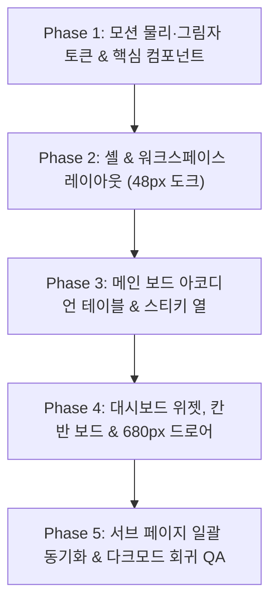

# LeadMaster CRM × monday.com 전면 벤치마킹 최종 마스터 플랜 (Vibe Full-Stack Edition)

> **문서 상태**: 모션·그림자·반응성·구조 양식 일체 반영 최종 업그레이드 완료 (Ready for Execution)  
> **핵심 원칙**: **"효과, 애니메이션, 반응(인터랙션), 구조 양식, 배경 그림자까지 monday.com 100% 완전 복제"**  
> **라이브 레퍼런스**: monday.com Workspace (`oracleyes99s-team.monday.com`) 브라우저 추출 Vibe Design System  
> **적용 대상 코드베이스**: `D:\안티그래피티 작업\01_03-leadmaster-crm`  
> **절대 불변 원칙**: **다크모드(`.dark`) 100% 무손실 보존** (라이트 모드 전면 승격 및 다크모드 고유 야간 환경 원형 유지)

---

## 1. 전역 모션 & 애니메이션 물리 엔진 (Motion Physics & Timing Curves)

monday.com의 매끄럽고 살아있는 듯한 반응성은 **정확한 밀리초(Duration)**와 **수학적 가감속 곡선(Cubic-Bezier)**에 의해 구동됩니다. 리드마스터 CRM에 이를 1:1로 탑재합니다.

### 1.1 타이밍 규격 (Duration Specifications)

```
┌─────────────────────────────────────────────────────────────────────────────┐
│ monday.com Motion Duration Tokens                                           │
├──────────────────────────┬──────────┬───────────────────────────────────────┤
│ 토큰명                   │ 시간     │ 적용 대상 (Use Cases)                 │
├──────────────────────────┼──────────┼───────────────────────────────────────┤
│ --motion-productive-short│ 70ms     │ 버튼 클릭 누름(Scale), 체크박스 토글   │
│ --motion-productive-med  │ 100ms    │ 테이블 행 호버 배경 전환, 툴팁 표시   │
│ --motion-productive-long │ 150ms    │ 드롭다운 메뉴 오픈, 상태 뱃지 호버   │
│ --motion-expressive-short│ 250ms    │ 아코디언 그룹 접기/펼치기, 모달 등장  │
│ --motion-expressive-long │ 400ms    │ 우측 슬라이드 드로어(680px) 개폐      │
└──────────────────────────┴──────────┴───────────────────────────────────────┘
```

### 1.2 가감속 곡선 (Timing Curves / Easings)

- **진입 곡선 (Enter)**: `cubic-bezier(0, 0, 0.35, 1)`
  - 모달, 드롭다운 팝오버, 슬라이드 드로어가 나타날 때 사용. 처음에 시원하게 감속하며 부드럽게 안착.
- **퇴장 곡선 (Exit)**: `cubic-bezier(0.4, 0, 1, 1)`
  - 팝업이나 드로어가 닫힐 때 사용. 사용자의 시야에서 망설임 없이 기민하게 퇴장.
- **기본 전환 (Transition)**: `cubic-bezier(0.4, 0, 0.2, 1)`
  - 탭 전환, 색상 변경, 너비 확장에 적용되는 표준 인터랙션 곡선.
- **강조/바운스 (Emphasize / Spring Bounce)**: `cubic-bezier(0, 0, 0.2, 1.4)`
  - **monday.com 특유의 쫀득한 반응성(Micro-Bounce)**을 만드는 핵심 곡선.
  - 상태(Status) 팝오버가 열릴 때 살짝 튕기듯 확대(Scale 0.95 ➔ 1.02 ➔ 1.00), 체크박스 체크 시 튀어오르는 효과.

---

## 2. 배경 그림자 & 고도 시스템 (Elevations & Shadows)

monday.com은 평면적인 플랫 디자인이 아닌, **5단계 계층형 고도(Elevation)**를 통해 요소들의 층위(Z-index & Depth)를 직관적으로 전달합니다.

```
Layer 5: Modal & Dialog (0 15px 50px rgba(0,0,0,0.2) + Backdrop rgba(33,33,33,0.7))
Layer 4: Slide-over Drawer 680px (-4px 0 24px rgba(0,0,0,0.12))
Layer 3: Status 3x3 Popover & Dropdowns (0 6px 20px rgba(0,0,0,0.15))
Layer 2: Hovered Row & Hovered Card (0 4px 8px rgba(0,0,0,0.08))
Layer 1: Sticky Column Scroll Divider (3px 0 4px rgba(0,0,0,0.1))
Layer 0: Canvas (#f6f7fb) & Default White Card (0 1px 3px rgba(0,0,0,0.04))
```

### 2.1 1:1 그림자 토큰 매핑

| 고도 레벨 | CSS 토큰 / 값 | 용도 및 시각적 효과 |
| :--- | :--- | :--- |
| **Canvas Base** | `none` (또는 `0 1px 3px rgba(0,0,0,0.04)`) | 일반 화이트 카드 기본 상태 |
| **Sticky Column**| **`3px 0 4px rgba(0, 0, 0, 0.1)`** | **테이블 가로 스크롤 시 고정 열(고객명) 우측에 생기는 그림자** |
| **Card Hover** | `0px 4px 8px rgba(0, 0, 0, 0.08)` | 칸반 카드, 대시보드 위젯 마우스 호버 시 살짝 떠오름 |
| **Menu / Popover**| **`0px 6px 20px rgba(0, 0, 0, 0.15)`** | 상태 변경 3×3 팔레트, 컨텍스트 메뉴, 날짜 선택기 |
| **Slide Drawer** | `-4px 0 24px rgba(0, 0, 0, 0.12)` | 리드 상세 드로어가 본문 위로 덮일 때의 좌측 그림자 |
| **Dialog / Modal**| **`0px 15px 50px rgba(0, 0, 0, 0.2)`** | 중앙 팝업 모달 + `rgba(33, 33, 33, 0.7)` 암전 백드롭 |

---

## 3. 마이크로 인터랙션 & 리액티브 반응 (Micro-Interactions)

사용자의 모든 마우스 및 키보드 조작에 즉각적이고 생동감 있는 피드백을 제공합니다.

### 3.1 버튼 & 컨트롤 클릭 피드백
- **버튼 누름 반응 (Press Effect)**:
  - 마우스 클릭 순간(`:active`): `transform: scale(0.97)` (70ms)로 쫀득하게 눌렸다가 놓으면 원복.
  - 키보드 포커스 시: `outline: 2px solid #0073ea`, `outline-offset: 2px`.
- **체크박스 애니메이션**:
  - 선택 시 중앙 체크 아이콘이 `scale(0) rotate(-10deg)` ➔ `scale(1) rotate(0)` (`120ms cubic-bezier(0, 0, 0.2, 1.4)`).

### 3.2 테이블 행(Row) 반응형 인터랙션
- **호버 인디케이터**:
  - 마우스가 행에 올라오면(100ms):
    1. 행 전체 배경이 `#f5f6f8`로 부드럽게 점등.
    2. 행 맨 좌측에 **6개 점 드래그 핸들(⋮⋮)**이 투명도 `0`에서 `0.6`으로 페이드인.
    3. 체크박스가 투명 테두리에서 또렷한 `#c3c6d4` 테두리로 강조.
- **선택된 행 (Selected State)**:
  - 체크된 행은 `bg-[#cce5ff]/20` (monday Highlight Blue 틴트) 유지.

### 3.3 상태 변경 3×3 팔레트 팝오버 (`StatusCell.tsx`)
- **오픈 애니메이션**:
  - 클릭된 셀을 기준으로 중심점에서 튕기듯 확장:
    `transform: scale(0.92) -> scale(1.02) -> scale(1.00)` (120ms `cubic-bezier(0, 0, 0.2, 1.4)`).
- **팔레트 셀 호버**:
  - 각 색상 블록 호버 시 살짝 어두워지며 테두리에 `2px solid white` 하이라이트 생성.
- **계약완료(Done) 축하 애니메이션 (Celebration Micro-Burst)**:
  - 상태를 '계약완료' 또는 '수임완료'(`#00c875`)로 변경하는 순간, 셀 주변에 은은한 300ms 초록빛 펄스 링(Pulse Ring) 확산 및 마이크로 축하 피드백.

### 3.4 셀 인라인 편집 (Inline Edit Interaction)
- 셀을 더블 클릭하거나 포커스 후 엔터 입력 시:
  - 즉시 텍스트가 인풋 모드로 전환되며 셀 외곽에 `2px solid #0073ea` 포커스 링 생성.
  - `Enter` 키를 누르면 70ms 페이드로 즉시 저장 및 포커스 해제, `Esc` 누르면 이전 값으로 롤백.

### 3.5 툴팁 (Tooltip System)
- 마우스 호버 200ms 지연 후:
  - 배경 `#323338` (Mud Black), 텍스트 `#ffffff` (12px), 모서리 `4px`.
  - 살짝 위로 `2px` 떠오르며 페이드인 (70ms).

---

## 4. 구조 양식 & 레이아웃 아키텍처 (Structural Forms & Patterns)

monday.com의 시각적 명료성을 완성하는 보드/페이지 구조 양식입니다.

```
┌────────────────────────────────────────────────────────────────────────────────────────┐
│ [1. Workspace Shell]                                                                   │
│ ┌──────┬─────────────────────────────────────────────────────────────────────────────┐ │
│ │ Mini │ Global App Bar (h-12) : Workspace Breadcrumb | Search (Ctrl+K) | User Dock  │ │
│ │ Dock │─────────────────────────────────────────────────────────────────────────────┤ │
│ │ w-12 │ Board Header (h-14)   : ★ Board Title | [+ New Lead] | Filter | Sort | Group│ │
│ │      │─────────────────────────────────────────────────────────────────────────────┤ │
│ │ #292f│ View Tabs (h-10)      : ▤ Main Table (active) | 田 Kanban | 📅 Calendar    │ │
│ │  4c  │─────────────────────────────────────────────────────────────────────────────┤ │
│ │      │ [2. Multi-Group Accordion Canvas (bg: #f6f7fb)]                             │ │
│ │      │                                                                             │ │
│ │      │ ▼ 🔵 신규 접수 리드 (5) ── Color Line [===========================]        │ │
│ │      │ ┌───┬──────────────┬──────────────┬─────────────┬─────────────┬───────────┐ │ │
│ │      │ │ □ │ 고객명 (Sticky)│ 상태 (32px)  │ 담당 상담원 │ 접수일시    │ 통화 발신 │ │ │
│ │      │ ├───┼──────────────┼──────────────┼─────────────┼─────────────┼───────────┤ │ │
│ │      │ │ □ │ 김철수       │ [ 신규접수 ] │ 👤 이영희   │ 10분 전     │ [📞 발신] │ │ │
│ │      │ └───┴──────────────┴──────────────┴─────────────┴─────────────┴───────────┘ │ │
│ │      │ [Summary Bar] 5건  │  [■■■■■■■■■■ 100% 신규 배터리 게이지]                  │ │
│ │      │                                                                             │ │
│ │      │ ▼ 🟠 1차 상담 진행 중 (18)                                                  │ │
│ │      │ ...                                                                         │ │
│ └──────┴─────────────────────────────────────────────────────────────────────────────┘ │
└────────────────────────────────────────────────────────────────────────────────────────┘
```

### 4.1 보드 계층 구조 (Board Hierarchy)
1. **아코디언 멀티 그룹 (Accordion Multi-Group)**:
   - 그룹 헤더: 좌측에 둥근 접기/펼치기 화살표(▼) + 그룹명(`18px font-semibold`) + 건수 뱃지(`font-mono text-xs`).
   - 그룹 상단 컬러 라인: 그룹 고유 색상(블루, 오렌지, 그린 등)으로 전체 표 상단에 `3px` 포인트 라인 배치.
   - 접기/펼치기 애니메이션: `height`가 부드럽게 줄어들거나 펼쳐지는 `250ms cubic-bezier(0, 0, 0.35, 1)` 적용.
2. **이중 고정(Sticky) 스크롤 구조**:
   - **수직 스크롤 시**: 컬럼 헤더(`th`)가 테이블 최상단에 고정(`sticky top-0 z-20 bg-white`).
   - **수평 스크롤 시**: 좌측 1열(체크박스 및 고객명)이 화면 왼쪽에 고정되며 우측에 `3px 0 4px rgba(0,0,0,0.1)` 그림자 자동 활성화.
3. **하단 배터리 게이지 요약 (Battery Summary Row)**:
   - 각 그룹 최하단 행: 전체 합계 수치 + 가로 `16px` 높이의 둥근 배터리 바.
   - 그룹 내 상태 비율(예: 완료 40%, 진행중 50%, 보류 10%)을 분할 렌더링.

### 4.2 우측 슬라이드오버 드로어 양식 (Pulse Side-Panel)
- 우측에서 `400ms cubic-bezier(0, 0, 0.35, 1)`로 미끄러져 들어오는 `680px` 폭의 드로어.
- 배경: `#ffffff`, 좌측 테두리 그림자 `-4px 0 24px rgba(0,0,0,0.12)`.
- **구조**:
  - 상단 헤더: 고객명(인라인 편집 가능), 상태 뱃지, 담당자 칩, 통화 버튼.
  - 상단 탭: `활동 피드 (Updates)`, `상세 정보 (Details)`, `통화 녹취 (Recordings)`, `히스토리 (Audit Log)`.
  - 본문: SNS 타임라인 스타일의 메모/피드 및 인라인 첨부파일 리스트.

---

## 5. 다크 모드(`.dark`) 100% 무손실 보존 아키텍처

> [!CAUTION]
> **다크 모드 불변 보장 원칙**:
> 본 기획의 모든 애니메이션, 모션 커브, 반응성, 여백 및 1:1 복제 규격은 라이트 모드뿐만 아니라 **다크 모드에서도 원형 그대로의 다크 테마를 완벽히 유지하도록 설계**되었습니다.

```css
/* index.css 무손실 공존 아키텍처 */

/* 1. 모션 & 물리 토큰 (라이트/다크 공통) */
:root {
  --motion-productive-short: 70ms;
  --motion-productive-med: 100ms;
  --motion-productive-long: 150ms;
  --motion-expressive-short: 250ms;
  --motion-expressive-long: 400ms;
  --motion-timing-enter: cubic-bezier(0, 0, 0.35, 1);
  --motion-timing-exit: cubic-bezier(0.4, 0, 1, 1);
  --motion-timing-transition: cubic-bezier(0.4, 0, 0.2, 1);
  --motion-timing-emphasize: cubic-bezier(0, 0, 0.2, 1.4);
}

/* 2. 라이트 모드 (:root) : monday.com 1:1 복제 */
:root {
  --background: 228 33% 97%;         /* #f6f7fb Riverstone Gray */
  --foreground: 225 6% 21%;          /* #323338 Mud Black */
  --card: 0 0% 100%;                 /* #ffffff */
  --border: 228 26% 85%;             /* #d0d4e4 */
  --shadow-sticky: 3px 0 4px rgba(0, 0, 0, 0.1);
  --shadow-popover: 0px 6px 20px rgba(0, 0, 0, 0.15);
  --shadow-drawer: -4px 0 24px rgba(0, 0, 0, 0.12);
  --backdrop: rgba(33, 33, 33, 0.7);
}

/* 3. 다크 모드 (.dark) : 기존 코드 100% 무손실 유지 */
.dark {
  --background: 240 10% 3.9%;        /* #09090b Zinc 950 (절대 불변) */
  --foreground: 0 0% 98%;            /* #fafafa (절대 불변) */
  --card: 240 10% 6.5%;              /* #111114 (절대 불변) */
  --primary: 160 84% 39%;            /* #059669 딥 에메랄드 (절대 불변) */
  --border: 240 3.7% 15.9%;          /* #27272a (절대 불변) */
  --shadow-sticky: 3px 0 4px rgba(0, 0, 0, 0.5);
  --shadow-popover: 0px 6px 20px rgba(0, 0, 0, 0.5);
  --shadow-drawer: -4px 0 24px rgba(0, 0, 0, 0.6);
  --backdrop: rgba(0, 0, 0, 0.85);
}
```

---

## 6. 최종 단계별 구현 로드맵 (5단계)



### Phase 1: 모션 물리·그림자 토큰 & 핵심 컴포넌트
- [ ] `index.css`: 모션 타이밍(`70ms`~`400ms`), 4종 `cubic-bezier`, 5단계 그림자 고도 토큰 추가 (**`.dark` 무변경**).
- [ ] `Button.tsx`: 70ms 액티브 스케일(`scale-[0.97]`), 32px 규격, 호버 상태 리뉴얼.
- [ ] `StatusCell.tsx` (신규): 3×3 컬러 매트릭스 팝오버, 튕김 애니메이션(`cubic-bezier(0, 0, 0.2, 1.4)`), '계약완료' 축하 이펙트.
- [ ] `BatteryProgress.tsx` (신규): 그룹 하단 다색상 요약 프로그레스 바.

### Phase 2: 전역 셸 & 레이아웃 프레임
- [ ] `Sidebar.tsx`: monday.com 스타일의 48px 다크네이비 미니 도크 + 240px 워크스페이스 트리.
- [ ] `GlobalAppBar.tsx`: 48px 높이, 중앙 통합 검색창(Ctrl+K), 라운드 사용자 도크.

### Phase 3: 케이스 관리 메인 보드 (`CaseList`)
- [ ] `CaseListTable.tsx`: 아코디언 멀티 그룹(신규/진행중/완료) 분할 및 접기/펼치기 애니메이션.
- [ ] 40px 행 높이, 9px/16px 패딩, 세로 구분선 제거, 호버 시 드래그 핸들 노출.
- [ ] 수평 스크롤 시 좌측 고객명 열 고정 및 `sticky-shadow` 효과 장착.
- [ ] `StatusCell` 및 `BatteryProgress` 완전 연동.

### Phase 4: 대시보드, 칸반, 상세 드로어
- [ ] `Dashboard.tsx`: 8px 카드, 상단 컬러 라인, 파이프라인 배터리 위젯.
- [ ] `KanbanBoard.tsx`: 4px 상태 악센트 라인, 드래그 호버 시 섀도우 증폭.
- [ ] `CaseDetailDrawer.tsx`: 우측 680px 슬라이드 인/아웃(400ms), 인라인 타이틀 편집, 소셜 피드.

### Phase 5: 서브 페이지 동기화 & 다크모드 무손실 회귀 검증
- [ ] 캘린더, 오토콜, 정산, 팀 관리 페이지에 동일한 규격/그림자/애니메이션 동기화.
- [ ] 라이트모드 ➔ 다크모드 전환 시 기존 야간 모드가 100% 정상 출력되는지 전수 검증.
- [ ] 빌드 무오류 확인(`npm run build`).
