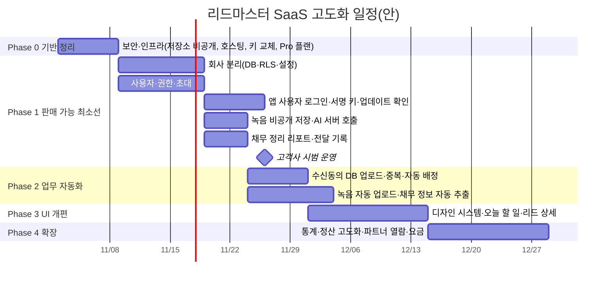

# 리드마스터 SaaS 고도화 작업 기획서 (v1.1)

- 작성일: 2026-11-01 (v1.1: 같은 날 확정 사항 반영 → **15장**)
- 대상: 리드마스터 웹 CRM(`01_03-leadmaster-crm`) + 안드로이드 앱(`LeadMasterApp`)
- 목적: 혼자 쓰던 시스템을 **다른 회사가 돈을 내고 쓰는 서비스**로 바꾸기 위한 작업 범위·순서·결정 사항 정리

---

## 1. 한 줄 요약

지금 시스템은 "한 사람, 한 회사, 한 대의 폰"을 전제로 만들어져 있다. 판매하려면 먼저 **회사별 데이터 분리(멀티테넌트), 사용자별 로그인·권한, 앱 배포·업데이트 체계, 보안 정리**를 해야 하고, 그 위에 리드 수집 자동화, 채무 정리 리포트, AI 통화 요약, UI 개편을 올린다.

---

## 2. 배경

| 구분 | 현재 (나) | 고객사 |
|---|---|---|
| 업무 | 광고 리드 1차 콜 → 변호사 사무실 전달 | 광고 + **광고 수신동의 DB** 1차 콜 → 변호사·사무장 상담 희망 리드의 채무 상황 정리 후 전달 |
| 사용자 | 1명 | 여러 명 예상 (관리자 + 상담원) |
| 폰 | 내 삼성폰 1대 | 상담원별 삼성폰 여러 대 |
| 파트너 | 내 거래 변호사 사무실 | 고객사의 거래 변호사 사무실 (나와 겹칠 수 있음) |

핵심 요구: **두 회사의 고객 데이터가 절대 섞이거나 서로 보이면 안 된다.**

---

## 3. 현재 시스템 진단 (판매 전에 반드시 바꿀 것)

코드를 기준으로 확인한 내용이다.

### 3.1 한 사람 전용으로 박혀 있는 부분
| 위치 | 내용 | 문제 |
|---|---|---|
| `contexts/AuthContext.tsx`, `services/api.ts` | 허용 이메일 기본값이 내 이메일 2개 | 회사·사용자 개념 없음 |
| `settings` 테이블 | 파트너, 상태 단계, Gemini 키, 정산 배치 등이 **전체 공용 key/value 하나** | 고객사가 설정을 바꾸면 내 설정도 바뀜 |
| 모든 테이블 | `cases`, `communication_logs`, `pending_calls` 등에 회사 구분 컬럼 없음 | 로그인만 하면 모든 데이터가 보임 |
| `services/api.ts` | 담당자 기본값 `진성훈`, 파트너 기본값 `P001`, 특정 고객 이름 정리 목록 | 고객사 데이터에 내 이름이 들어감 |
| `CaseDetailAiSummary.tsx` | 녹취 화자 판단에 `진성훈` 이름 사용 | 고객사 상담원 구분 안 됨 |
| `telegram-webhook` | 관리자 메시지 제외 기준이 `markjin`/`마크진` 하드코딩, 텔레그램 봇 1개 | 회사별 봇·방 분리 안 됨 |
| `MyPage.tsx` | `HOST_EMAIL` 하드코딩 | |
| 앱 `LeadMasterApi.kt` | 공용 서비스 계정 1개(비밀번호가 APK 안에 있음) | 고객사 폰에 설치하면 **내 계정 비밀번호가 고객사에 넘어감**, 모든 폰이 같은 계정 |
| 앱 `MainActivity.kt` | 접속 주소가 `9981mark-hub.github.io`로 고정 | 주소를 바꾸려면 앱 재배포 |

### 3.2 보안·인프라
- **GitHub 저장소가 공개(public)** 상태다. 소스 전체와 Apps Script 주소·토큰, 텔레그램 디버그 키가 누구에게나 보인다. 판매 전에 비공개로 바꿔야 한다.
- 운영 사이트가 GitHub Pages(공개 저장소 필요)다. 비공개 전환과 함께 Vercel 등으로 옮긴다.
- Supabase 무료 플랜이다. 2026-07에 대역폭 초과로 사이트가 멈춘 적이 있다. 유료 고객이 생기면 Pro 플랜(백업 포함)이 필요하다.
- Gemini API 키가 `settings` 테이블과 브라우저에 그대로 내려간다. 고객사 사용자도 키를 볼 수 있다.
- 녹음 파일이 구글 드라이브에 "링크 있는 누구나 보기"로 저장된다. 채무 정보가 담긴 녹음이라 위험하다.
- 앱이 폰의 **모든 통화·문자 기록**을 서버로 올린다. 고객사 상담원의 개인 통화까지 올라갈 수 있다.

### 3.3 이미 정리된 것 (2026-10-31)
- 대역폭: 탭/앱 복귀 시 변경분만 조회, Realtime 재연결 수정
- RLS: anon에 열려 있던 3개 테이블 잠금 SQL 작성(`003_lock_anon_tables.sql`, 실행 필요)
- 앱: versionCode 관리, `.gitignore`, 서명 키 백업, JDK 17 빌드 환경

---

## 4. 핵심 결정: 운영 방식

| 항목 | A. 고객사마다 따로 설치 | B. 하나의 시스템에 회사별 분리 (멀티테넌트) |
|---|---|---|
| 방식 | Supabase 프로젝트·웹 주소·앱을 회사마다 복사 | 데이터에 `회사ID`를 붙이고 DB 권한(RLS)으로 분리 |
| 시작 속도 | 빠름 (1~2주) | 느림 (3~4주) |
| 데이터 분리 | 물리적으로 완전 분리 | DB 정책으로 분리 (정책 실수 시 노출 위험) |
| 업데이트 | 고칠 때마다 회사 수만큼 배포 | 한 번 배포로 전체 반영 |
| 비용 | 회사마다 Supabase 비용 | 하나로 통합 |
| 3번째 고객부터 | 관리 부담 급증 | 회사 추가만 하면 됨 |

**권장: B (멀티테넌트)**
- 판매 대상이 같은 업종이라 기능이 거의 같고, 앞으로 고객이 늘어날 가능성이 있다.
- 어차피 "사용자별 로그인·권한"을 새로 만들어야 해서, 그 작업에 회사 구분을 같이 넣는 것이 추가 비용이 적다.
- 내 기존 데이터는 "리드마스터 본사" 회사로 묶어서 그대로 쓴다.

> 고객사가 **당장 다음 주부터** 써야 한다면: A로 먼저 넘기고 B 완성 후 합치는 방법도 있다. 다만 나중에 데이터를 합치는 작업이 추가된다.

---

## 5. 사용자·권한 설계

| 역할 | 누구 | 할 수 있는 것 |
|---|---|---|
| 플랫폼 관리자 | 나 | 회사 생성·정지, 사용량·요금 확인, 공지, 장애 대응. 고객사 고객 데이터는 기본적으로 **보지 않음**(지원 요청 시에만 기록을 남기고 열람) |
| 회사 관리자 | 고객사 대표·팀장 | 상담원 초대·해제, 파트너(변호사 사무실)·상태 단계·문자 템플릿·전달 양식 설정, 전체 리드·통계·정산, 엑셀 내보내기 |
| 상담원 | 고객사 직원 | 배정된 리드 조회·통화·메모·전달. 엑셀 내보내기·삭제는 기본 금지 |
| (선택) 파트너 열람 | 변호사 사무실 | 자기에게 전달된 리드와 리포트만 열람, 진행 결과 회신 |

- 로그인: 구글 로그인 유지 + 이메일 로그인 추가(회사 이메일이 구글이 아닐 수 있음)
- 초대 방식: 회사 관리자가 이메일로 초대 → 수락하면 회사에 연결

---

## 6. 기능 고도화 목록

우선순위: **P0** = 고객사 사용 시작 전 필수 / **P1** = 사용 시작 후 1~2개월 내 / **P2** = 이후

### 6.1 리드 수집
| 우선 | 기능 | 내용 |
|---|---|---|
| P0 | 회사별 리드 분리 | 모든 리드에 회사ID. 같은 전화번호라도 회사가 다르면 별개 리드 |
| P0 | **수신동의 DB 업로드** | 엑셀 업로드 시 동의 일자·동의 경로·제공처 컬럼을 받아 저장. 업로드 이력(누가, 언제, 몇 건) 기록 |
| P0 | 중복 판별 | 같은 회사 안에서 전화번호 기준 중복 표시(재유입 횟수, 이전 상담 이력 연결) |
| P1 | 랜딩페이지 직접 수집 | 구글 시트를 거치지 않고 회사별 수집 주소(엔드포인트)로 바로 등록. 회사별 키 발급 |
| P1 | 매체 연동 | 메타 리드광고 웹훅, 카카오·토스 리드 수집 형식 지원(매체가 제공하는 방식 확인 필요) |
| P1 | 자동 배정 | 신규 리드를 상담원에게 순번/가중치로 자동 배정, 미응대 시 재배정 |
| P2 | 유입 품질 점수 | 매체·캠페인별 연결률·전달률로 리드 품질 표시 |

### 6.2 1차 통화 업무
| 우선 | 기능 | 내용 |
|---|---|---|
| P0 | 상담원별 클릭투콜 | PC에서 누르면 **그 상담원의 폰**으로 발신 요청(현재는 폰 1대 전제) |
| P0 | 통화 결과 코드 | 부재/결번/거절/상담희망/진행불가 등 회사별 설정, 한 번의 탭으로 기록 |
| P1 | 오늘 할 일 큐 | 신규·재콜 예정·부재 재시도를 우선순위대로 한 화면에 |
| P1 | 부재 재콜 규칙 | 회사별 재시도 간격·최대 횟수 설정(현재 부재콜 위젯 고도화) |
| P1 | 상담 스크립트 | 회사별 통화 스크립트·체크리스트를 통화 화면 옆에 표시 |
| P2 | 자동통화(오토다이얼) 상담원별 운영 | 현재 기능을 상담원·회사 단위로 |

### 6.3 녹음·AI 통화 요약
| 우선 | 기능 | 내용 |
|---|---|---|
| P0 | 녹음 저장소 교체 | 구글 드라이브 공개 링크 → Supabase Storage **비공개** 저장, 회사별 폴더, 열람 시 임시 주소 |
| P0 | AI 호출 서버 이전 | 브라우저에서 Gemini 직접 호출 → 서버(Edge Function)에서 호출. 키는 서버에만. 회사별 사용량 기록 |
| P1 | 녹음 자동 업로드 | 통화 종료 후 삼성 통화녹음 파일을 찾아 해당 리드에 자동 첨부(와이파이 전용 옵션) |
| P1 | 상담 회차별 이력 | 요약을 덮어쓰지 않고 회차별(일시·녹음·요약·핵심 항목) 누적 |
| P1 | **채무 정보 자동 추출** | 녹취에서 채무 총액, 채권사 수, 월 소득, 4대보험, 주거, 부양가족, 연체 여부 등을 **입력 칸에 자동 채움** → 상담원 확인 후 저장 |
| P2 | 통화 품질 피드백 | 상담원 화법·누락 질문 자동 점검 |

### 6.4 변호사 사무실 전달 (고객사 핵심 업무)
| 우선 | 기능 | 내용 |
|---|---|---|
| P0 | **채무 정리 리포트 표준 양식** | 고객 기본정보 + 채무 현황 표 + 소득·재산 + 상담 희망 시간 + 상담원 의견. 파트너별 양식 선택 |
| P0 | 전달 기록 | 언제, 누구에게, 어떤 내용으로 보냈는지 리드별 기록(재전달·중복 전달 방지) |
| P1 | 전달 채널 | 텔레그램(회사별 봇), 이메일, 카카오 알림톡(유료·사전 심사 필요) 중 선택 |
| P1 | 파트너 회신 수집 | 현재 텔레그램 메시지 AI 분류를 회사별로 분리, 관리자 이름 하드코딩 제거 |
| P2 | 파트너 열람 페이지 | 변호사 사무실이 링크로 접속해 받은 리드 확인·결과 입력(텔레그램 의존도 감소) |

### 6.5 정산·통계
| 우선 | 기능 | 내용 |
|---|---|---|
| P0 | 회사별 정산 분리 | 파트너별 수수료 규칙·정산 배치를 회사 단위로 |
| P1 | 매체별 성과 | 매체·캠페인별 리드 수, 연결률, 전달 수, 계약 수, 건당 비용 |
| P1 | 상담원 성과 | 통화 수, 통화 시간, 전달 수, 전환율 |
| P2 | 수신동의 DB 공급처별 성과 | DB 구매처별 품질 비교 |

### 6.6 플랫폼 운영 (나)
| 우선 | 기능 | 내용 |
|---|---|---|
| P0 | 회사 관리 | 회사 생성, 관리자 초대, 사용 정지 |
| P1 | 사용량 | 회사별 사용자 수, 리드 수, AI 요약 분량, 녹음 저장 용량 |
| P1 | 공지·버전 | 앱 최신 버전 안내, 공지 배너 |
| P2 | 요금 청구 | 사용량 기반 청구서 생성 |

---

## 7. 안드로이드 앱

| 우선 | 항목 | 내용 |
|---|---|---|
| P0 | **사용자별 로그인** | 공용 서비스 계정 제거. 웹에서 로그인하면 앱이 그 로그인 정보를 이어받아(브릿지로 세션 전달) 같은 사용자·같은 회사로 동작 |
| P0 | 통화·문자 기록 업로드 범위 제한 | **CRM에 등록된 리드 번호만** 업로드(상담원 개인 통화 제외) |
| P0 | 정식 서명 키 | 디버그 키 대신 리드마스터 전용 릴리즈 키 생성·보관. 고객사 폰은 처음부터 이 키로 설치. 내 폰은 한 번 재설치 필요 |
| P0 | 접속 주소 설정화 | 서버 주소를 앱에 고정하지 않고 설정에서 받아옴(호스팅 이전 대비) |
| P0 | 권한 설정 안내 화면 | 첫 실행 시 필요한 권한(전화, 통화기록, 다른 앱 위에 표시, 발신자 정보 앱, 배터리 최적화 제외)을 단계별로 안내하고 상태 표시 |
| P1 | 앱 내 업데이트 확인 | 서버에 최신 버전·다운로드 주소 등록 → 앱이 실행 시 확인 후 설치 안내 |
| P1 | 통화 종료 시 메모 유실 수정 | 작성 중인 메모를 통화 종료 후에도 유지, 임시 저장 |
| P1 | 녹음 자동 업로드 | 6.3 참조 |
| P1 | 삼성 기종 점검표 | 고객사 기종·One UI 버전별 수신 팝업·발신 동작 확인 목록 |
| P2 | 폴링 줄이기 | 1초 간격 서버 조회를 실시간 구독 방식으로 바꿔 배터리·데이터 절약 |

배포 방식: 구글 플레이 미등록 유지. 다운로드 페이지(로그인 필요) + 앱 내 업데이트 알림으로 운영.

---

## 8. UI·디자인 개편

### 8.1 방향
- **상담원 중심**: 첫 화면을 대시보드 대신 "오늘 할 일(전화할 리드)"로. 리드 1건을 열면 통화·메모·결과 기록·전달까지 한 화면에서 끝.
- **회사 브랜딩**: 로고·대표 색을 회사별로 설정(화이트라벨). 기본 브랜드는 리드마스터.
- **일관된 디자인 시스템**: 색·글꼴(Pretendard)·여백·버튼·입력칸·표·상태 배지 규칙을 정하고 모든 화면에 적용. 현재 화면마다 스타일이 다름.
- **모바일(앱) 화면 별도 최적화**: 통화 중 한 손 조작, 큰 버튼, 결과 코드 빠른 선택.

### 8.2 화면별 개편 대상
| 화면 | 개편 내용 |
|---|---|
| 로그인/회사 선택 | 회사 로고, 이메일·구글 로그인, 초대 수락 |
| 오늘 할 일 (신규) | 우선순위 큐, 재콜 시각, 부재 횟수, 원클릭 발신 |
| 리드 목록 | 필터 저장, 담당자·매체·상태 필터, 대량 배정 |
| 리드 상세 | 상단 요약 카드(채무 총액·소득·상태) / 통화·녹음·AI 요약 / 채무 입력 / 전달 이력 |
| 전달 리포트 | 미리보기·수정·채널 선택·전송 |
| 통계 | 매체·상담원·파트너 3개 탭으로 정리 |
| 설정 | 회사 설정 / 사용자 관리 / 파트너 / 상태·결과 코드 / 템플릿 / 연동 으로 분리 |
| 플랫폼 관리(나 전용) | 회사 목록, 사용량, 공지 |

### 8.3 기술 정리 (화면 개편과 같이 진행)
- Tailwind를 CDN 방식에서 빌드 포함 방식으로(운영 환경 경고·속도 문제 해소)
- 너무 큰 파일 분리: `Settlement.tsx` 4,101줄, `Statistics.tsx` 2,398줄, `Settings.tsx` 2,038줄, `services/api.ts` 3,125줄
- 로컬 캐시(localStorage)를 회사·사용자별로 분리(로그아웃·회사 전환 시 섞임 방지)

---

## 9. 인프라·보안·법적 체크리스트

### 9.1 인프라 (P0)
- [ ] GitHub 저장소 **비공개 전환**
- [ ] 호스팅 이전: GitHub Pages → Vercel(비공개 저장소 배포 가능), 전용 도메인 연결
- [ ] Supabase Pro 플랜 전환 (대역폭·백업)
- [ ] 노출됐던 값 교체: Apps Script 토큰, 텔레그램 디버그 키, 앱 서비스 계정 비밀번호, Gemini 키
- [ ] 운영/개발 환경 분리(고객사 데이터로 테스트하지 않기)
- [ ] 일일 백업 확인, 복구 절차 문서화

### 9.2 데이터 보호 (P0)
- [ ] 모든 테이블 회사별 RLS + 자동 점검 스크립트(다른 회사 계정으로 조회 시 0건인지)
- [ ] 접근 기록: 리드 열람·엑셀 내보내기·삭제·녹음 재생을 누가 언제 했는지 저장
- [ ] 엑셀 내보내기 권한 제한(관리자만)
- [ ] 휴지통·보관 기간 후 자동 파기 규칙(회사별 설정)

### 9.3 법적 검토 항목 (참고용, 최종 판단은 대표님)
아래는 이 업종에서 일반적으로 확인하는 항목이다. 시스템에 강제 차단을 넣지 않고, 기록·표시 기능으로 지원한다. 계약·법률 판단은 전문가 확인을 권한다.
- 고객사 ↔ 나: 개인정보 **처리위탁 계약**(내가 고객사 데이터를 보관·처리하는 수탁자가 됨)
- 수신동의 DB: 동의 일자·경로 기록 보관(광고성 정보 전송 관련)
- 통화 녹음: 녹음 사실 고지 문구를 스크립트에 포함
- 변호사 사무실 전달: 고객의 제3자 제공 동의 여부 기록 칸
- 채무·소득 정보는 민감도가 높은 정보이므로 열람 권한 최소화

---

## 10. 데이터 이전 계획 (내 기존 데이터)

1. `organizations` 테이블 생성, "리드마스터 본사" 회사 1개 생성
2. 모든 테이블에 `org_id` 추가 → 기존 행 전부 본사로 채움
3. `settings`의 공용 값 → 회사별 설정으로 복사, 파트너는 `partners` 테이블로 정리
4. 내 계정을 본사 관리자로 연결
5. RLS를 회사 기준으로 교체 (교체 전 백업, 실패 시 되돌리는 SQL 준비)
6. 새 앱(사용자 로그인 버전) 설치 후 공용 서비스 계정 비활성화
7. 고객사 회사 생성 → 관리자 초대 → 시범 운영

작업 중 내 업무가 멈추지 않도록, 2~5는 사용량이 적은 시간에 하고 각 단계마다 확인 후 진행한다.

---

## 11. 일정 (대략, 1인 개발 + AI 기준)

| Phase | 기간(대략) | 끝났을 때 상태 |
|---|---|---|
| 0 | 1주 | 소스·키 노출 없음, 유료 플랜, 안정적 배포 |
| 1 | 3~4주 | **고객사가 실제로 쓸 수 있음** (분리된 데이터, 상담원 계정, 앱 설치, 리포트 전달) |
| 2 | 2~3주 | 수신동의 DB 운영, 녹음·AI 자동화 |
| 3 | 2~3주 | 새 디자인 적용 |
| 4 | 2~3주 | 통계·정산·파트너 열람·청구 |

일정은 고객사 요구 범위와 테스트 기간에 따라 달라진다. Phase 1 끝에 고객사 시범 운영(1~2주)을 권장한다.

---

## 12. 비용 구조 (요금 책정 전 확인할 항목)

| 항목 | 변동 요인 | 비고 |
|---|---|---|
| Supabase | 데이터 양, 녹음 저장 용량, 대역폭 | Pro 플랜 기본료 + 초과 사용량 |
| Gemini(AI 요약) | 녹음 분량(분) | 회사별 사용량 기록 후 단가 산정 |
| 호스팅 | 트래픽 | Vercel 요금제 |
| 문자/알림톡 | 발송 건수 | 알림톡 사용 시 발송 대행사 비용 |
| 도메인·기타 | 고정 | |

요금 방식 후보: (1) 사용자(상담원) 수 × 월정액 (2) 월정액 + AI 요약 분량 추가 과금 (3) 리드 건수 기준. 시범 운영 기간 사용량을 측정한 뒤 정하는 것을 권장한다.

---

## 13. 결정이 필요한 질문

1. ~~운영 방식~~ → **확정: 멀티테넌트**
2. ~~사용 시작 희망일~~ → **확정: 빠른 시일 내**
3. ~~고객사 규모~~ → **확정: 상담원 30명, 대부분 삼성, 5년 이내 출시 기종**
4. **파트너 열람 페이지**: 변호사 사무실이 직접 접속하는 기능이 필요한가요, 텔레그램 전달로 충분한가요?
5. ~~전달 채널~~ → **확정: 텔레그램**
6. **수신동의 DB 형식**: 고객사가 받는 DB 엑셀 샘플(개인정보 지운 것)을 받을 수 있나요?
7. **브랜딩**: 고객사 로고·이름으로 보이게 할까요, 리드마스터 이름 그대로 쓸까요?
8. **비용 부담**: AI 요약·녹음 저장 비용을 요금에 포함할까요, 사용량만큼 따로 받을까요?
9. **데이터 열람 원칙**: 장애 대응 때 제가(플랫폼 관리자) 고객사 데이터를 볼 수 있게 할까요?
10. **내 업무 기능 유지**: 정산 화면의 세무·지출·영수증 기능은 내 회사 전용으로 두고 고객사에는 숨길까요?

---

## 14. 위험 요소와 대응

| 위험 | 영향 | 대응 |
|---|---|---|
| 회사 간 데이터 노출 | 계약·신뢰 상실, 법적 문제 | RLS 자동 점검, 테스트 회사 2개로 교차 확인 후 오픈 |
| 데이터 이전 중 내 업무 중단 | 영업 손실 | 단계별 백업·되돌리기 SQL, 한가한 시간 작업 |
| 삼성 기종별 앱 동작 차이 | 수신 팝업·발신 오류 | 고객사 기종 사전 확인, 점검표, 시범 운영 |
| 서명 키 분실 | 업데이트 설치 불가 → 전 직원 재설치 | 릴리즈 키 2곳 이상 보관(오프라인 포함) |
| AI·저장 비용 급증 | 적자 | 회사별 사용량 한도·알림 |
| 1인 개발·운영 부담 | 장애 대응 지연 | 오류 알림(텔레그램), 장애 대응 안내문, 업데이트 공지 체계 |

---

## 15. 확정 사항 반영 (2026-11-01)

| 항목 | 확정 |
|---|---|
| 운영 방식 | 멀티테넌트 |
| 시작 시점 | 빠른 시일 내 |
| 규모 | 상담원 30명, 폰 약 30대 |
| 기종 | 대부분 삼성, 최근 5년 출시 (대략 Android 11~16 / One UI 3~8) |
| 전달 채널 | 텔레그램 |

### 15.1 확정 사항 때문에 바뀌는 점

**상담원 30명 → 앞 장의 P1·P2 일부를 P0로 올린다**
| 항목 | 이유 | 변경 |
|---|---|---|
| 앱의 1초 간격 서버 조회 | 30대 × 1초 = 하루 약 260만 번 요청. 대역폭·비용 초과, 배터리 소모 | P2 → **P0**: 실시간 구독(Realtime)으로 교체, 조회는 보조로만 |
| 앱 내 업데이트 확인 | 30대에 카톡으로 APK를 매번 보낼 수 없음 | P1 → **P0** |
| 권한 설정 안내 화면 | 30명이 각자 권한을 설정해야 함. 하나라도 빠지면 팝업·발신이 안 됨 | P0 유지, 권한 상태를 관리자 화면에서도 보이게 |
| 통화·문자 기록 업로드 제한 | 30명의 개인 통화가 서버에 쌓임 | P0 유지 (등록된 리드 번호만) |
| 웹 첫 로딩 시 전체 리드 다운로드 | 30명이 각자 회사 전체 리드를 받음 | **P0**: 목록은 서버에서 페이지 단위 조회, 상담원은 배정 리드 위주 |
| Supabase 플랜 | 무료 플랜 한도 초과 확실 | **P0**: Pro 플랜 |
| 자동 배정 | 30명에게 리드를 손으로 나누기 어려움 | P1 → **P0** (순번 배정 + 관리자 수동 재배정) |

**기종 범위 (Android 11~16) → 앱 점검 기준**
- 현재 `minSdk 26`(Android 8)이라 설치는 모두 가능하다.
- 기종마다 달라지는 부분: 발신자 정보 앱(통화 스크리닝) 권한, 다른 앱 위에 표시, 배터리 최적화 제외, 알림 권한(Android 13+), 전체 화면 알림(Android 14+).
- 시범 운영 때 **기종·One UI 버전별 점검표**를 채우고, 문제 기종은 따로 대응한다.

**텔레그램 전달 → 수동 복사에서 자동 전송으로**
- 지금: 상담원이 요약을 복사 → 텔레그램 방을 열고 → 붙여넣기.
- 바꿀 것 (P0):
  1. 회사마다 **회사 전용 텔레그램 봇**을 등록한다(설정 화면에서 봇 토큰 입력).
  2. 파트너(변호사 사무실)마다 전달할 **텔레그램 방**을 등록한다. 봇을 그 방에 초대하면 방 ID가 자동으로 잡힌다.
  3. 상담원이 리드 상세에서 **[전달]** 을 누르면, 채무 정리 리포트가 봇 이름으로 파트너 방에 바로 올라간다.
  4. 전달 기록(시각, 보낸 사람, 받은 방, 메시지 ID)을 리드에 남긴다.
  5. 변호사 사무실이 그 메시지에 **답장**하면, 회신이 해당 리드에 자동으로 연결된다(메시지 ID로 정확히 매칭). 지금처럼 이름으로 추측해 매칭하는 방식보다 정확하다.
- 내 회사 텔레그램 연동은 같은 구조로 옮기고, `markjin` 같은 하드코딩은 설정값으로 바꾼다.

### 15.2 진행 순서 (빨리 시작하기 위한 단계)

전체 30명이 한 번에 쓰기 전에 **소수 시범 운영**을 먼저 한다.

| 단계 | 내용 | 끝났을 때 |
|---|---|---|
| **0. 기반 정리** (약 1주) | 새 호스팅(Vercel) 배포 → 앱 접속 주소 설정화 → 저장소 비공개 → 키 교체 → Supabase Pro → 릴리즈 서명 키 생성 | 노출 없는 안정된 운영 환경 |
| **1-A. 회사 분리** (약 1~2주) | `organizations`·회사 멤버·역할 테이블, 모든 테이블 `org_id`, 회사별 RLS, 회사별 설정, 내 데이터 본사로 이전 | 두 회사 데이터 완전 분리 (교차 조회 자동 점검 통과) |
| **1-B. 사용자·앱** (약 1~2주, 1-A와 일부 병행) | 초대·로그인·권한, 앱 사용자 로그인(웹 세션 전달), 공용 계정 제거, 실시간 구독 전환, 앱 내 업데이트, 권한 안내 화면, 기록 업로드 제한 | 상담원 각자 계정으로 앱 사용 |
| **1-C. 전달·배정** (약 1주) | 채무 정리 리포트 양식, 텔레그램 봇 자동 전송·회신 연결, 순번 자동 배정 | 고객사 핵심 업무가 시스템 안에서 끝남 |
| **시범 운영** (1~2주) | 고객사 관리자 1명 + 상담원 3~5명. 기종 점검표 작성, 오류 수정 | 30명 확대 여부 판단 |
| **전체 오픈** | 30명 초대, 앱 일괄 설치 안내 | |
| 2 → 3 → 4 | 수신동의 DB·녹음 자동 업로드·AI 채무 추출 → UI 개편 → 통계·정산·청구 | |

시범 운영 시작까지 **대략 4~5주**가 목표다. 범위를 더 줄이면(예: 자동 배정을 관리자 수동 배정으로) 1주 정도 당길 수 있다.

**주의할 순서**: 저장소를 비공개로 바꾸면 GitHub Pages가 멈춘다. 지금 내 폰 앱이 GitHub Pages 주소를 열고 있으므로, **새 주소 배포 → 새 주소를 여는 앱 설치 → 그 다음 비공개 전환** 순서를 지킨다.

### 15.3 Phase 1 착수 전에 필요한 것

| 항목 | 누가 | 비고 |
|---|---|---|
| GitHub 로그인 갱신 (`gh auth login`) | 대표님 | 이전 작업 push부터 필요 |
| DB 잠금 SQL 실행 (`003_lock_anon_tables.sql`) | 대표님 | Supabase SQL Editor |
| Supabase Pro 플랜 결제 | 대표님 | 시범 운영 전까지 |
| Vercel 계정 확인 (기존 `0103-leadmaster-crm-sigma` 프로젝트 소유 계정) | 대표님 | 새 호스팅 |
| ~~고객사 상담원 로그인 수단~~ | 확정 | **전원 구글 계정 보유 → 구글 로그인만 사용** (이메일 로그인 추가 안 함) |
| ~~고객사 텔레그램 운영 방식~~ | 확정 | **변호사 사무실이 만든 방이 모두 있음** → 그 방에 회사 봇을 초대하는 방식 (방 관리자 협조 필요) |
| 유료 플랜 전환 시점 | 확정 | **시스템 완성 후** 전환. 개발·시범 운영은 무료 플랜 (30명 전체 오픈 전 Pro 필요) |

상세 DB 설계: `docs/설계_멀티테넌트_v1.md`
| 수신동의 DB 엑셀 샘플 (개인정보 지운 것) | 고객사 | 업로드 양식 설계용 (Phase 2) |
