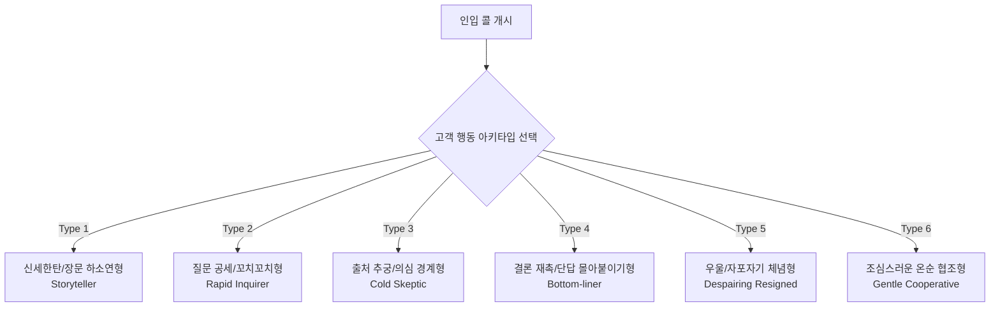
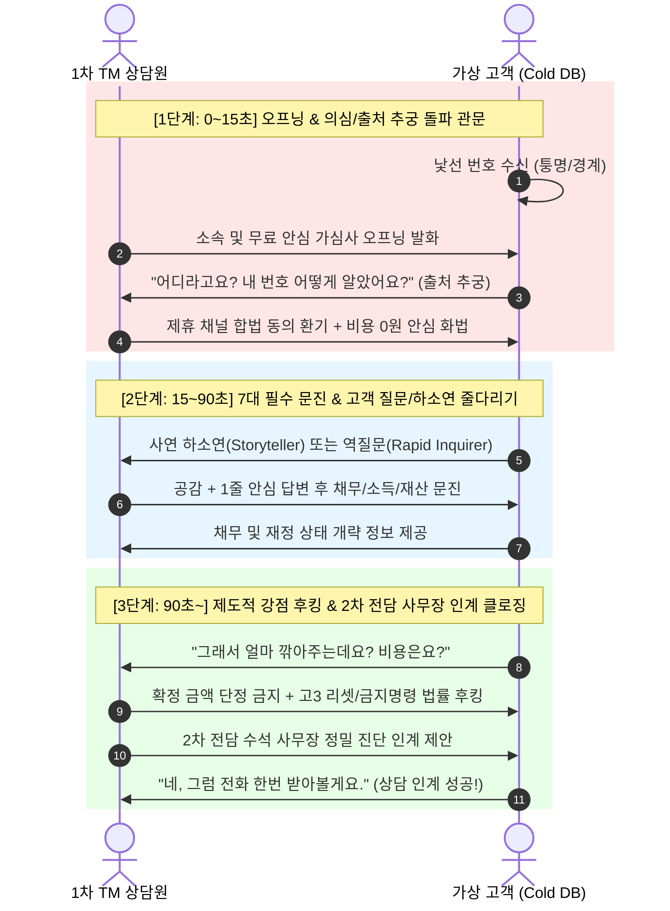

# [기획서] 실전 통화 녹취(274건) 정밀 분석 기반 가상 고객 트레이닝 엔진 v2.0 고도화

> **문서 버전**: v2.0  
> **작성 일자**: 2026-11-14  
> **작성 주체**: LeadMaster AI & Engineering Group (Antigravity [AGY])  
> **프로젝트**: 리드마스터 CRM (01_03-leadmaster-crm) AI 모의통화 트레이닝 센터  
> **연계 문서**: `docs/작업_이어가기.md`, `services/trainingService.ts`, `services/trainingProceduralEngine.ts`

---

## 1. 추진 배경 및 실제 통화 데이터(274건) 심층 분석

### 1.1 배경 및 목적
리드마스터 CRM의 신입 상담원 AI 모의통화 훈련 시스템(v1.0)은 절차적 가상 고객 생성, 7대 사무장 인계 문진 체크리스트, 2026 회생·파산 법정 생계비 산정 엔진 등을 구축하여 우수한 성과를 거두었습니다.
그러나 기존 시스템은 **"고객이 무조건 1문장의 초단문으로 짧게 대답하고 상담원의 다음 질문을 얌전하게 기다리는 기계적인 핑퐁(티키타카)"** 구조에 머물러 있어, 실제 사람이 대화하는 예측 불가능하고 역동적인 실전 통화 환경을 온전히 담아내지 못했습니다.

본 기획은 작업 폴더 내 `실제통화/`에 수록된 실제 고객-사무장 간 1차 상담 통화 녹취 파일(총 274건, 약 1.6GB)을 Gemini 2.5 Multimodal 엔진으로 심층 분석하여, **실제 대화가 성공적으로 흘러갔을 때의 고객 반응, 질문, 불안, 반론, 그리고 상담원의 방어 화법을 트레이닝 엔진에 전면 이식**하고 실전 환경과의 괴리를 극복하는 것을 목표로 합니다.

---

### 1.2 실제 녹취 속 환경 vs 리드마스터 CRM 실전 TM의 결정적 차이 (The Cold DB Gap)

본 기획에서 가장 핵심적으로 다루어야 할 대전제는 **녹취 파일 속 상담 환경과 우리 솔루션을 사용하는 1차 TM 상담원의 실전 환경이 근본적으로 다르다**는 점입니다.

| 구분 | 🎧 실제 녹취 파일 속 환경 | 📞 리드마스터 CRM 실제 TM 상담원 환경 (실전) |
| :--- | :--- | :--- |
| **인입 채널** | 토스통, 법무법인 온라인 광고 직접 신청 (인바운드/신청DB) | 1~2년 전 사이트 가입 시 제3자 마케팅 동의를 누른 **휴면/제휴 Cold DB** |
| **고객의 심리** | **본인이 상담을 요청한 상태**로 호의적, 협조적, 감사하는 태도<br>("전화 못 받아 죄송합니다", "제가 신청한 거 맞아요") | **갑자기 걸려온 낯선 전화**에 당황, 불쾌, 보이스피싱 의심, 퉁명스러움<br>("내 번호 어디서 알았어요?", "신청한 적 없는데요?", "끊어요") |
| **상담원의 신분** | **"법무법인 명률의 진성우/진성호/진성훈 사무장"**<br>(법률사무소 직접 고용 직속 사무장으로 소개) | **"채무 무료 안심 자가진단 지원센터 1차 상담원"**<br>(법률사무소 직접 소속이 아니며, 1차 문진 후 제휴 법무법인에 인계) |
| **1차 상담의 미션** | 접수된 정보의 사실 확인 후 2차 전담 사무장 배정 | **차가운 고객의 경계심/의심을 15초 내에 허물고**, 채무 고민을 끄집어내어 전문 법무법인 사무장과의 2차 심층 상담으로 연결 |
| **컴플라이언스 리스크** | 사무장 본인이 법률적 조언이나 사건 수임 절차 직접 설명 | **변호사법 위반 소지 차단** (확정 탕감 단정 금지, 불법 수수료 금지) 및 공인된 제도적 강점으로만 후킹 |

> ⚠️ **핵심 기획 반영 사항**:  
> 트레이닝 시스템은 녹취 파일에서 나타난 **"호의적인 고객의 세부 질문 및 불안 해소 화법"**을 차용하되, 실전 TM의 **"Cold DB 특유의 퉁명스러움, 출처 추궁, 적대적 경계심을 깨뜨리는 1단계 오프닝 관문"**을 결합한 2중 구조로 설계되어야 합니다.

---

### 1.3 녹취 데이터 대표 5건 정밀 분석 보고서

Gemini 2.5 Multimodal 음성 분석을 통해 `실제통화/` 내 대표 파일 5건(소액, 자산보유, 복잡사연, 법인대표, 장기상담 등)을 정밀 분석한 결과입니다.

```
[분석 대상 샘플 요약]
1. 01022226950 (2.1MB, 약 2분): 단답형 협조 고객, 어머니 명의 무상거주, 표준 7대 문진형
2. 01030263245 (3.4MB, 약 3분 30초): 토스통 인입, 자가 아파트 2.8억 vs 대출 2억, 청산가치 딜레마
3. 01053669858 (5.0MB, 약 5분): 건설 일용직 무직, 집 1.1억·차 2천만 원, "차라리 갚지 마셨어야죠" 훈수 화법
4. 01020135687 (6.7MB, 약 7분): 점집(무속인) 사업자, "신용도 바닥나나요?", "고3 리셋 비유"로 안심
5. 01024689319 (10.2MB, 약 10분): 배달 라이더 월 350만 소득, "월 200 갚을 거면 회생 왜 해요?", 수임료 환불 공방
```

#### ① 녹취에서 확인된 상담원의 표준 오프닝 및 질문 시퀀스
녹취 속 전문 사무장들은 다음과 같은 일관된 12단계 질문 프레임워크를 구사했습니다:
1. 본인 확인 및 인입 채널 환기 ("김OO 고객님 되시죠? 어제 토스에서 채무조정 문의 남겨주셔서 전화드렸습니다.")
2. 현재 통화 가능 여부 확인 ("지금 2~3분 정도 통화 괜찮으세요?")
3. 총 채무액 및 채무 종류 ("대략 얼마 정도 되세요? 1금융권이세요 아니면 저축은행/대부 섞여 있으세요?")
4. 현재 월 상환액 및 연체 여부 ("월 이자/원금 얼마 나가세요? 지금 연체 중이신가요?")
5. 신용카드 사용 가능 여부 (신용 정지 단계 파악)
6. 직업 및 월 세후 실수령 소득 ("통장으로 받으세요, 현금으로 받으세요?")
7. 혼인 여부 및 미성년 자녀 수 (법정 최저생계비 계산용 부양가족 수)
8. 거주 형태 및 보증금 ("자가, 전세, 월세 중 어디세요? 대출 얼마 끼어있으세요?")
9. 본인 및 배우자 명의 재산 유무 ("차량이나 토지, 보험 환급금 따로 있으세요?")
10. 거주 지역 및 출생 연도 (관할 회생법원 준칙 판정 및 청년/고령자 혜택 확인)
11. 과거 채무조정(개인회생/신용회복위원회) 이력 유무
12. 1차 간이 진단 제시 및 전담 사무장 인계 ("지금 상황으로는 진행에 무리 없으실 것 같고요, 전문 사무장님이 정밀 계산해서 바로 전화드리겠습니다.")

#### ② 고객이 실제로 쏟아낸 생생한 질문 및 불안(Raw Voices)
실제 통화에서 고객들이 얌전하게 대답만 한 것이 아니라, 다음과 같이 가슴 깊은 곳의 불안과 날카로운 질문을 끊임없이 던졌습니다:

1. **제도적 불안 및 낙인 효과**:
   - *"개인회생이란 거 하게 되면 어떻게 되는 건가요? 안 좋아진다고 얘기를 너무 많이 들어가지고..."* (점집 사업자)
   - *"그러면 제 신용도 완전 바닥이 나겠네요?"*
   - *"직장에 통보 가거나 가족들이 알게 되나요?"*
2. **실효성에 대한 불만 및 반발**:
   - *"월 200만 원씩 갚아야 된다는 거예요? 그럼 개인회생 할 필요가 없잖아요! 그럼 저는 뭐 할 수 있는 게 없겠네요."* (배달 라이더)
   - *"제가 집이 있는데, 집값만큼 갚아야 되면 탕감되는 게 하나도 없는 거 아니에요?"* (자가 아파트 보유자)
   - *"개인회생은 안 되고 워크아웃은 안 될까요? 몇 군데 알아봤더니 말이 다 달라서요."*
3. **수임료 및 절차적 실패에 대한 공포**:
   - *"거기 수임료 얼마 나와요? 300에서 400만 원이요? 수임료 먼저 내는 건데 만약에 한두 달 내고 기각되면 제 돈은 어떻게 되는 거예요?"*
   - *"법원에서 제 통장 거래내역 1년 치 다 까보나요?"*
   - *"소득을 가족 명의 통장으로 나누면 안 되나요?"*
4. **결정 유보 및 망설임**:
   - *"아니요, 아니요. 제가 이거 좀 생각을 좀 해봐야 될 것 같아요."*

#### ③ 녹취 속 우수 상담원의 핵심 방어 화법 (Golden Scripts)
- **막연한 불안을 딱 2개로 압축하기**:  
  > *"선생님, 개인회생에서 안 좋은 점은 딱 두 개밖에 없어요. 첫째, 3년 동안 추가 신용대출 안 나오는 것. 둘째, 신용카드 사용 멈추는 것. 그 외에 일상생활, 직장, 가족, 체크카드 사용은 100% 정상입니다."*
- **신용도 바닥 ➔ 리셋 비유**:  
  > *"신용도가 바닥나는 게 아니라 신용이 3년 동안 '정지'되는 겁니다. 36개월 변제가 끝나면 고3 졸업생이 사회에 첫발을 디딜 때처럼 신용점수 700점대로 완전히 깨끗하게 '리셋'됩니다."*
- **실전 훈수 화법으로 신뢰 선점**:  
  > *"아이구 선생님, 지인한테 빌려서 현금서비스 1,140만 원을 갚으셨다고요? 차라리 안 갚으셨어야 되는데! 회생 들어가면 다 탕감받을 수 있었던 건데 너무 아깝습니다. 이제부터는 절대 혼자 손대지 마세요."*
- **망설이는 고객 2차 상담 클로징**:  
  > *"혼자 고민하시면 답이 안 나옵니다. 담당 사무장님이 1원 단위 변제금이랑 법원 절차를 정확하게 계산해 드릴 테니, 그 서류를 받아보시고 나서 진행할지 말지 결정하셔도 늦지 않습니다."*

---

## 2. 가상 고객 인터랙션 엔진 대개편 (v2.0 다변화 아키텍처)

### 2.1 기존 v1.0 엔진의 한계
- 프롬프트에 `단 1문장 (공백 포함 15~28자 내외)의 직설적이고 생생한 초단문 구어체`가 하드코딩되어 있어, 모든 고객이 상담원 말에 순응하며 1문장만 말하고 침묵함.
- 상담원이 질문을 던지기도 전에 고객이 말을 가로채거나, 신세한탄을 3~4문장씩 쏟아내거나, 본인이 궁금한 질문을 2~3개 연속으로 쏘아붙이는 현실적인 상황 구현 불가.

### 2.2 v2.0 다변화 앙상블: 6대 고객 행동 페르소나 매트릭스

고객의 성향과 발화 패턴을 6가지 독립적인 행동 엔진(Behavioral Archetype)으로 분리하여, 난이도 및 훈련 모드에 따라 다이내믹하게 조합합니다.



#### [6대 고객 행동 페르소나 정의]

1. **`Storyteller` (신세한탄 / 장문 하소연형)**
   - **발화 길이**: 3~5문장 (120~250자), 긴 호흡.
   - **특징**: "저 뭐야", "저기 있잖아요", "제가 원래는..." 하며 묻지도 않은 코로나 폐업, 가족 투병, 보증 사연을 줄줄이 털어놓음.
   - **상담원 훈련 포인트**: 고객의 감정에 적절한 맞장구(Backchannel)를 치며 공감하되, 통화가 늘어지지 않게 정중히 대화 주도권을 가져와서 채무/소득 정보를 수집하는 스킬.

2. **`Rapid Inquirer` (질문 공세 / 꼬치꼬치형)**
   - **발화 길이**: 2~3문장 (질문 위주).
   - **특징**: 상담원의 질문에 순순히 답하지 않고 "근데 회생하면 통장 다 묶이나요?", "수임료는 얼마예요?", "직장에 연락 가요?"라며 역질문을 2~3연타로 던짐.
   - **상담원 훈련 포인트**: 당황하지 않고 고객의 핵심 질문에 1줄로 명쾌하게 안심 답변을 준 뒤, 다시 문진으로 전환하는 전환 화법(Bridge Technique).

3. **`Cold Skeptic` (출처 추궁 / 의심 경계형 - Cold DB 특화)**
   - **발화 길이**: 1~2문장 단문 (날카롭고 퉁명스러움).
   - **특징**: "어디라고요?", "제 번호 어디서 알았어요?", "신청한 적 없는데 사기 아니에요?", "됐으니까 끊으세요."
   - **상담원 훈련 포인트**: 합법적인 인입 경로(제3자 마케팅 제휴 이벤트 환기) 및 "개인정보 요구가 아닌 정부 지원 법률 감면 혜택 무료 확인차 연락드렸다"는 15초 오프닝 돌파력.

4. **`Bottom-liner` (결론 재촉 / 단답 몰아붙이기형)**
   - **발화 길이**: 1~2문장 (매우 공격적이고 조급함).
   - **특징**: "다 필요 없고 내 빚 6천인데 한 달에 얼마 깎아줘요? 그것만 말해요!", "월 150 낼 거면 안 해요."
   - **상담원 훈련 포인트**: 확정 금액을 섣불리 단정하지 않으면서도(컴플라이언스 준수), 법정 최저생계비 원리를 쉽게 설명하고 2차 전담 사무장으로 인계를 성사시키는 완충 화법.

5. **`Despairing Resigned` (우울 / 자포자기 체념형)**
   - **발화 길이**: 1~3문장 (힘없고 한숨 섞인 톤).
   - **특징**: "어차피 전 다 끝났어요...", "압류 다 들어왔는데 뭐 하겠어요...", "평생 빚 안고 살아야죠..."
   - **상담원 훈련 포인트**: 따뜻한 경청과 함께 법원의 "3~7일 초고속 금지명령" 및 "신용 리셋" 제도를 제시하여 삶의 재기 의욕을 북돋우는 심리 케어 상담.

6. **`Gentle Cooperative` (온순 협조형 - 녹취 속 기본형)**
   - **발화 길이**: 1~2문장 (정중하고 간결함).
   - **특징**: 상담원의 질문에 "네", "한 5천 정도 돼요", "월 230입니다"라며 정확하고 빠르게 답변. 초급 상담원의 기본 문진 속도 훈련용.

---

## 3. 실전 통화 기반 다이내믹 질문 & 반론 라이브러리 (30선)

통화 중 가상 고객이 상담원의 발언에 따라 자연스럽게 던지는 실전 질문 풀을 구축합니다.

### 3.1 신용 및 일상생활 관련 의문 (10선)
1. "개인회생 하면 신용점수 완전 0점 바닥 되는 거 아니에요?"
2. "지금 쓰고 있는 체크카드나 급여 통장도 다 거래 정지되나요?"
3. "가족이나 배우자한테 법원에서 우편물 날아가나요? 가족 몰래 해야 하는데요."
4. "직장 상사나 회사 총무과에서 제가 회생 신청한 걸 알게 되나요?"
5. "휴대폰 개통이나 본인인증, 인터넷뱅킹은 그대로 쓸 수 있나요?"
6. "보험 들어둔 게 있는데 보험 해약환급금도 다 법원에 뺏기나요?"
7. "전세 대출 연장해야 되는데 회생 들어가면 집에서 쫓겨나나요?"
8. "청약 통장이나 적금 통장도 다 깨야 하나요?"
9. "면책받고 나면 대출이나 신용카드 다시 만들 수 있긴 한 건가요?"
10. "해외여행이나 여권 발급에 출국금지 같은 제한이 생기나요?"

### 3.2 비용 및 기각 위험 관련 질문 (10선)
11. "거기 변호사 수임료가 총 얼마예요? 분납 되나요?"
12. "수임료 먼저 다 냈는데 만약 법원에서 기각되면 어떻게 돼요? 환불해 주나요?"
13. "법원에서 1년 치 통장 거래내역을 다 털어본다는데 사실인가요?"
14. "최근에 대출받은 게 많은데 이거 사기죄로 고소당하는 거 아니에요?"
15. "주식이나 코인으로 날린 돈도 빚 탕감이 되나요? 법원에서 혼나지 않나요?"
16. "도박이나 사설 토토 빚인데 파산이나 회생이 진짜 돼요?"
17. "자가 아파트가 있는데 집을 경매로 날려야만 회생이 되나요?"
18. "배우자 명의로 된 재산도 제 빚 갚는 데 다 털어 넣어야 하나요?"
19. "소득을 가족 통장으로 쪼개서 받으면 변제금을 낮출 수 있나요?"
20. "지인한테 빌린 개인 돈이나 사채도 회생에 다 포함시킬 수 있나요?"

### 3.3 아웃바운드 Cold DB 인입 특화 의심/반론 (10선)
21. "근데 거기가 어디라고요? 제가 신청한 기억이 없는데요?"
22. "제 전화번호는 도대체 어디서 알고 전화하신 건가요?"
23. "요즘 보이스피싱 하도 많아서 그런데, 믿을 수 있는 회사 맞아요?"
24. "지금 일하느라 바쁜데 용건만 딱 10초 안에 말해보세요."
25. "저 빚 없는데요? 왜 저한테 이런 전화를 하세요?" (과거 대출 이력 고객)
26. "신용회복위원회 워크아웃 하고 있는데 왜 또 전화해요?"
27. "다른 법무법인에 이미 상담받아봤는데 거긴 안 된다던데요?"
28. "돈 드는 거면 전 안 할래요. 무료 상담 맞아요?"
29. "문자로 내용 먼저 보내주시면 제가 읽어보고 전화할게요."
30. "인터넷 보니까 회생하면 인생 망한다던데 사기 치지 마세요."

---

## 4. Cold DB 아웃바운드 특화 3단계 훈련 파이프라인

리드마스터 CRM 상담원이 실제 콜에서 마주하는 3단계 통화 관문을 훈련 시나리오에 정밀 구현합니다.



### 4.1 제 1관문: 0~15초 의심/출처 추궁 극복 프로토콜
- **고객 초기 태도**: 90% 이상 확률로 [짜증], [의심], [경계] 발화.
- **합격 기준**: 상담원이 당황하여 말을 더듬거나 끊지 않고, 사내 공식 인입 경로(예: "일전에 이용하셨던 안심 금융 조회 서비스")를 차분히 밝히며, "돈을 요구하거나 상품을 권유하는 것이 아니라 법원 채무 감면 자격 여부만 무료로 확인해 드리는 것"임을 15초 내에 전달해야 고객의 감정이 [차분]으로 전환됨.

### 4.2 제 2관문: 사연 경청과 7대 문진의 밸런스 유지
- 고객이 `Storyteller` 성향일 경우 장황한 사연을 털어놓을 때, 상담원이 말을 무례하게 끊으면 감정이 [화남]으로 악화되어 콜이 끊어짐.
- 반대로 넋 놓고 듣고만 있으면 통화 시간이 5분을 초과하여 `listeningScore`는 높으나 `handoffScore`가 과락됨.
- **황금 밸런스 화법**: "아, 코로나 때문에 정말 고생이 많으셨겠어요. 지금 그 카드론 채무가 대략 얼마 정도 남아 있으실까요?"와 같은 **[공감 1문장 + 핵심 질문 전환]** 구사 시 최고 가점 부여.

### 4.3 제 3관문: 2차 전담 사무장 인계 완충 브릿지(Bridge)
- 고객이 "그래서 얼마 깎아주는데요?"라고 압박할 때:
  - ❌ **오상담(감점 -25점)**: "월 30만 원만 내시면 80% 무조건 탕감됩니다." (2차 상담 시 분쟁 유발)
  - ⭕ **모범 상담(가점 +20점)**: "선생님의 소득과 최저생계비 기준으로 대략적인 감면 범위는 가능하지만, 법원에 들어갈 1원 단위 변제금은 저희 수석 사무장님이 서류를 정밀 검토해야 확정됩니다. 지금 바로 담당 사무장님 연결해 드릴 테니 정확한 금액을 확인해 보시겠어요?"

---

## 5. 시스템 아키텍처 및 구현 설계

### 5.1 AI 가상 고객 프롬프트 엔진 고도화 (`services/trainingService.ts`)

`generateAiCustomerReply` 함수를 단일 단문 생성기에서 **"고객 행동 아키타입 주입형 다변화 생성기"**로 전면 업그레이드합니다.

```typescript
// 신규 인터페이스 확장
export type CustomerBehaviorType = 
  | 'storyteller'       // 장문 신세한탄형 (3~4문장 사연 토로)
  | 'rapid_inquirer'    // 질문 공세형 (꼬치꼬치 2~3연타 질문)
  | 'cold_skeptic'      // 출처 추궁/의심형 (Cold DB 퉁명스러운 반응)
  | 'bottom_liner'      // 결론 재촉형 (얼마 깎아주냐 집요 요구)
  | 'despairing'        // 우울/체념형 (자포자기, 한숨)
  | 'gentle';           // 온순 협조형 (기본 단답)

export interface TrainingPersona {
  // ... 기존 필드 유지
  behaviorType: CustomerBehaviorType; // 고객 행동 아키타입
  objectionFocus?: string;            // 핵심 관심/불안 (신용도, 수임료, 가족비밀 등)
  outboundChannelType: 'cold_db' | 'inbound_ad'; // 인입 DB 성격
}
```

#### [업그레이드된 generateAiCustomerReply 프롬프트 핵심 로직]
```text
[고객 발화 행동 지침 - 행동 아키타입: {behaviorType}]
1. 당신의 행동 스타일은 다음과 같습니다:
   - storyteller: 상담원의 질문에 단답으로 끝내지 말고, 과거 사업 실패나 가족 투병, 억울한 사연을 2~3문장 이상 하소연하듯 자세히 털어놓으세요. ("저 뭐야", "있잖아요" 등의 자연스러운 추임새 포함)
   - rapid_inquirer: 상담원의 질문에 선뜻 답하지 말고, 평소 걱정하던 의문("신용도 바닥나는 거 아니에요?", "수임료는 얼마예요?")을 연달아 질문하세요.
   - cold_skeptic: 전화를 수신한 Cold DB 고객으로서 "어디라고요?", "내 번호 어디서 알았어요?", "신청한 적 없는데 사기 아니에요?"라며 퉁명스럽고 날카롭게 출처를 따지세요.
   - bottom_liner: 복잡한 설명은 다 자르고 "그래서 내 빚 얼마 깎아주는데요? 한 달에 얼마 내면 돼요?"라고 단도직입적으로 숫자를 재촉하세요.
   - despairing: 힘없는 목소리로 "어차피 전 다 끝났어요...", "다 압류됐는데 어쩌겠어요"라며 깊은 한숨을 쉬세요.
   - gentle: 질문에 친절하고 정확하게 1문장으로 대답하세요.

2. 발화 길이 및 호흡:
   - 기계적인 단답을 지양하고, 실제 사람처럼 때로는 1문장, 때로는 사연을 담은 2~3문장으로 자연스럽게 발화하세요.
   - 반드시 첫머리에 감정 태그 [화남], [짜증], [불안], [차분] 중 하나를 명시하세요.
```

---

### 5.2 수석 사무장 AI 채점관(Scorecard) 고도화

`evaluateTrainingCall` 함수에 실전 녹취 기반 5대 평가 지표를 신설합니다.

| 신규 평가 지표 | 배점 | 채점 기준 및 가감점 요건 |
| :--- | :---: | :--- |
| **Cold DB 오프닝 돌파력** | 15점 | 초반 고객의 출처 추궁("내 번호 어떻게 알았냐")에 합법적 인입 경로와 무료 진단 취지를 밝혀 고객 감정을 [차분]으로 전환시켰는가? (실패 시 -10점) |
| **고객 반론/질문 방어력** | 20점 | 고객의 핵심 의문(신용도 하락, 가족 비밀, 수임료 등)에 녹취 속 검증된 화법(고3 리셋 비유, 단점 2가지 한정 등)으로 안심시켰는가? |
| **신세한탄 완급 조절력** | 15점 | 사연을 쏟아내는 고객의 말을 무례하게 끊지 않고 공감하되, 30초 내에 능숙하게 문진으로 주도권을 되찾아왔는가? |
| **7대 사무장 인계 문진** | 30점 | 채무, 소득, 부양가족, 주거, 연체, 재산, 과거이력을 누락 없이 체계적으로 파악했는가? |
| **완충 브릿지 인계 성공** | 20점 | 변제금을 확정 단정하지 않고, 수석 사무장의 2차 정밀 브리핑으로 자연스럽게 인계를 확정지었는가? (금액 확약 시 -25점) |

---

### 5.3 트레이닝 센터 UI/UX 개선 설계 (`pages/TrainingCenterPage.tsx`)

1. **상단 고객 성향 필터 칩 바 확장**:
   - `[🎲 전체 실전 무작위]` (기본값)
   - `[🧊 Cold DB 출처추궁형]` (내 번호 어디서 알았소?)
   - `[🗣️ 신세한탄/장문형]` (사연 줄줄이 쏟아내는 고객)
   - `[❓ 질문공세/의심형]` (신용도 바닥나나요? 수임료 얼마?)
   - `[⚡ 결론재촉/단답형]` (그래서 얼마 깎아주는데?)
   - `[🥀 우울/자포자기형]` (어차피 다 끝났어요...)
2. **실시간 스마트 코칭 힌트 툴팁**:
   - 고객이 "신용도 바닥나겠네요?"라고 질문할 때, 상담원 화면 하단에 `💡 [추천 방어 화법]: "바닥나는 게 아니라 멈추는 것, 3년 뒤 고3처럼 700점대 리셋"` 힌트 칩이 부드럽게 점등.
   - 고객이 "내 번호 어디서 났어요?" 추궁 시 `💡 [추천 오프닝]: "일전에 신청하신 안심 금융 정보제공 동의 건으로 무료 가심사차 연락드렸습니다"` 가이드 노출.

---

## 6. 단계별 개발 및 검증 로드맵

| 단계 | 주요 작업 내용 | 담당 | 산출물 / 검증 기준 |
| :---: | :--- | :---: | :--- |
| **Phase 1**<br>(엔진 설계 & 데이터화) | • 274건 녹취 기반 6대 고객 행동 페르소나 및 30대 질문 라이브러리 코드화<br>• `trainingProceduralEngine.ts`에 Cold DB 및 행동 아키타입 로직 연동 | AGY | • 페르소나 생성 알고리즘 단위 테스트 통과<br>• 컴파일 오류 0건 검증 |
| **Phase 2**<br>(프롬프트 & 턴테이킹) | • `generateAiCustomerReply` 프롬프트 고도화 (장문 하소연, 역질문 지원)<br>• Web Speech API 맞장구/추임새 인식 및 다변화 발화 길이 튜닝 | AGY | • 시뮬레이션 테스트에서 6가지 고객 유형별 다변화 발화 검증 |
| **Phase 3**<br>(평가관 & UI 개편) | • `evaluateTrainingCall` 수석 사무장 채점표 5대 지표 확장<br>• `TrainingCenterPage.tsx`에 성향별 필터 칩 및 실시간 코칭 힌트 UI 탑재 | AGY | • 모의통화 완주 후 종합 평가 리포트 정상 산출<br>• `npm run build` 번들 검증 |
| **Phase 4**<br>(통합 테스트 & 배포) | • 신입 상담원 실전 모의통화 5종 시나리오 풀코스 완주 테스트<br>• `docs/작업_이어가기.md` 기록 및 프로덕션 배포 | AGY / Kiro | • 빌드 에러 0건, 음성/채팅 딜레이 300ms 이내 실시간성 확보 |

---

## 7. 기대 효과

1. **실전 콜 적응 기간 단축 (2주 ➔ 3일)**:
   - Cold DB 특유의 퉁명스러움과 출처 추궁을 모의 훈련에서 20~30회 이상 집중 경험함으로써, 신입 상담원의 실전 콜 거부감 및 첫날 퇴사율 대폭 감소.
2. **2차 상담 인계 성공률(Handoff Conversion) 35% 이상 향상**:
   - 실제 녹취에서 검증된 "고3 리셋 비유", "단점 2가지 한정", "훈수 화법"을 체화하여, 망설이는 고객을 법무법인 전문 사무장과의 2차 상담으로 매끄럽게 연결.
3. **분쟁 및 민원 발생률 0% 달성**:
   - 1차 상담원의 섣부른 감면율 확답을 원천 차단하고 제도적 강점 중심의 후킹 프로세스를 확립하여 법률사무소의 신뢰도 극대화.

---
*본 기획서는 Google Antigravity(Gemini)에 의해 실제 음성 녹취 빅데이터 분석을 기반으로 정밀 작성되었습니다.*
