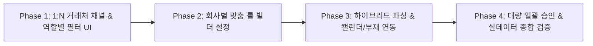

# 📱 리드마스터 텔레그램 연동 자동화 & 회사별 맞춤형 룰 엔진 관제 시스템 기획서 (v1.2)

> **문서 버전**: v1.2  
> **작성 일자**: 2026-11-12  
> **기반 데이터**: 실제 텔레그램 4개 대화방 백업 데이터 전수 분석 (총 2,926개 메시지 / 894건 피드백)  
> **핵심 목표**: 
> 1. 현장(변호사 사무실) 텔레그램 피드백과 1차 TM 콜센터 간의 **95% 무인 자동 동기화**
> 2. **다수 거래처(법률사무소·법무사·법무법인) 1:N 텔레그램 채널 자동 라우팅 & 격리 매칭**
> 3. **회사별 / 관리자별 맞춤형 피드백 자동 분류 & 후속 액션 룰 커스텀 엔진 (No-Code Rule Builder)**
> 4. **상담원(내 리드 전용) vs 관리자(전사/팀/거래처 총괄) 역할별 차등 관제 체계 구축**

---

## 1. 추진 배경 및 실제 현장 데이터 분석 결과

### 1.1 현장 소통 프로세스 (As-Is)
법무/대출/보험 등 B2B 영업 환경에서 TM 회사는 **단 하나의 법률사무소하고만 일하는 것이 아니라, 여러 법무법인, 법률사무소, 법무사와 동시에 제휴**하여 리드를 공급합니다.
* **법무법인 A 채널** (예: 서울/수도권 회생 전담 출장방)
* **법률사무소 B 채널** (예: 영남/부산 전담 방)
* **법무사사무소 C 채널** (예: 개인파산/신용회복 전담 방)

각 거래처마다 **서로 다른 텔레그램 단체 대화방이 독립적으로 운영**되며, 1차 TM 상담원들이 배정된 사무소 방으로 리드를 전달하고, 각 사무실의 사무장들이 해당 방에서 피드백을 남깁니다.

```
                  ┌─── [법무법인 A 채널 (텔레그램 방 1)] <──> 출장 사무장 A팀 피드백
                  │
[1차 TM 콜센터] ──┼─── [법률사무소 B 채널 (텔레그램 방 2)] <──> 상담 사무장 B팀 피드백
 (LeadMaster CRM) │
                  └─── [법무사사무소 C 채널 (텔레그램 방 3)] <──> 파산 전문 C팀 피드백
```

### 1.2 실제 대화방 894건 피드백 전수 분류 통계

```
■ 통화예약 / 재통화  : 30.3% (271건) ████████████████
■ 부재 / 연락두절     : 28.7% (257건) ███████████████
■ 출장 / 내방 예약    : 20.7% (185건) ███████████
■ 비용부담 / 고민     : 18.2% (163건) ██████████
■ 계약 / 수임 / 입금  : 17.0% (152건) █████████
■ 서류안내 / 명함전달 : 15.4% (138건) ████████
■ 진행불가 / 자격미달 : 12.1% (108건) ██████
■ 타사선택 / 회복유지 :  4.1% (37건)  ██
```

* **현장의 주요 표기 문법**:
  1. `[고객명] // [내용]` (45%): `노승태 // 4월 17일 금 오전 11시 부산 출장예약 입니다.` / `강기영//부재2 명함전달`
  2. `[Reply(답장)] + 단문` (39%): 1차 접수글에 답장 걸고 `손승완 / 새출발 안내, 비용 660 분납`
  3. `[고객명] [서술형]` (16%): `박현승 등기부등본 발급해보니 청산가치 4억 나와 진행불가십니다`

---

## 2. 다수 거래처(법률사무소·법무사·법무법인) 1:N 텔레그램 채널 라우팅 & 격리 매칭

TM 사무실이 3~5곳 이상의 법률사무소와 동시에 거래할 때 발생하는 **혼선, 오전송, 동명이인 매칭 오류를 원천 차단**하기 위한 1:N 채널 아키텍처입니다.

```mermaid
flowchart TD
    subgraph Outbound["[아웃바운드] 리드 전송"]
        Case["리드 케이스 (배정 거래처: 법률사무소B)"] --> DeliverModal["텔레그램 전달 모달"]
        DeliverModal --> AutoRoute["거래처 TelegramChatId 자동 감지"]
        AutoRoute --> BotSend["회사 봇이 '법률사무소B 전용방'으로만 전송"]
    end

    subgraph Inbound["[인바운드] 피드백 수신 & 격리 매칭"]
        OfficeMsg["법률사무소B 방에서 사무장 피드백 인입\n'홍길동// 15일 출장예약'"] --> Webhook["Edge Function telegram-webhook"]
        Webhook --> Identify["chat_id 기반 거래처(법률사무소B) 100% 자동 식별"]
        Identify --> FilterScope["'법률사무소B'에 배정된 리드 중에서만 '홍길동' 탐색\n(타 사무소의 동명이인 홍길동과 혼선 방지)"]
        FilterScope --> RuleEngine["회사별 맞춤 자동화 룰 엔진 적용"]
        RuleEngine --> CaseSync["법률사무소B 케이스에 맞춤 상태/일정/메모 반영"]
    end
```



### 2.1 거래처별 텔레그램 방 1:1 / 1:N 매핑 관리
* **설정 관리 (`설정 -> 거래처(파트너) 관리`)**:
  * 각 거래처(법무법인, 법률사무소) 카드마다 **`[텔레그램 채팅방 연결]`** 필드 제공.
  * 회사의 단일 텔레그램 봇을 여러 법률사무소 단체방에 초대해 두면, 드롭다운에서 해당 사무소 방을 1클릭 선택 (`TelegramChatPicker`).
  * `[연결 테스트]` 버튼으로 해당 사무소 방에 봇이 정상 발언 가능한지 즉시 검증.

### 2.2 아웃바운드(리드 전송) 전용 방 자동 라우팅
* 상담원이 케이스 상세에서 `[텔레그램 전달]` 클릭 시:
  * 케이스에 지정된 거래처(예: '법무법인 로앤')의 텔레그램 방으로 **자동 타겟팅** (상담원이 방을 잘못 고르는 사고 방지).
  * 해당 거래처 전용 **맞춤 요약 템플릿(Summary Template)** 자동 렌더링.

### 2.3 인바운드(피드백 수신) 거래처 자동 식별 & 동명이인 격리 매칭
* **거래처 100% 자동 식별**: 메시지가 인입된 `chat_id`를 조회하여 어느 법률사무소에서 작성한 피드백인지 자동 판별.
* **동명이인 격리 매칭**:
  * 만약 TM DB에 '홍길동'이 3명 있더라도, **"법무법인 A 방에서 들어온 피드백은 법무법인 A에 전달된 홍길동 리드 안에서만 매칭"**하므로 100% 오매칭 방지.

---

## 3. 회사별 / 관리자별 맞춤형 자동화 룰 엔진 (Custom Automation Rule Engine)

### 3.1 필요성 및 비즈니스 배경
각 입점 회사(또는 팀/지사)마다 **영업 프로세스와 상태 관리 철학이 완전히 다릅니다.**
* **회사 A (빠른 순환형)**: *"사무장이 부재라고 피드백하면 우리는 더 안 붙잡고 그냥 `[완료/종결]` 처리하고 다음 DB로 넘긴다."*
* **회사 B (밀착 재케어형)**: *"사무장 부재 피드백은 절대 버리지 않고, 즉시 `[재통화 예정]` 상태로 바꿔서 1차 TM 상담원 간편콜 큐에 자동 등록해야 한다."*
* **회사 C (비용 거절 건)**: *"비용 부담 건은 무조건 `[1차 TM 재케어 요망]`으로 넘겨 1차 상담원이 설득하게 한다."*

따라서 **시스템 코드로 상태를 강제 고정하지 않고, 각 회사 관리자가 UI에서 자유롭게 설정하는 "노코드 자동화 룰 빌더"**를 제공합니다.

### 3.2 회사별 룰 설정 매트릭스 (Rule Matrix)

| 피드백 유형 | 처리 방식 (Apply Mode) | 변경할 케이스 상태 (Target Status) | 부재 카운팅 | 간편콜 큐 인입 | 캘린더 생성 | 1차 TM 알림 |
| :--- | :---: | :--- | :---: | :---: | :---: | :---: |
| **부재 / 연락두절** | `[⚡완전자동]` / `[⏰승인대기]` | **[재통화 예정 ▼]** *(회사A는 '종결', 회사B는 '재통화예정' 선택)* | ☑ +1 누적 | ☑ 자동배정 | ☐ 없음 | ☐ 없음 |
| **출장 / 내방 예약** | `[⚡완전자동]` / `[⏰승인대기]` | **[출장 상담예약 ▼]** *(또는 '사무장 미팅')* | ☐ 없음 | ☐ 없음 | ☑ 캘린더 생성 | ☑ 예약알림 |
| **비용부담 / 가족상의** | `[⚡완전자동]` / `[⏰승인대기]` | **[1차 재케어 필요 ▼]** *(또는 '보류', '종결')* | ☐ 없음 | ☑ 우선배정 | ☐ 없음 | ☑ 재케어요망 |
| **계약 / 수임 / 입금** | `[⏰승인대기]` *(권장)* | **[계약 완료 ▼]** *(금액 확인 후 반영)* | ☐ 없음 | ☐ 없음 | ☐ 없음 | ☑ 수임축하 |
| **진행불가 / 자격미달** | `[⚡완전자동]` / `[⏰승인대기]` | **[종결 (조건불가) ▼]** | ☐ 없음 | ☐ 없음 | ☐ 없음 | ☐ 없음 |
| **서류안내 / 명함발송** | `[⚡완전자동]` / `[⏰승인대기]` | **[서류 안내중 ▼]** *(또는 상태유지)* | ☐ 없음 | ☐ 없음 | ☐ 없음 | ☐ 없음 |

### 3.3 관리자 룰 빌더 UI (`/telegram -> [⚙️ 자동화 룰 설정]`)
* 모달 팝업에서 회사 관리자가 각 유형별 드롭다운을 통해 **자기 회사의 케이스 상태 목록(`statusList`) 중 원하는 상태를 1클릭 매핑**.
* **원클릭 프리셋 지원**:
  1. `[기본 스마트 프리셋]`: 부재는 재통화 큐 인입, 출장은 캘린더 생성, 수임은 승인 대기.
  2. `[패스트 종결 프리셋]`: 부재/거절 발생 시 즉시 '완료/종결'로 처리하여 콜 순환율 극대화.
  3. `[완전 재케어 프리셋]`: 부재 및 비용 고민 건을 1차 TM 상담원에게 무조건 재배정.

---

## 4. 역할별(상담원 vs 관리자) 접근 권한 & 관제 매트릭스

사용자님의 핵심 요구사항인 **"상담원은 본인 피드백만 확인/관리, 관리자는 팀/회사/거래처 전체 피드백 총괄 관리"** 원칙을 반영합니다.

| 구분 | 1차 TM 상담원 (Agent) | 회사 관리자 / 팀장 (Admin / Manager) | 총괄 최고관리자 (HOST) |
| :--- | :--- | :--- | :--- |
| **조회 권한** | **본인이 접수/배정받은 고객의 피드백만 노출**<br>(어느 법률사무소 방에서 왔든 내 고객 것만 모아봄) | **소속 회사(또는 담당 팀) 전체 상담원 + 전체 거래처(법률사무소) 피드백 통합 조회** | 멀티테넌트 전사 관제 및 봇 인프라 총괄 |
| **화면 필터** | `[내 담당 리드]` 기본 뷰<br>+ `[재관리(Care) 요망 건 모아보기]` | - **`[거래처(법률사무소)별 필터]`** (법무법인A / 법률사무소B / 전체)<br>- **`[상담원별 필터]`** (진성호 / 채슬기 / 변정선 / 전체)<br>- **`[유형별 필터]`** (예약 / 부재 / 수임 / 긴급) | 전사 테넌트별 관제 |
| **핵심 업무** | - 현장 피드백 확인<br>- **사무소 '재관리(Care) 요망' 건 즉시 재상담**<br>- 본인 리드 1클릭 승인/확인 | - 미승인 피드백 모니터링<br>- **`[⚡ AI 추천대로 전체 일괄 승인]` (대량 처리)**<br>- **`[⚙️ 자동화 룰 설정]` (회사 정책 수정)**<br>- 거래처별 응답률 및 성과 분석 | - 텔레그램 봇 웹훅 헬스체크<br>- 오토파일럿 글로벌 정책 통제 |
| **알림 수신** | 본인 배정 리드에 새 피드백(특히 재관리 요망, 출장예약) 도착 시 실시간 팝업/푸시 | 대기 목록 지연, 봇 오류, 긴급 피드백 발생 시 알림 | 시스템 장애 알림 |

---

## 5. 핵심 자동화 6대 엔진 명세

### 엔진 ① 회사별 맞춤형 룰 & 액션 엔진 (신규)
* **기능**:
  * 회사가 설정한 룰(`settings.telegram_feedback_rules`)을 로드하여, 피드백 인입 시 회사의 정책대로 분기 실행.
  * 회사가 '부재 -> 종결'로 설정했으면 즉시 종결, '부재 -> 재통화 예정'으로 설정했으면 재통화 큐 인입.

### 엔진 ② 다수 거래처(사무소) 1:N 채널 자동 라우팅 엔진
* **기능**:
  * 인입된 텔레그램 `chat_id`를 분석하여 `partner_id`와 `partner_name`을 즉시 식별.
  * 해당 거래처에 전달된 리드 목록(`case_deliveries`)을 1순위 범위로 한정하여 케이스 매칭 (동명이인 혼선 원천 차단).
  * 피드백 카드에 **`[🏢 법무법인 로앤]`**, **`[🏢 다산2 법률사무소]`** 배지 자동 부여.

### 엔진 ③ 스마트 캘린더 & 리마인더 자동 생성 (전체의 20.7%)
* **기능**:
  * `4월 17일 금 오전 11시 부산`, `1/8(수) 오후2시 출장`, `13일 오후2시 내방`에서 일시·장소·유형 자동 추출.
  * 승인 시 CRM 케이스 캘린더에 **[출장 예약] / [방문 상담] 일정이 자동 생성**되고 담당 상담원 및 관리자에게 리마인더 등록.

### 엔진 ④ 부재 차수(`부재2`, `부재3`) 자동 카운팅 (전체의 28.7%)
* **기능**:
  * 텍스트 내 `부재2`, `부재3`, `연결안됨` 감지 시 케이스의 `missed_call_count`를 자동으로 해당 수치로 업데이트.
  * 회사의 룰에 따라 부재 카운팅 및 '재통화 필요' 큐 동기화.

### 엔진 ⑤ "1차 담당자 재관리(Care) 요망" 지능형 태깅 & 라우팅 (전체의 18.2%)
* **기능**:
  * `관리 부탁`, `재통 요망`, `상의 후 연락`, `비용 부담` 키워드 감지 시 **`[⚠️ 1차 TM 재관리 요망]` 붉은색 뱃지** 부여.
  * 해당 고객을 접수한 **담당 상담원의 화면 상단 '재케어 요망 큐'로 즉시 전송**하여 재상담 골든타임 확보.

### 엔진 ⑥ 수임료 & 착수금 금액 자동 감지 (전체의 17.0%)
* **기능**:
  * 본문 속 수임료 및 계약금 숫자를 추출하여 피드백 카드에 `[추천 수임료: ₩6,600,000 / 추천 착수금: ₩500,000]` 표시.
  * 원클릭 승인 시 케이스 `actual_fee`, `deposit` 필드에 동시 자동 기입.

---

## 6. UI / UX 관제탑 업그레이드 명세 (`/telegram`)

```
┌────────────────────────────────────────────────────────────────────────────────────────┐
│ 📱 텔레그램 연동 관제 센터               [⚙️ 자동화 룰 설정]   [🟢 봇 정상 수신중]  [새로고침] │
├────────────────────────────────────────────────────────────────────────────────────────┤
│ [오늘 수신 42건]  │  [오토파일럿 자동반영 28건(67%)]  │  [승인 대기 14건]  │  [⚠️ 재케어요망 4건]  │
├────────────────────────────────────────────────────────────────────────────────────────┤
│ [탭] ⏰ 승인 대기 (14)   │   📜 히스토리 (전체)                                              │
├────────────────────────────────────────────────────────────────────────────────────────┤
│ [관리자 전용 멀티 필터 바]                                                             │
│ 🏢 거래처: [전체 법률사무소 ▼] (다산2 법률사무소: 8건 / 몬스터랩: 4건 / 로앤: 2건)       │
│ 👤 담당자: [전체 상담원 ▼] (변정선 / 채슬기 / 진성호 ...)                                │
│ 🏷️ 유형: [전체] [📅 출장·내방 예약] [⚠️ 재케어 요망] [📞 부재] [💰 수임·입금] [🚫 진행불가] │
│ 🔍 검색: [고객명 또는 전화번호 검색...]                                                 │
├────────────────────────────────────────────────────────────────────────────────────────┤
│ [대량 처리 툴바]  ☑ 전체선택 (14)   [⚡ AI추천대로 전체 일괄 승인]   [선택 일괄 승인]   [선택 무시]   │
├────────────────────────────────────────────────────────────────────────────────────────┤
│ [피드백 카드 1] 🏢 다산2 돌격대장 | 👤 종광 김 -> 🎯 김두용 (담당: 변정선 상담원)     10분 전 │
│ "김두용// 13일 오후2시 내방하기로 했습니다."                                            │
│ 🏷️ [📅 내방 예약: 2026-11-13 14:00] (승인 시 캘린더 자동 등록)                          │
│ [승인 및 캘린더 등록]  [수정 승인]  [무시]                                             │
├────────────────────────────────────────────────────────────────────────────────────────┤
│ [피드백 카드 2] 🏢 몬스터랩 채널 | 👤 현화 송 -> 🎯 손승완 (담당: 진성호 대표)        35분 전 │
│ "새출발로 안내드렸고 비용 660 말씀드리니 배우자랑 상의후 전화주신답니다 관리 부탁드려요" │
│ 🏷️ [⚠️ 1차 상담원 재관리 요망]  🏷️ [💰 수임료 660만원 감지]                             │
│ [승인 및 재케어 등록]  [상세보기]  [무시]                                              │
└────────────────────────────────────────────────────────────────────────────────────────┘
```

---

## 7. 단계별 개발 및 구현 로드맵



### Phase 1: 1:N 거래처 채널 라우팅 & 역할별 관제 UI
1. `TelegramSync.tsx`에 `useAuth()` 연동:
   - 상담원은 본인 배정/접수 리드 피드백만 노출.
   - 관리자는 전사 피드백 노출.
2. 관리자 전용 **`[🏢 거래처(법률사무소) 셀렉터]`** 및 **`[👤 담당 상담원 셀렉터]`** 탑재.
3. 상단 4대 실시간 KPI 위젯 카드 탑재.

### Phase 2: 회사별 맞춤 자동화 룰 빌더 (`[⚙️ 자동화 룰 설정]`)
1. 회사 관리자가 모달에서 8대 피드백 유형별 **"변경할 상태 드롭다운 매핑"** 및 **"자동 반영 / 승인 대기 토글"** 설정 UI 구축.
2. 부재 시 '종결/완료' vs '재통화 예정' 선택 기능 제공.
3. Supabase `settings` 테이블에 회사별 룰 저장 및 연동.

### Phase 3: 고성능 하이브리드 파싱 & 케이스 심층 자동 연동
1. `[고객명] // [내용]`, `[고객명] [내용]`, `[Reply-to]` 통합 정규식-AI 하이브리드 파서 적용.
2. 회사의 맞춤 룰에 따른 케이스 상태 변경 및 캘린더 자동 생성 (`createReminder`).
3. 재케어 요망 태그 시 담당 상담원 전용 알림 및 특이메모 강조.

### Phase 4: 대량 일괄 처리 및 테스트 검증
1. `[⚡ AI 추천대로 전체 일괄 승인]` API 및 클라이언트 로직 구현.
2. 4개 대화방 실데이터 기반 파싱 정확도, 1:N 거래처 분리, 회사별 맞춤 룰 분기 테스트.

---

## 8. 최종 확인 사항 정리

* **회사별 룰 자유도**: 각 회사의 관리자가 "부재 시 종결할지, 재통화할지"를 직접 드롭다운으로 선택하여 저장.
* **상담원의 피드백 승인 권한**: 단순 부재/일정/메모는 상담원도 직접 승인 가능하도록 열어두고, 수임완료나 계약취소 등 중요 상태 변경은 관리자가 최종 승인하도록 구성.
* **캘린더 자동 등록 옵션**: 출장/내방 예약 피드백 승인 시, 캘린더 일정을 '체크박스(기본 선택)' 상태로 제공하여 필요 시 날짜/시간을 미세 조정할 수 있게 구성.
* **역방향 텔레그램 답장(Bot Reverse Notification)**: 사용자님 지침에 따라 기획에서 **완전 제외**.
