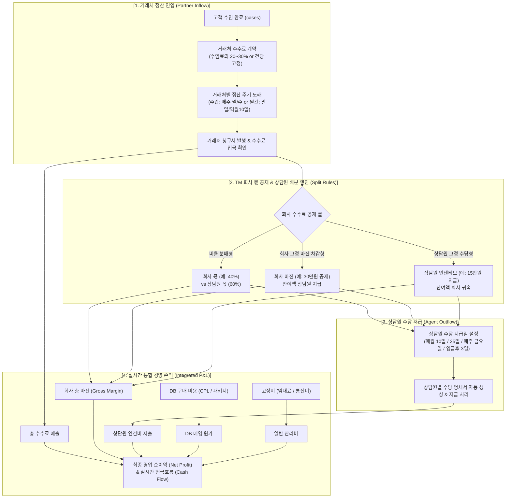

# [기획서] 차세대 통합 정산 & 경영 손익(P&L) 관제 센터 구축 (v1.1)
> **부제**: 거래처 수수료 계약 · 회사 마진 공제 · 상담원 수당 배분 룰 및 이중 정산 주기(거래처 입금일 vs 상담원 지급일) 전방위 커스텀 엔진  
> **작성일**: 2026-11-12 | **버전**: v1.1 (수수료 분배 룰 & 이중 정산 주기 설정 전면 반영) | **작성자**: Antigravity (LeadMaster CRM)

---

## 1. 추진 배경 및 핵심 요구사항 분석

### 1.1 현업 TM 조직의 고유한 수수료 및 정산 현실
대표님께서 정확히 짚어주신 바와 같이, TM 회사의 정산 구조는 일반적인 급여 시스템과 완전히 다릅니다:
1. **수수료 3단 분배 메커니즘 (Three-Tier Revenue Split)**:
   * TM 회사는 독자적으로 매출을 발생시키는 것이 아니라, **거래처(법무법인/법률사무소)로부터 계약된 수수료를 정산받아, 그중 '회사분의 수수료(회사 몫/마진)'를 떼고 나머지를 상담원에게 성과 수당으로 지급**합니다.
   * 따라서 수수료 금액, 회사 몫 공제 방식(비율 또는 고정액), 상담원 지급액이 유기적으로 자동 계산되어야 합니다.
2. **거래처별 정산 주기와 날짜의 다양성 (Diverse Partner Cycles)**:
   * 어떤 법률사무소는 **매주 월요일** 정산, 어떤 곳은 **매주 수요일**, 또 다른 곳은 **매월 말일** 또는 **익월 10일** 등 거래처마다 정산 시기와 날짜가 제각각입니다.
3. **상담원 수당 지급일의 독립성 (Independent Agent Payout Dates)**:
   * 거래처에서 정산받는 날짜와, 상담원에게 수당을 지급하는 날짜는 결코 같지 않습니다.
   * 어떤 TM 회사는 **매월 10일(또는 25일) 월급날**에 지난달 수수료를 모아서 일괄 지급하고, 어떤 회사는 **매주 금요일 주급 형태**로 지급하며, 또 어떤 회사는 **거래처 입금 확인 후 N영업일 이내** 지급합니다.
4. **회사별 전방위 설정 가능성 (Full Configurability)**:
   * 이 모든 수수료 금액, 분배 룰, 정산 주기, 지급 날짜는 **시스템에 고정(Hard-coded)되어 있으면 안 되며, TM 회사 관리자가 마우스 클릭 몇 번으로 자유롭게 설정하고 언제든 변경**할 수 있어야 합니다.

---

## 2. 수수료 분배 & 이중 정산 주기 아키텍처



---

## 3. 핵심 기능별 상세 설계 명세

### 3.1 수수료 3대 분배 모델 설정 엔진 (Commission Split Engine)
관리자는 **[설정 ➔ 정산 정책]**에서 기본 룰을 정하고, 필요 시 거래처별로 개별 예외를 둘 수 있습니다.

| 분배 모델 | 산출 공식 및 실무 예시 | 적합한 TM 업무 형태 |
| :--- | :--- | :--- |
| **모델 A. 비율 분배형<br>(Ratio Split)** | **수수료 총액 × 상담원 배분율(%)**<br>- 거래처 수수료 120만원 인입 시<br>- 회사 몫 40% (48만원) 공제 ➔ 상담원에게 60% (72만원) 지급 | 법률/회생 TM에서 가장 널리 쓰이는 표준 정률제 |
| **모델 B. 회사 고정 마진 차감형<br>(Margin Deduction)** | **수수료 총액 - 회사 고정 마진(원)**<br>- 거래처 수수료 120만원 인입 시<br>- 회사 고정 마진 30만원 공제 ➔ 상담원에게 나머지 90만원 전액 지급 | 고액 수임 건에 대해 상담원에게 강력한 동기부여 제공 |
| **모델 C. 상담원 고정 수당형<br>(Fixed Agent Incentive)** | **상담원 고정 건당 수당(원) 지급 후 잔여액 회사 귀속**<br>- 거래처 수수료 120만원 인입 시<br>- 상담원에게 건당 15만원 지급 ➔ 나머지 105만원 회사 매출 귀속 | 기본급이 있거나 인센티브가 정액제로 고정된 조직 |

---

### 3.2 이중 정산 주기 및 날짜 설정 엔진 (Dual Settlement Schedule)

#### 1) 거래처 수수료 정산 주기 (Partner Inflow Schedule)
거래처(법률사무소)마다 수수료를 계산하여 청구하고 입금받는 주기:
* **주간 정산 (Weekly)**: `매주 월요일`, `매주 화요일`, `매주 수요일`, `매주 금요일` 중 선택 (선택 요일에 직전 주 실적 자동 정산서 발행).
* **격주 정산 (Bi-weekly)**: `격주 월요일`, `격주 수요일`.
* **월 N회 분할 정산 (Monthly Split)**: `월 2회 (15일 및 말일)`, `월 2회 (10일 및 25일)`.
* **월 1회 일괄 정산 (Monthly Single)**: `매월 말일`, `익월 5일`, `익월 10일`, `익월 25일`.
* **건별 즉시 정산 (Per Case)**: 고객 수임 입금 확인 즉시 개별 건 정산.

#### 2) 상담원 수당 지급 주기 및 날짜 (Agent Outflow Schedule)
거래처에서 수수료를 받은 뒤, 상담원에게 회사분을 떼고 지급하는 주기:
* **월급 정기 지급형 (Monthly Payroll)**:
  * `매월 10일` (전월 1일~말일 실적 합산 지급)
  * `매월 25일` (당월 실적 선지급 또는 전월 실적)
  * `매월 말일`
* **주급 정기 지급형 (Weekly Payout)**:
  * `매주 금요일` (해당 주차 거래처 입금 확인 건 지급)
* **입금 후 N영업일 지급형 (After Deposit)**:
  * 거래처에서 TM 회사 통장으로 입금이 확인된 날로부터 `영업일 기준 3일 이내` 즉시 지급 (미수금 발생 시 상담원 선지급 리스크 완벽 방어).

---

## 4. 정산 페이지 v4.5 화면 구성 (UI/UX Specification)

### 4.1 최상단: 통합 경영 손익(P&L) 요약 전광판
```
┌──────────────────────────────────────────────────────────────────────────────────────────────────┐
│  📊 [2026년 11월] 통합 경영 손익 현황                [월간 선택: 11월 ▼]  [엑셀 다운로드] [정산 정책 설정] │
├───────────────────┬───────────────────┬───────────────────┬───────────────────┬──────────────────┤
│   거래처 정산매출  │   회사 순마진(몫) │   상담원 지급수당 │    DB 구매 원가   │   최종 영업 순익 │
│   ₩ 42,500,000    │   ₩ 17,000,000    │   ₩ 25,500,000    │   ₩ 8,400,000     │  ₩ 17,100,000    │
│  (입금완료 3,100만) │  (회사 마진율 40%)│  (상담원 60% 배분) │  (총 12회차 매입)  │  (순이익률 40.2%) │
└───────────────────┴───────────────────┴───────────────────┴───────────────────┴──────────────────┘
```

---

### 4.2 탭 1: [🏢 거래처별 수수료 정산 관제] (인입 매출)
* **거래처 요약 카드**:
  * 법무법인 명율: `매주 수요일 정산 (D-1)` | 이번 주 청구 `18건 (₩12,600,000)` | 입금완료 `₩8,000,000` | 미수 `₩4,600,000`
  * 로앤파트너스: `매월 말일 정산 (11/30)` | 당월 대상 `31건 (₩21,700,000)` | D-18
* **주간/월간 캘린더 타임라인**: 어느 요일에 어느 사무실에서 정산금이 들어오는지 타임라인 시각화.
* **원클릭 정산서 발행**: 엑셀/PDF 다운로드 및 텔레그램 전송용 텍스트 복사.

---

### 4.3 탭 2: [👥 상담원 수당 정산 대장] (회사분 공제 후 지급)
* **상담원 수당 지급 카운트다운**:
  * "다음 상담원 급여 지급일: **2026.11.25 (D-13)** | 총 지급 예정액: **₩25,500,000 (상담원 8명)**"
* **상담원별 상세 수당 테이블**:
  * 상담원명 / 소속팀
  * 당월 수임 완료 건수 (예: 12건)
  * 거래처 수수료 총액 (예: ₩8,400,000)
  * **회사분 공제 마진 (40%)**: - ₩3,360,000
  * **상담원 실지급 수당 (60%)**: **₩5,040,000**
  * 지급 상태: `[지급 대기]`, `[1차 주급 완료]`, `[급여 이체 완료]`
  * 액션: `[상세 수임건 리스트]`, `[개인 수당 명세서 인쇄]`

---

### 4.4 탭 3: [📦 DB 구매비용 및 공급사 정산] (원가 지출)
* 당월 총 DB 매입 비용: ₩8,400,000 (총 4,800건 매입, 평균 CPL ₩1,750)
* 공급처별 대장:
  * 패스트애드 (CPL 5,000원 / 1,200건 = ₩6,000,000) ➔ 수임 24건 발생 (매출 ₩16,800,000, ROI 280%)
  * 애드온마케팅 (대량 패키지 3,000건 50만원 = ₩500,000) ➔ 수임 8건 발생 (매출 ₩5,600,000, ROI 1120%)
* 매출 대비 DB 원가 비중: **19.8%** (안전 구간 유지)

---

### 4.5 탭 4: [📊 종합 경영 손익(P&L) & 현금흐름 Cockpit]
* **원스톱 손익 계산서**:
  1. 거래처 정산 매출: ₩42,500,000 (100.0%)
  2. (-) DB 구매비용 (매출원가): - ₩8,400,000 (19.8%)
  3. (-) 상담원 수당 (인건비): - ₩25,500,000 (60.0%)
  4. (-) 사무실 임대료/통신/프로그램비 (고정비): - ₩2,500,000 (5.9%)
  5. (=) **회사 최종 영업 순이익: ₩6,100,000 (영업이익률 14.3%)**
* **현금흐름(Cash Flow)**:
  * 통장 실제 유입액 (거래처 실제 입금) vs 통장 실제 유출액 (상담원 송금 + DB 대금 결제) = 당월 순현금 증감.

---

## 5. 데이터베이스 스키마 및 설정 모달 설계

### 5.1 회사별 정산 정책 설정 테이블 (`org_settlement_policies`)
```sql
CREATE TABLE IF NOT EXISTS org_settlement_policies (
  id UUID PRIMARY KEY DEFAULT gen_random_uuid(),
  org_id UUID NOT NULL UNIQUE,
  
  -- 수수료 분배 룰
  split_model VARCHAR(30) DEFAULT 'ratio_split', -- 'ratio_split', 'margin_deduction', 'fixed_agent_incentive'
  company_share_ratio NUMERIC(5, 2) DEFAULT 40.0, -- 회사 몫 (%)
  agent_share_ratio NUMERIC(5, 2) DEFAULT 60.0,   -- 상담원 몫 (%)
  company_fixed_margin INT DEFAULT 300000,        -- 회사 고정 마진 (원)
  agent_fixed_incentive INT DEFAULT 150000,       -- 상담원 고정 수당 (원)
  
  -- 상담원 수당 지급 일정
  agent_payout_cycle VARCHAR(30) DEFAULT 'monthly_fixed', -- 'monthly_fixed', 'weekly_fixed', 'after_partner_deposit'
  agent_payout_day INT DEFAULT 10,                 -- 매월 10일 (or 매주 금요일=5)
  payout_delay_days INT DEFAULT 3,                 -- 입금 확인 후 N일 이내
  
  created_at TIMESTAMPTZ DEFAULT NOW(),
  updated_at TIMESTAMPTZ DEFAULT NOW()
);
```

### 5.2 거래처별 개별 오버라이드 지원 (`partners` 테이블 확장)
* `settlement_cycle`: 'weekly' | 'biweekly' | 'monthly_split' | 'monthly_single'
* `settlement_day_of_week`: 1(월), 2(화), 3(수)...
* `settlement_day_of_month`: 31(말일), 10(익월 10일)...
* `custom_commission_rate`: 기본 수수료율 오버라이드 (예: 25%)

---

## 6. 단계별 구현 마일스톤

1. **[Milestone 1] DB 스키마 & 정책 서비스 엔진 구축**:
   - `supabase/migrations/033_settlement_policies_and_split.sql`
   - `services/settlementPolicyService.ts` (정책 CRUD & 3대 분배 모델 자동 계산기)
2. **[Milestone 2] 정산 정책 & 수수료 분배 설정 모달 (`SettlementPolicyModal.tsx`)**:
   - 회사 수수료 몫(%) vs 상담원 몫(%) 슬라이더
   - 거래처 정산 주기 & 상담원 지급일 선택기
3. **[Milestone 3] 상단 경영 손익 KPI 바 & 거래처 정산 탭 고도화**:
   - 거래처별 정산 시기, 건수, 금액, D-Day 카드 및 캘린더
4. **[Milestone 4] 상담원 수당 정산 대장 탭 신설**:
   - 회사분 공제 내역 투명 표기, 상담원별 지급 예정액, 급여 지급일 카운트다운
5. **[Milestone 5] DB 구매비용 & 종합 손익(P&L) 연동 완성**:
   - 회차별 DB 원가 대조, 손익계산서 요약 및 월별 추이 차트

---

> 💬 **피드백 요청**:
> 본 기획서 v1.1은 대표님께서 말씀해주신 **"거래처 수수료 인입 ➔ 회사분 공제 ➔ 상담원 지급"**의 3단 메커니즘과, **"거래처 정산 주기/날짜 및 상담원 지급일의 회사별 맞춤 설정"**을 완벽하게 수용하도록 설계되었습니다.
> 검토 후 의견을 주시면 바로 구현에 착수하겠습니다!
