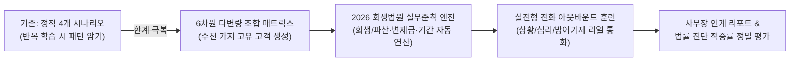
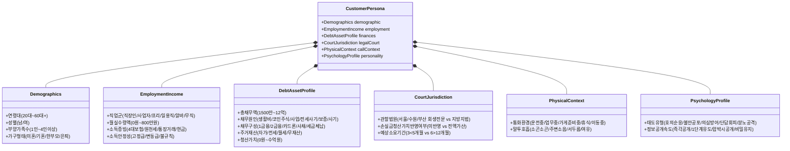
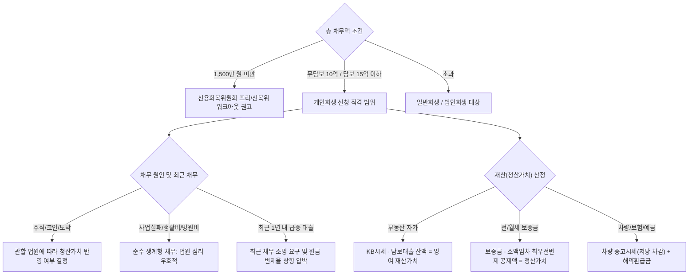
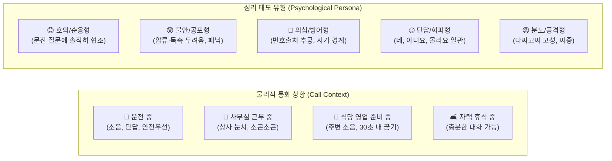
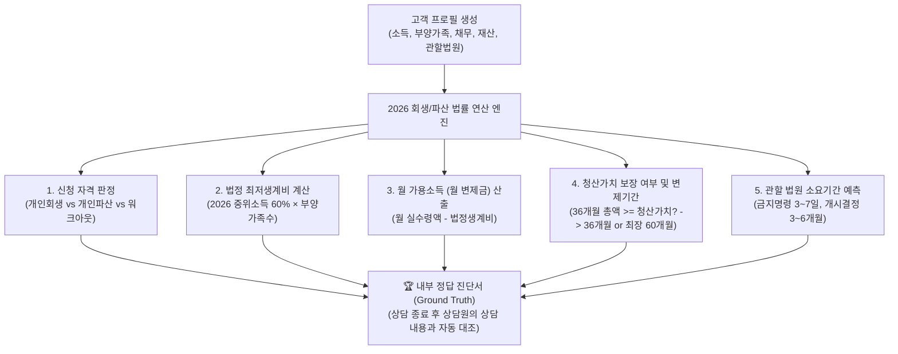
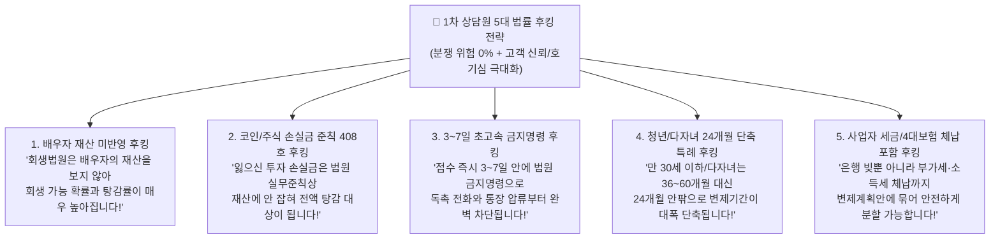
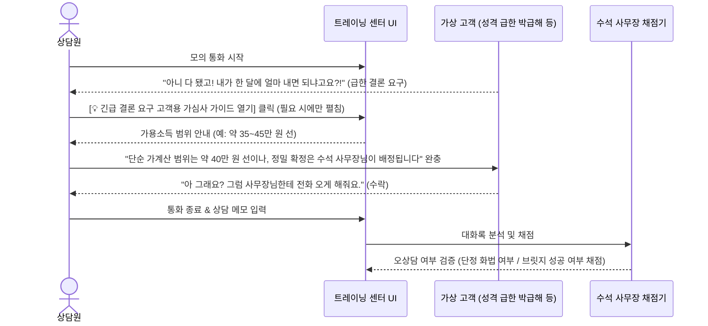
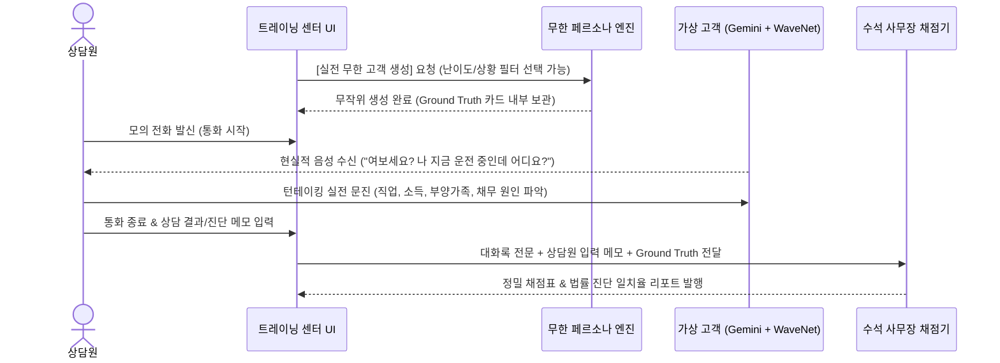

# 📑 [기획서] 개인회생·파산 초정밀 진단 결합형 무한 AI 가상 고객 페르소나 엔진 v1.0

> **문서 상태**: 구현 및 실전 가동 (Implemented & Live)  
> **기획 목적**: 신입 및 전문 상담원의 실전 상담 역량 강화를 위해, 정적 시나리오의 한계를 넘어 **수천~수만 가지의 고유한 법률·금융·심리·상황 조합을 실시간으로 무한 생성**하고, 실제 대한민국 회생법원 실무준칙에 따른 **정밀 법률 진단(회생/파산 판정, 변제금, 변제기간, 소요기간) 및 자동 평가 시스템**을 구축함.

---

## 1. 추진 배경 및 핵심 방향성



### 1.1 기존 시스템의 한계
* **패턴 고착화**: 정적 4개 레벨과 단순 무작위 6개 유형으로는 며칠만 연습해도 고객의 답변 패턴을 외워 실전 대응력이 저하됨.
* **법률적 인과관계 부재**: 고객의 나이, 소득, 부양가족, 재산, 채무 원인에 따라 **개인회생인지 파산인지, 월 변제금이 30만 원인지 150만 원인지, 36개월인지 60개월인지**가 법적으로 명확히 갈리는데, 기존에는 단순 대화 연습에 그침.
* **실전 상황 변수 부재**: 실제 TM 아웃바운드 전화를 걸면 고객은 편하게 앉아있는 경우보다 **운전 중, 상사 눈치 보는 사무실, 식당 오픈 준비 중, 독촉으로 극도로 흥분한 상태**가 대부분임.

### 1.2 핵심 구축 목표
1. **6차원 다변량 무한 조합 (Procedural Matrix Generation)**: 10,000개 이상의 유니크한 가상 고객 페르소나 생성.
2. **2026 대한민국 회생법원 실무준칙 연동**: 법정 최저생계비, 청산가치 보장의 원칙, 관할 법원별 차이(주식/코인 손실금 반영 여부 등) 자동 연산.
3. **심리·물리 환경 다변화**: 호의형부터 극단적 단답/회피형, 분노형, 번호 추궁형까지 현실감 있는 통화 태도 구현.
4. **상담 문진 적중률 평가 (Ground Truth Matching)**: 상담원이 통화 중 파악한 정보가 고객의 실제 숨겨진 조건과 일치하는지 정밀 채점.

---

## 2. 6차원 다변량 페르소나 매트릭스 (Combinatorial Dimensions)

매 통화마다 아래 6가지 축의 독립적인 매트릭스가 유기적으로 조합되어 **완전히 새로운 1인의 고유 고객**으로 탄생합니다.



### [차원 1] 인구통계학적 특성 (Demographics)
| 연령대 | 성별 | 가구 형태 및 부양가족 | 실전 대표 페르소나 특성 |
| :--- | :--- | :--- | :--- |
| **20대 초중반** | 남/여 | 미혼 단독 1인 가구 | 학자금 대출, 첫 신용카드 과소비, 코인/SNS 리딩방 빚투, 부모님 모르게 해결 원함 |
| **30대** | 남/여 | 영유아 자녀 1~2명, 외벌이/맞벌이 | 전세사기 보증금 미반환, 아파트 영끌 주담대+신용대출 복합, 양육비 지출 극심 |
| **40대** | 남/여 | 중고등 자녀 2인, 배우자 | 가계부채의 정점, 사업/직장 병행, 카드 돌려막기 한계 도달, 급여 압류 위기 |
| **50대** | 남/여 | 성인 자녀, 배우자, 노부모 부양 | 자영업 폐업 위기, 거래처 어음, 세금 체납, 퇴직금 소진 후 재취업 난항 |
| **60대 이상** | 남/여 | 독거 노인 or 부부 2인 가구 | 질병/의료비 채무, 지인 보증 채무, 소득 전무(기초연금 의존), 파산/면책 1순위 |

---

### [차원 2] 직업 및 소득 구조 (Employment & Income)
*개인회생은 '반복적이고 지속적인 소득'이 필수이며, 소득 형태에 따라 증빙 방식이 달라집니다.*

| 직업 종류 | 소득 형태 및 입증 방식 | 회생/파산 진행 시 핵심 쟁점 |
| :--- | :--- | :--- |
| **1. 4대보험 정규직** | 급여명세서, 원천징수영수증, 건강보험공단 | 가장 표준적인 형태. 월 실수령액이 명확하여 변제금 산정이 신속함. |
| **2. 개인사업자 (자영업)** | 부가가치세 과세표준증명, 종합소득세, 카드매출 | 매출에서 필요경비(임대료, 인건비, 재료비)를 공제한 **'순소득'** 입증이 핵심. |
| **3. 프리랜서 / 특고직** | 3.3% 사업소득 원천징수, 통장 입금 내역 | 배달 라이더, 대리기사, 학원강사 등. 최근 1년 평균 소득으로 가용소득 산출. |
| **4. 일용직 / 알바 (단기)** | 노무비 지급명세서, 고용주 확인서, 현금수령 | 4대보험 미가입 상태. 통장 거래내역 또는 고용 확인서로 계속소득 입증 필요. |
| **5. 전업주부** | 소득 0원 (배우자 소득으로 생활) | 원칙상 회생 불가(파산 또는 파트타임 취업 후 조건부 회생 진행 대상). |
| **6. 무직 / 장기 구직자** | 소득 0원, 건강 문제/장애/고령 여부 | 근로 능력이 영구히 상실된 경우 **[개인파산]** 최적격, 근로 가능 시 취업 권고. |

---

### [차원 3] 채무 및 재산 구조 (Debt & Liquidation Value)
*개인회생의 절대 원칙: **총 변제금 > 재산 총액(청산가치)** (청산가치 보장의 원칙)*



---

### [차원 4] 관할 법원별 실무 차이 (Jurisdiction)
*2026년 3월 1일부로 대전·대구·광주 회생법원이 공식 개원하여, 대한민국은 **전국 6대 전문 회생법원 체제(서울·수원·부산·대전·대구·광주)**로 재편되었습니다.*

| 관할 법원 구분 | 해당 법원 및 관할 지역 | 주식/코인 손실금 처리 실무 | 청년/다자녀 단축 특례 | 예상 심리 기간 |
| :--- | :--- | :--- | :--- | :--- |
| **수도권 전문 회생법원** | **서울회생법원** (서울 전역)<br/>**수원회생법원** (경기 남부) | **실무준칙 제408호**: 투자 실패 손실금을 청산가치에 **미반영** (원금 탕감률 극대화) | 24~36개월 단축 변제 적극 적용 | 접수 후 개시까지 약 3~4개월 (초고속) |
| **영남권 전문 회생법원** | **부산회생법원** (부산·울산·경남)<br/>**대구회생법원 (2026 신설)** (대구·경북) | 전문 회생법원 준칙 적용: 주식/코인 손실금 청산가치 제외 및 생계비 우대 | 24~36개월 단축 변제 가능 | 약 4~5개월 (전담 재판부 신속 심리) |
| **충청/호남 전문 회생법원** | **대전회생법원 (2026 신설)** (대전·세종·충남)<br/>**광주회생법원 (2026 신설)** (광주·전남) | 전문 재판부 도산 전담: 불필요한 보정 절차 단축, 탕감률 우호적 심리 | 24~36개월 단축 변제 가능 | 약 3~5개월 (원정사법 해소, 신속 개시) |
| **일반 지방법원 도산부** | **인천지법, 의정부지법, 청주지법, 전주지법, 창원지법 등** | 일반 민·형사와 병행: 최근 채무 및 주식/코인 손실금의 청산가치 가산 요구 빈번 | 원칙적 36개월 고수 (단축에 보수적) | 6~10개월 (보정 권고 다수, 지연 심리) |

---

### [차원 5 & 6] 통화 상황 및 심리 태도 (Context & Personality)



* **단답/회피형 (Avoidant) 고객의 실제 대화 흐름 예시**:
  * 상담원: "고객님, 현재 총 채무가 대략 어느 정도 되실까요?"
  * 고객: "글쎄요... 잘 몰라요."
  * 상담원 (미숙): "모르시면 조회가 안 되시는데요..." (통화 실패 ❌)
  * 상담원 (우수): "아, 그러실 수 있습니다! 혹시 대출받으신 곳이 은행, 카드사, 캐피탈 중 대략 몇 군데 정도 기억나실까요?" ➔ 고객: "두세 군데 되는 것 같아요." (유도 성공 ⭕)

---

## 3. 법률적 자동 판정 엔진 (Legal Decision Engine)

가상 고객이 생성될 때, 시스템은 **내부 정답지(Ground Truth Card)**를 백엔드에서 미리 계산해 둡니다.



### 3.1 대한민국 법원 개인회생 법정 최저생계비 공식 기준표 (보건복지부 기준 중위소득 60%)

법원 개인회생 실무에서는 1원 단위까지 법정 고시 금액을 정확하게 적용하여 가용소득(월 변제금)을 산정합니다.

#### [현행 법원 실무 적용 기준: 2025년 보건복지부 확정 고시]
| 가구원 수 (부양가족 포함) | 2025 기준 중위소득 (100%) | **개인회생 법정 최저생계비 (60%)** | 실무 권장 표기 |
| :---: | :---: | :---: | :---: |
| **1인 가구** (단독) | 2,392,013원 | **1,435,208원** | 약 144만 원 |
| **2인 가구** (자녀 1인 or 노부모 1인) | 3,932,658원 | **2,359,595원** | 약 236만 원 |
| **3인 가구** (배우자 미취업 + 자녀 1인) | 5,025,353원 | **3,015,212원** | 약 302만 원 |
| **4인 가구** (자녀 2인 부양) | 6,097,773원 | **3,658,664원** | 약 366만 원 |
| **5인 가구** (자녀 3인 다자녀) | 7,108,192원 | **4,264,915원** | 약 426만 원 |
| **6인 가구** | 8,064,805원 | **4,838,883원** | 약 484만 원 |

#### [참고: 2026년 기준 중위소득 60%]
* **1인 가구:** 1,538,543원 (약 154만 원)
* **2인 가구:** 2,519,575원 (약 252만 원)
* **3인 가구:** 3,215,422원 (약 322만 원)
* **4인 가구:** 3,896,843원 (약 390만 원)
* **5인 가구:** 4,545,000원 (약 455만 원)

### 3.2 핵심 계산 공식
1. **월 변제금 (가용소득)**:
   $$\text{월 변제금} = \text{월 실수령 소득} - \text{법정 인정 최저생계비}$$
   *(예: 월 250만 원 버는 1인 가구 = $2,500,000 - 1,435,208 = 1,064,792\text{원}$)*
2. **총 변제기간 산정**:
   * $\text{월 변제금} \times 36\text{개월} \ge \text{청산가치(재산)} \implies \mathbf{36\text{개월 만기}}$
   * 만약 36개월 총 변제금이 청산가치에 미달하면 $\implies \mathbf{37\text{개월}\sim 60\text{개월}}$까지 연장.
3. **원금 탕감률**:
   $$\text{탕감률(\%)} = \left( 1 - \frac{\text{월 변제금} \times \text{변제개월수}}{\text{총 채무원금}} \right) \times 100$$

---

## 4. 법률사무소 실무 최적화: 2단계 1차 상담 프로토콜 및 조건부 가심사 정책

> [!IMPORTANT]
> **법률회사의 1차 TM 상담 제1원칙: "1차 상담원은 판사가 아니다."**  
> 1차 TM 상담원이 고객에게 자세한 변제금이나 탕감률을 섣불리 확정적으로 이야기하는 것은 법률회사에서 극도로 경계하는 **'오상담 및 민원 유발 행위'**입니다.  
> 실제 법원 접수나 2차 전문 사무장 심층 검토 단계에서 변제금이 상향 조정될 경우, 고객은 *"아까 상담원은 30만 원이라더니 왜 말이 바뀌냐!"*며 극심하게 반발하고 수임이 취소되는 치명적인 분쟁이 발생하기 때문입니다.

### 4.1 1차 상담원의 본질적 역할과 딜레마
```mermaid
flowchart TD
    A["📞 1차 TM 아웃바운드 인입"] --> B{"고객의 반응 유형"}
    
    B -->|표준/협조형 (90%)| C["[Tier 1: 표준 문진 모드 (원칙)]<br/>- 상담원이 변제금/탕감률을 먼저 언급 절대 금지<br/>- 7대 핵심 조건(소득, 가족, 주거, 채무, 연체) 수집 집중<br/>- '조건 충족 확인 -> 수석 사무장 정밀 심층 배정'으로 완결"]
    
    B -->|성격 급함/결론 강요 (10%)<br/>'그래서 내가 한 달에 얼마 내냐고!'| D["[Tier 2: 조건부 방어적 가심사 모드 (치트키)]<br/>- 상담원이 가심사 가이드를 열어 '대략적인 가능 범위'만 파악<br/>- 확정 단정 금지: '단순 가계산 범위 + 변동 가능성' 완충 안내<br/>- 사무장 브릿지: '정확한 1원 단위 확정은 2차 사무장이 분석' 유도"]

    C --> Success["🤝 2차 전문 사무장 심층 상담 성공 인계"]
    D --> Success
```

1. **섣부른 단정의 치명성 (Over-promising Risk)**:
   - 1차 상담원은 서류를 보지 않은 상태이므로, 고객의 일방적 구두 진술만 믿고 *"고객님은 월 30만 원에 80% 탕감됩니다"*라고 말해서는 절대 안 됨.
2. **반대로 수치를 전혀 언급하지 않을 때의 콜 이탈 (Drop-off Risk)**:
   - 하지만 성격이 급한 고객, 의심 많은 고객은 *"대략 얼마 탕감되는지도 안 알려주면서 내 개인정보랑 연봉을 왜 다 꼬치꼬치 캐묻냐!"*, *"바쁘니까 결론만 말해요, 한 달에 얼마 내요?!"*라며 보챔.
   - 이때 상담원이 *"그건 제가 절대 말씀 못 드립니다"*라고만 딱딱하게 막아서면 고객은 전화를 끊어버림(상담 실패).
3. **해결책: '조건부 가심사 브릿지(Bridge) 프로토콜'**:
   - 가심사 계산기를 시스템에 기본 탑재하되 **기본값은 숨김/접힘 상태**로 둠.
   - 고객이 먼저 강하게 요구할 때만 조심스럽게 열어보고, **"단순 가계산 범위 제시 + 사무장 정밀 인계 명분"**으로 전환하는 방패막이로 사용함.

---

### 4.2 상담원의 실전 화법 가이드 (Best vs Worst Practice)

| 구분 | 나쁜 화법 (Worst Practice ❌ - 감점 요인) | 모범 화법 (Best Practice ⭕ - 만점 요인) |
| :--- | :--- | :--- |
| **변제금 문의 시** | "고객님은 월 45만 원 나오시네요. 80% 탕감되실 겁니다." *(확정 단정형 ➔ 2차 상담 시 분쟁 유발)* | *"고객님, 마음이 얼마나 급하고 답답하시겠습니까. 다만 개인회생은 법원 정식 인가 절차라 제가 섣불리 확답을 드리면 오히려 고객님께 큰 피해가 갈 수 있습니다."* |
| **결론 재촉 시** | "그건 제가 알 수 없고요, 서류 다 떼어 오셔야만 알 수 있습니다." *(고객 짜증 및 콜 이탈)* | *(가심사 계산기 확인 후)* *"현재 말씀해주신 월 소득과 법정 최저생계비만으로 **단순 가계산해 본 대략적인 범위는 월 40~50만 원 선**에서 조율될 가능성이 있습니다. **하지만 이는 최근 채무나 부양가족 인정 서류에 따라 크게 달라질 수 있기 때문에**, 오늘 오후 3시에 저희 **회생 전담 수석 사무장님이 1원 단위까지 가장 유리하게 줄여서 정확히 확정 브리핑**을 드리도록 바로 메모 전달해 놓겠습니다!"* |

---

### 4.3 1차 상담원의 강력한 무기: [법률 실무준칙 제도적 강점 5대 후킹(Legal Hooking) 전략]

> [!TIP]
> **변제금 숫자를 확정짓지 않고도 고객을 매료시키는 법:**  
> 구체적인 숫자("월 30만 원 나옵니다")는 분쟁의 씨앗이지만, **"법률 제도와 법원 실무준칙상의 유리한 특징"**은 분쟁 위험이 **0%**이면서 고객의 눈과 귀를 사로잡는 가장 강력한 1차 상담의 무기입니다!



#### [실무 5대 법률 후킹 스크립트 모음]
1. **배우자 명의 주택/재산이 있는 기혼자 고객**:
   - 멘트: *"고객님, 회생법원은 실무준칙상 배우자 명의의 재산을 신청인의 재산(청산가치)으로 잡지 않기 때문에, 배우자분 집이나 재산에 전혀 피해가 가지 않고 회생 가능 확률과 탕감률이 훨씬 높아집니다!"*
   - 효과: 가족에게 빚 피해가 갈까 봐 전전긍긍하던 고객의 심리적 불안을 일거에 해소하고 신뢰 확보.
2. **주식·코인·해외선물 빚투 고객**:
   - 멘트: *"고객님, 서울·수원·부산·대전·대구·광주 회생법원 준칙 제408호에 따라 주식이나 코인 투자로 잃으신 손실금은 재산에 잡히지 않아 최대 원금 탕감 대상으로 인정받으실 수 있습니다!"*
   - 효과: "투자 빚이라 기각당할까 봐" 망설이던 2030 청년층의 수임 의사를 100%로 끌어올림.
3. **독촉·압류 직전의 불안/패닉 고객**:
   - 멘트: *"고객님, 서류 접수 후 영업일 기준 3~7일 안에 법원에서 [금지명령]이 바로 떨어집니다. 추심원 방문, 독촉 전화, 급여 및 통장 압류를 합법적으로 완벽히 올스톱 시켜드립니다!"*
   - 효과: 당장 내일이 두려운 고객에게 즉각적인 심리적 안도감 제공.
4. **만 30세 이하 청년 또는 미성년 자녀 2인 이상 다자녀 가구**:
   - 멘트: *"고객님은 만 30세 이하 청년(또는 다자녀) 특례 심사 대상이셔서, 일반 36개월이나 60개월 대신 24개월 안팎으로 변제기간을 단축하여 조기 졸업하실 수 있습니다!"*
   - 효과: 변제 기간의 부담을 절반 가까이 덜어주어 계약 체결률 급상승.
5. **자영업자 및 소상공인 (세금 체납 보유)**:
   - 멘트: *"개인회생은 신용대출뿐만 아니라 골치 아픈 국세, 부가가치세 체납, 4대보험 미납금까지 변제계획안에 함께 묶어 안전하게 분할 처리할 수 있습니다!"*
   - 효과: 세금 때문에 신용회복위원회나 파산을 진행하지 못하던 사업자 고객 유치.

---

### 4.4 트레이닝 센터 시스템 연동 및 채점 기준 (Scorecard)



1. **가심사 타깃 카드 UI의 '기본 접힘(Collapsed)' 정책**:
   - 상담 진행 중 화면을 어지럽히지 않도록 기본 상태에서는 가심사 카드를 숨겨두며, 성격 급한 고객이 보챌 때만 **`[💡 결론 요구 고객용 1차 가심사 가이드 열기]`**를 클릭해 슬라이드로 열람.
2. **사무장 채점표(Scorecard) 채점 기준 추가**:
   - **⚠️ 섣부른 확정 단정 감점 (-20점)**: 고객이 묻지도 않았는데 상담원이 먼저 "무조건 80% 탕감됩니다", "월 40만 원에 끝납니다"라고 단정 지어 확약한 경우.
   - **✅ 완충 브릿지 성공 가점 (+15점)**: 고객의 급한 결론 요구에 당황하지 않고 가예측 범위를 조심스럽게 언급하면서 2차 사무장 상담으로 자연스럽게 전환한 경우.
   - **✅ 법률 제도적 강점 후킹 가점 (+10점)**: 배우자 재산 미반영, 코인손실 준칙 408호, 신속 금지명령 등 제도적 특성을 적절히 안내하여 신뢰를 유발한 경우.
   - **✅ 기본 문진 충실 가점 (+15점)**: 불필요한 금액 언급 없이 7대 필수 문진을 차분히 완료하여 사무장 인계 카드를 완성한 경우.

---

## 5. 트레이닝 센터 UI/UX 연동 및 상담원 채점표 (Scorecard)



### 5.1 상담원 화면에 노출될 페르소나 선택기 (프리셋 & 무한 생성)
1. **[🎲 전체 실전 무작위]**: 버튼 1클릭으로 487건 DB 기반 및 소액(1,200만)·초고액·재산초과 등 전 범위 무작위 즉시 배정.
2. **[🎯 11대 실전 테마 집중 훈련]**:
   - `[💡 소액채무 (1200만선)]`: 회생 수임료 부담 커서 회생 비추천, 신복위 워크아웃(5만 원) 솔직 권고 훈련
   - `[🏛️ 초고액·일반회생]`: 무담보 10억 초과 연쇄 부도. 개인회생 불가, 법원 전문재판부 일반회생 전담 배정
   - `[🚫 재산초과·기각위험]`: 보유 아파트 잉여가치가 채무보다 큼. 법원 회생 기각 위험 및 자산대환 안내
   - `[🪙 코인·주식]`: 2030 토스/신용 빚투, 서울/수원/부산/대전/대구/광주 회생법원 준칙 제408호 연동
   - `[🏭 사업자·세금]`: 자영업 식자재/어음/부가세 체납, 매출 필요경비 분리 문진
   - `[🏠 전세사기·LH]`: 깡통전세 보증금 미반환, LH 임대 질권설정 및 소액보증금 공제
   - `[⚖️ 파산·면책]`: 고령, 장기 질환 근로불능, 무소득 1순위 파산 권고
   - `[🔄 워크아웃 전환]`: 신복위 신속채무조정 유예 만료, 원금 미감면 불만족 회생 전환
   - `[🚗 운전·현장직]`: 스피커폰/건설 소음, 30초 내 용건 정리 및 콜백 약속 훈련
   - `[🛡️ 단답·의심형]`: "잘 몰라요", "내 번호 어디서 알았소?", 정보 회피 고객 유도 문진
   - `[🎰 도박·최근채무]`: 불법 사설 토토(파산 불가/회생 고변제율) 및 최근 2개월 집중 대출 소명 대비

### 5.2 사후 평가 리포트에 추가될 [법률 진단 정밀 대조표]
통화가 끝난 후, AI 수석 사무장이 상담원의 문진 및 판단 결과를 실제 데이터와 1:1로 비교 평가합니다.

| 평가 항목 | 가상 고객 실제 정답 (Ground Truth) | 상담원이 파악한 내용 | 일치 여부 & 코칭 |
| :--- | :--- | :--- | :---: |
| **신청 적격** | **개인회생** (월 소득 260만 원 지속) | 개인회생 적격으로 판단 | ✅ 100점 |
| **인정 생계비** | **2,359,595원** (2인 가구 법정 생계비) | 부양가족 질문 누락 (1인으로 오인) | ⚠️ -15점 감점 |
| **예상 월 변제금** | **약 24만 원** (260만 - 236만) | "월 120만 원 내셔야 합니다" 안내 | ❌ 오진단 경고 |
| **관할 법원 특성** | **서울회생법원** (코인 손실 청산가치 제외) | 관할 법원 준칙 설명 성공 | ✅ 우수 가점 |
| **1차 법률 후킹** | **배우자 재산 미반영 원칙 안내** | 법률적 강점으로 불안 해소 | ✅ 후킹 가점 |
| **상황 대응력** | 운전 중 고객 ➔ 안전 배려 후 1분 내 완료 | 길게 끌지 않고 요점만 정리 | ✅ 우수 가점 |

---

## 6. 개발 및 적용 완료 상태 (Live Deployed)

* ✅ **6차원 다변량 무한 고객 엔진**: `services/trainingProceduralEngine.ts` 구축 완료.
* ✅ **2026 회생법원 체제(서울·수원·부산·대전·대구·광주)** 및 **2025/2026 법정 최저생계비 1원 단위 정밀 연동**: 완료.
* ✅ **트레이닝 센터 8대 테마 필터 & 1차 법률 후킹 UI**: `pages/TrainingCenterPage.tsx` 구축 완료.
* ✅ **수석 사무장 AI 채점기 (오상담 감점 / 후킹 가점)**: `services/trainingService.ts` 연동 완료.
* ✅ **초고속 턴테이킹(0.18초) & 스마트 말 겹침 중재**: 구현 완료.
