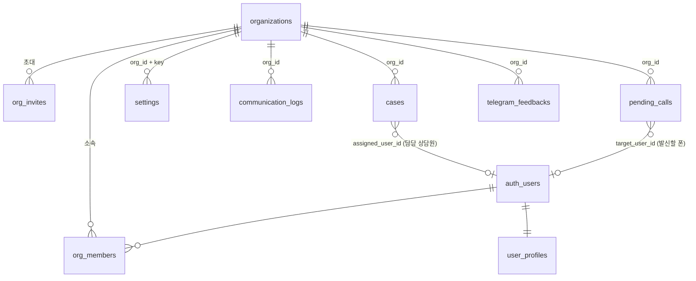

# 멀티테넌트(회사별 분리) 설계 v1

- 작성일: 2026-11-01
- 관련: `docs/기획서_리드마스터_SaaS_고도화_v1.md` 15장 (Phase 1-A)
- SQL 초안: `supabase/migrations/004_multitenant_core.sql`, `005_multitenant_rls.sql`, 점검 `006_multitenant_check.sql`
- 로컬 점검: `supabase/tests/multitenant_rls_test.mjs` (메모리 Postgres에서 001~005 적용 후 21개 항목 확인, 2026-11-01 전부 통과)
- **운영 DB에는 아직 실행하지 않았다.**

---

## 1. 확정 조건

| 항목 | 내용 |
|---|---|
| 방식 | 멀티테넌트 (Supabase 프로젝트 1개, 회사별 `org_id`로 분리) |
| 로그인 | 구글 로그인만 (고객사 상담원 전원 구글 계정 보유) |
| 규모 | 고객사 상담원 30명 + 본사 |
| 전달 | 텔레그램 (변호사 사무실이 만든 기존 방 사용) |
| 비용 | 유료 플랜(Supabase Pro 등)은 시스템 완성 후 전환. 개발·시범 기간은 무료 플랜 |

---

## 2. 데이터 구조

| 테이블 | 역할 |
|---|---|
| `organizations` | 회사. 본사 ID는 `00000000-0000-0000-0000-000000000001` 고정 |
| `org_members` | 회사-사용자 연결, 역할(owner/admin/agent), 표시 이름, 사용 여부 |
| `user_profiles` | 활성 회사, 플랫폼 관리자 여부(나만 true) |
| `org_invites` | 이메일 초대 (14일 유효) |

기존 업무 테이블 11개(`cases`, `settings`, `partners`, `telegram_feedbacks`, `communication_logs`, `pending_sms`, `sms_templates`, `pending_calls`, `tax_invoices`, `auto_dial_batches`, `auto_dial_items`)에 `org_id`를 추가하고 기존 데이터는 모두 본사로 채운다.

추가 컬럼:
- `cases.assigned_user_id`: 담당 상담원 (자동 배정용)
- `pending_calls.requested_by`, `pending_calls.target_user_id`: 누가 요청했고 어느 상담원 폰에서 걸지
- `pending_sms.target_user_id`, `communication_logs.user_id`

---

## 3. 핵심 설계: org_id 기본값

`org_id`의 기본값을 `current_org_id()`(로그인한 사용자의 회사)로 둔다.

- 웹·앱이 지금처럼 `org_id` 없이 INSERT해도 **자기 회사로 자동 저장**된다.
- 조회는 RLS가 자기 회사 행만 돌려준다.
- 그래서 1단계(DB 변경) 직후에도 **본사 업무는 웹·앱 코드 수정 없이 그대로 돌아간다.** (로컬 점검에서 확인)
- `settings`는 기본키가 `(org_id, key)`로 바뀌지만, 웹의 `upsert({ key, value })`가 그대로 동작한다. (로컬 점검에서 확인)
- Edge Function(service_role)은 회사가 없어 기본값이 NULL → `NOT NULL` 위반으로 INSERT가 실패한다. **회사를 지정하지 않은 서버 코드가 실수로 데이터를 넣는 것을 막는 장치**다.
  - 예외: `telegram_feedbacks`는 웹훅이 고쳐질 때까지 본사를 기본값으로 둔다(전환기간 전용, 005b에서 제거).

---

## 4. 권한 (RLS)

| 대상 | owner/admin | agent | anon |
|---|---|---|---|
| 리드(cases) 조회·등록·수정 | O | O | X |
| 리드 영구 삭제 | O | X | X |
| 설정·파트너 변경 | O | 읽기만 | X |
| 세금계산서 | O | X | X |
| 통화·문자 기록, 전화·문자 요청, 자동통화, 텔레그램 피드백 | O | O | X |
| 멤버 역할 변경·해제, 초대 | O (owner 초대는 owner만) | X | X |
| 다른 회사 데이터 | X | X | X |
| 회사 생성 | 플랫폼 관리자(나)만 | X | X |

로컬 점검에서 확인한 항목: 다른 회사 리드·통화기록·설정 0건, 다른 회사로 등록·이동 거부, 상담원 설정 변경·영구 삭제 거부, 자기 역할 상승·플랫폼 관리자 권한 부여 불가, anon 0건, 초대 수락·중복 수락 방지, 일반 사용자 회사 생성 거부.

Phase 1에서는 **상담원도 회사 전체 리드를 볼 수 있다.** 화면에서 기본 필터를 "내 담당"으로 둔다. 상담원에게 자기 담당만 보이게 하려면 cases 정책 한 줄만 바꾸면 된다(13장 결정 사항).

---

## 5. 적용 순서 (운영)

| 순서 | 작업 | 영향 | 되돌리기 |
|---|---|---|---|
| 0 | **운영 DB 백업** (`supabase db dump`, DB 비밀번호 필요) | 없음 | - |
| 1 | 스테이징 DB(무료 두 번째 프로젝트)에 001~005 적용 + 006 점검 | 없음 | 프로젝트 삭제 |
| 2 | 운영 DB에 004 → 005 실행 (사용 없는 시간) | 본사 업무 그대로. 화이트리스트 대신 멤버십으로 권한 판단 | 백업 복원 |
| 3 | 006 사후 점검 (org_id 빈 행 0, anon 0, 사용자별 건수) | 없음 | - |
| 4 | **웹훅 수정·배포** (회사별 봇 → org_id 지정, 리드 검색을 같은 회사로 제한) → 005b 실행 | 텔레그램 피드백 회사별 분리 | 이전 버전 재배포 |
| 5 | 웹 수정 배포 (9장 1-B 목록) | 초대·로그인·회사 표시 | 이전 커밋 재배포 |
| 6 | 앱 수정 배포 (사용자 로그인) | 상담원별 폰 동작 | 이전 APK |
| 7 | **고객사 회사 생성** (`create_organization`) → 대표 초대 | 고객사 사용 시작 | 회사 정지(status) |

> **4번 전에 7번을 하면 안 된다.** 지금 웹훅은 service_role로 **모든 회사의 리드를 이름으로 검색**한다. 고객사가 생긴 뒤 웹훅이 그대로면 본사 텔레그램 메시지가 고객사 리드에 붙을 수 있다.

> 무료 플랜에는 자동 백업 다운로드가 없다. 0번 백업은 반드시 수동으로 받는다.

---

## 6. 텔레그램 회사별 분리 설계 (4번)

변호사 사무실이 만든 기존 방에 **회사 봇을 초대**하는 방식이다.

| 항목 | 설계 |
|---|---|
| 봇 | 회사마다 1개. 회사 관리자가 BotFather로 만들고 토큰을 설정 화면에 입력 |
| 저장 | 새 테이블 `org_telegram_bots(org_id, bot_username, webhook_secret, …)`. 토큰은 클라이언트가 읽을 수 없게(쓰기 전용 RPC + 서버만 읽기) |
| 웹훅 주소 | `.../functions/v1/telegram-webhook?org=<org_id>` + 회사별 secret 헤더 검증 |
| 방 연결 | 봇이 방에 초대되면 `my_chat_member` 이벤트로 방 ID·이름을 자동 기록 → 관리자가 파트너와 연결 |
| 전달 | [전달] 버튼 → Edge Function이 회사 봇으로 파트너 방에 리포트 전송 → `case_deliveries(case_id, chat_id, message_id, sent_by, sent_at)` 기록 |
| 회신 연결 | 변호사 사무실이 리포트에 **답장**하면 `reply_to_message_id`로 `case_deliveries`를 찾아 리드에 정확히 연결. 답장이 아닌 메시지는 지금처럼 이름 매칭(같은 회사 리드 안에서만) |
| 하드코딩 제거 | `markjin`/`마크진` 제외 규칙 → 회사 설정 "우리 쪽 발신자 이름 목록" |

변호사 사무실 방에 봇을 초대하려면 방 관리자(보통 변호사 사무실)의 협조가 필요하다. 초대 안내문을 만들어 고객사에 제공한다.

---

## 7. 앱 (사용자 로그인) 설계

- 웹 WebView에서 구글 로그인 → 웹이 `AndroidBridge.setSession(accessToken, refreshToken)` 호출 → 앱이 저장(EncryptedSharedPreferences) 후 이 토큰으로 Supabase 호출, 만료 전 refresh.
- 공용 서비스 계정(`android-app@…`)은 전환 기간에만 본사 agent로 두고, 새 앱 배포 후 비활성화(`org_members.status='disabled'` + 비밀번호 변경).
- 앱이 읽는 전화 요청: `pending_calls`에서 `target_user_id = 나` 만 (지금은 회사 전체).
- 통화·문자 기록 업로드: 회사 리드 전화번호와 일치하는 것만.
- 1초 폴링 → Realtime 구독(`pending_calls`, `pending_sms`, filter `target_user_id=eq.<나>`), 폴링은 재연결 실패 시 30초 간격 보조.

---

## 8. 무료 플랜에서 개발할 때 주의

| 항목 | 무료 한도/특징 | 대응 |
|---|---|---|
| 대역폭(egress) | 월 5GB (2026-07 초과 이력) | 증분 동기화 적용 완료. 시범 운영은 소수 인원으로 |
| 프로젝트 수 | 조직당 활성 2개 | 스테이징 1개 추가 가능한지 확인 필요 |
| 백업 | 다운로드 가능한 자동 백업 없음 | 마이그레이션 전 수동 dump |
| 일시정지 | 7일간 사용 없으면 정지 | 스테이징은 쓸 때만, 정지되면 재개 |

30명 전체 오픈 전에는 Pro 전환이 필요하다(대역폭·백업). 시범 운영(3~5명)까지는 무료로 가능할 것으로 보지만, 사용량을 대시보드에서 매주 확인한다.

---

## 9. 코드 변경 목록

### 1-A (DB만, 이번 SQL)
- 004/005 실행. 웹·앱 코드 변경 없음.

### 1-B 웹
| 파일 | 변경 |
|---|---|
| `contexts/AuthContext.tsx` | 로그인 후 `rpc('accept_my_invites')` → `current_org_id`/역할 조회. 허용 이메일 목록 검사 → 회사 멤버십 검사. 미소속이면 "초대받지 않은 계정" 화면 |
| `services/api.ts` | localStorage 키를 `lm:<org_id>:cases` 형태로 회사별 분리. 담당자 기본값 `진성훈`·파트너 `P001`·특정 고객 이름 정리 목록 제거. 담당자 = 로그인 사용자 표시 이름 |
| `services/supabase.ts` | `enqueuePendingCall`: 다른 상담원 요청까지 지우던 정리 쿼리를 **내 요청만**으로. Realtime 구독에 `org_id` 필터 |
| `pages/Settings.tsx` | 관리자 전용 탭 분리, 멤버·초대 관리 화면 추가, 허용 이메일 화면 제거 |
| `pages/MyPage.tsx`, `CaseDetailAiSummary.tsx` | `HOST_EMAIL`, 화자 이름 하드코딩 제거 |
| 신규 | 회사 표시(상단), 플랫폼 관리자 화면(회사 생성·목록) |

### 1-B Edge Function
- `telegram-webhook`: 6장 설계 반영, 모든 cases 조회에 `org_id` 조건

### 1-B 앱
- 7장 설계 반영

---

## 10. 결정이 필요한 것

1. **상담원 리드 조회 범위**: 회사 전체 리드를 볼 수 있게(현재 설계) / 자기 담당만
2. **본사 기존 허용 이메일 `2882a@naver.com`**: 본사 관리자(admin)로 넣는 것이 맞는지
3. **스테이징 DB**: Supabase 무료 프로젝트를 하나 더 만들 수 있는지 (대시보드에서 New project 가능 여부)
4. **운영 DB 백업 방법**: DB 비밀번호를 `.env.local`에 `SUPABASE_DB_URL`로 넣어 주시면 제가 dump를 받는다 / 직접 받는다
