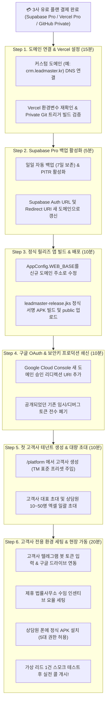

# 🚀 리드마스터 CRM 최종 오픈 준비 리스트 & 유료 전환 후 실행 로드맵 (v2.0)

> **원칙**: 첫 고객사 계약서 날인 및 이용료(예: 30인 기준 월 ₩144만 원) 입금 확인 즉시 유료 플랜 전환 및 본 로드맵을 1단계부터 순차 실행합니다.  
> **총 월 인프라 비용**: 약 \$49/월 (약 ₩66,500원) ➔ 마진율 **95% 이상**

---

## 📌 1. 현재 사전 준비 완료 현황 (₩0 비용 100% 완료)

| 영역 | 사전 구축 완료 내역 | 관련 파일 / 위치 |
|---|---|---|
| **보안 시스템** | 5대 무비용 보안 (동적 워터마크, 앱 캡처 방지, 주민번호 마스킹, 대량열람 감지, 세션 즉시 파기) | `components/SecurityWatermark.tsx`, `028_agent_security_profiles.sql` |
| **제휴 B2B 허브** | 법률사무소 수임 인계 실적, 인센티브 정산, 1초 카카오톡 청구서 복사 | `components/partner-hub/`, `utils/settlement.ts` |
| **HR 근태·급여** | flex.team형 1초 근태 위젯, 실시간 재실 현황판, 4대 맞춤 급여 연산, 급여대장 엑셀 | `components/hr/`, `services/hr.ts`, `029_hr_attendance_and_payroll.sql` |
| **데이터 무누수** | 멀티테넌트 RLS 완전 격리 PGlite 자동 검증기 (14/14 PASS) | `scripts/verify_multitenant_isolation.mjs` |
| **플랫폼 관리** | 활성 인원 × ₩48,000 자동 매출 관제, 50명 대량 초대 모달 | `pages/PlatformPage.tsx`, `BulkInviteModal.tsx` |
| **정식 서명 키** | 영구 릴리즈 키(`leadmaster-release.jks`) 및 자동 빌드 파이프라인 | `scripts/app_build_release.ps1` |
| **법적 계약서** | 개인정보 처리위탁 표준계약서, SaaS 이용계약서 & SLA, 청구서 | `docs/legal/`, `docs/billing/` |
| **현장 매뉴얼** | 관리자 5분 온보딩 가이드, 상담원 3분 앱 설치법, 기종별 점검표 | `docs/manuals/` |

---

## 🧭 2. 유료 결제 직후 순차 실행 로드맵 (Sequential Action Plan)

---

### [Step 1] 도메인 연결 및 Vercel Pro 설정 (소요: 15분)
> **핵심 이유**: GitHub 저장소를 Private으로 바꾸면 기존 GitHub Pages(`9981mark-hub.github.io`)가 즉시 셧다운됩니다. 따라서 **Vercel을 메인 호스팅으로 완전히 전환하고 도메인을 먼저 연결**해야 합니다.

1. **커스텀 도메인 연결**:
   - 가비아/후이즈/클라우드플레어 등에서 구입한 도메인(예: `crm.leadmaster.kr` 또는 `app.leadmaster.co.kr`) 준비.
   - Vercel 대시보드 ➔ 프로젝트 ➔ `Settings` ➔ `Domains`에 도메인 추가 ➔ 안내되는 DNS 레코드(CNAME 또는 A 레코드) 설정.
   - *(도메인이 아직 없다면 기본 제공되는 `leadmastercrm.vercel.app`을 우선 정식 주소로 사용 가능)*.
2. **Private 저장소 자동 빌드 확인**:
   - GitHub 저장소를 `Private`으로 전환한 후, Vercel에서 Git 커밋 시 자동 빌드가 정상 동작하는지 테스트 1회 진행.
3. **환경 변수(Env Variables) 점검**:
   - Vercel 대시보드 ➔ `Settings` ➔ `Environment Variables`에 `VITE_SUPABASE_URL`, `VITE_SUPABASE_ANON_KEY`, `VITE_GEMINI_API_KEY` 등이 프로덕션 환경에 올바르게 주입되어 있는지 확인.

---

### [Step 2] Supabase Pro 백업 및 Auth 설정 (소요: 5분)
> **핵심 이유**: 유료 Pro 전환으로 7일 비활동 시 슬립(Pause) 위험이 완전히 사라지며, 일일 백업이 가동됩니다.

1. **자동 백업 확인**:
   - Supabase 대시보드 ➔ `Database` ➔ `Backups` 메뉴에서 **Daily Backup (7-day retention)** 활성화 상태 확인.
2. **Auth Redirect URLs 갱신**:
   - Supabase 대시보드 ➔ `Authentication` ➔ `URL Configuration` 접속.
   - **Site URL**: `https://새도메인` (또는 `https://leadmastercrm.vercel.app`)으로 변경.
   - **Redirect URLs**:
     - `https://새도메인/**`
     - `https://새도메인/auth/callback` 추가 저장.
   - 이 과정을 누락하면 구글 로그인 후 이전 GitHub Pages 주소로 튕기는 현상이 방지됩니다.

---

### [Step 3] 안드로이드 정식 릴리즈 앱 빌드 및 배포 (소요: 10분)
> **핵심 이유**: 디버그 키(`debug.keystore`)로 배포된 앱은 향후 업데이트 시 서명 충돌로 앱 삭제 후 재설치해야 합니다. 정식 키(`leadmaster-release.jks`)로 빌드해야 영구적으로 원활한 인앱 자동 업데이트가 가능합니다.

1. **서버 주소(WEB_BASE) 수정**:
   - 안드로이드 스튜디오 프로젝트(`D:\안드로이드 스튜디오 작업\Projects\LeadMasterApp`):
   - `AppConfig.kt` (또는 Constants) 파일에서 `WEB_BASE`를 신규 정식 Vercel/커스텀 도메인 주소로 지정.
2. **정식 서명 키 빌드 실행**:
   - `scripts/app_build_release.ps1` 실행.
   - 생성된 `LeadMaster.apk` (서명 지문: `7ee0d49a...`)를 웹의 `public/app/LeadMaster.apk` 경로에 배치.
   - `public/app/version.json`의 `versionCode`, `versionName` 갱신.
3. **다운로드 링크 점검**:
   - `https://새도메인/app/LeadMaster.apk` 브라우저 직접 접속하여 APK 다운로드가 원활한지 확인.

---

### [Step 4] 구글 OAuth 콘솔 및 보안 비밀키 쇄신 (소요: 10분)
> **핵심 이유**: 저장소를 비공개로 전환하더라도, 이전에 공개되었던 토큰은 만일의 사태를 위해 즉시 폐기하고 신규 발급받는 것이 안전합니다.

1. **Google Cloud Console OAuth 승인 도메인 추가**:
   - [Google Cloud Console](https://console.cloud.google.com/) ➔ `API 및 서비스` ➔ `사용자 인증 정보`.
   - 사용 중인 OAuth 2.0 클라이언트 ID 편집:
     - **승인된 자바스크립트 원본**: `https://새도메인` 추가.
     - **승인된 리디렉션 URI**: `https://oenksfblktflfurxjmtv.supabase.co/auth/v1/callback` 확인.
2. **임시 토큰 폐기 및 프로덕션 키 확인**:
   - Apps Script 배포 토큰, 이전 텔레그램 테스트 봇 키가 남아있는지 확인하고 프로덕션 전용 키로 최종 고정.

---

### [Step 5] 첫 고객사 테넌트 생성 및 50명 대량 초대 (소요: 10분)
> **핵심 이유**: 고객사 대표가 가입하기 전 테넌트와 상담원 명단이 미리 준비되어 있으면 "로그인하자마자 완벽하게 세팅된 화면"을 보고 극도의 만족감을 느낍니다.

1. **플랫폼 관리자 (`/platform`) 접속**:
   - `[새 고객 회사 생성]` 폼 실행.
   - 회사명 입력 (예: `한결법률컨설팅`).
   - 대표자 구글 이메일 입력.
   - **`[✓] TM 표준 프리셋 자동 적용`** 체크 유지 후 `[회사 만들기]` 클릭.
   - ➔ 1차/2차 상담 상태, 금융회생 스크립트, 녹음 보존 주기(1년) 자동 주입 완료.
2. **상담원 10~50명 일괄 초대 (`BulkInviteModal`)**:
   - 고객사 관리자에게 전달받은 상담원 엑셀(이름, 구글 이메일) 복사.
   - `[👥 상담원 대량 초대]` 모달에 붙여넣기 ➔ 1초 파싱 ➔ `[일괄 초대 발송]` 클릭.
   - 전원에게 기본 보안 프로필(워터마크 On, 캡처 차단 On, 주민번호 마스킹 On) 자동 부여.

---

### [Step 6] 고객사 전용 환경 세팅 & 현장 실전 가동 (소요: 20분)
> **고객사 관리자와 화면 공유(또는 현장 방문)로 15분 만에 끝내는 세팅 절차입니다.**

1. **고객사 텔레그램 봇 연결**:
   - 고객사 관리자가 텔레그램 `@BotFather`에서 1분 만에 봇 생성.
   - CRM `설정` ➔ `텔레그램 연동` 탭에 토큰 입력 ➔ `[웹훅 등록]` 클릭 ➔ 즉시 연동 완료.
2. **제휴 법률사무소 등록**:
   - CRM `설정` ➔ `제휴 거래처 관리`에서 제휴 법률사무소/법무법인 등록 및 건당 인센티브 요율 설정.
3. **고객사 구글 드라이브 비공개 녹음 저장소 연결**:
   - `구글 드라이브 연동` 클릭 ➔ 고객사 관리자 구글 계정으로 로그인 ➔ CRM 전용 비공개 폴더 자동 생성.
4. **상담원 앱 설치 및 5대 권한 허용 (상담원 1인당 3분)**:
   - 상담원 스마트폰 브라우저에서 `https://새도메인/app/LeadMaster.apk` 다운로드 및 설치.
   - 앱 최초 실행 시 안내되는 **5대 권한** 허용:
     1. 전화 발신 및 통화 상태 (`READ_PHONE_STATE`, `CALL_PHONE`)
     2. 통화 기록 조회 (`READ_CALL_LOG`)
     3. 다른 앱 위에 그리기 (수신/발신 팝업 HUD)
     4. 배터리 사용량 최적화 중지 (백그라운드 통신 유지)
     5. 오디오 녹음 파일 접근 권한
5. **실전 1콜 스모크 테스트 (End-to-End)**:
   - PC 웹에서 테스트 리드 [통화하기] 클릭 ➔ 상담원 스마트폰 즉시 다이얼링 확인.
   - 통화 중 팝업 메모 작성 ➔ 통화 종료 후 구글 드라이브 녹음 파일 비공개 자동 업로드 확인.
   - 텔레그램 단체방에 통화 브리핑 메시지 도착 확인.
   - ➔ **완벽 확인 후 당일 영업 개시!**

---

## 📅 오픈 당일 분 단위 타임테이블 요약

| 시간 | 담당자 | 실행 항목 | 체크 |
|---|---|---|:---:|
| **09:00** | 대표님 | 고객사 계약서 서명 확인 & 첫 달 이용료 입금 확인 | ⬜ |
| **09:05** | 개발진 | Supabase Pro (\$25) / Vercel Pro (\$20) / GitHub (\$4) 유료 결제 승인 | ⬜ |
| **09:15** | 개발진 | Vercel 커스텀 도메인 DNS 연결 & Supabase Auth URL 갱신 | ⬜ |
| **09:25** | 개발진 | 정식 서명 키(`leadmaster-release.jks`)로 Release APK 빌드 & 업로드 | ⬜ |
| **09:35** | 대표님 | `/platform`에서 첫 고객사 테넌트 생성 & 상담원 엑셀 대량 초대 | ⬜ |
| **09:45** | 대표+고객사 | 고객사 관리자 텔레그램 봇 토큰 입력 & 구글 드라이브 연결 (10분) | ⬜ |
| **10:00** | 고객사 팀 | 상담원 전원 APK 다운로드 및 5대 권한 허용 (현장 매뉴얼 배포) | ⬜ |
| **10:20** | 전원 | 테스트 1콜 스모크 테스트 (전화-팝업-녹음-텔레그램) 검증 | ⬜ |
| **10:30** | 고객사 | **정식 영업 통화 시작 (Live Outbound Launch)** | 🚀 |

---

## 🚨 오픈 직후 발생 가능한 3대 상황 및 즉각 해결책

1. **상담원 폰에서 "출처를 알 수 없는 앱 설치 차단" 팝업이 뜰 때**:
   - 해결: `설정 ➔ 보안 ➔ 출처를 알 수 없는 앱 설치 ➔ Chrome(또는 삼성 인터넷) 허용` 클릭 안내 (매뉴얼 2페이지 그림 제공).
2. **구글 로그인 시 "승인되지 않은 리디렉션 URI" 에러가 뜰 때**:
   - 해결: Step 4의 Google Cloud Console에 신규 도메인의 리디렉션 URI가 오타 없이 들어갔는지 확인 후 저장 (반영에 1~2분 소요).
3. **통화 종료 후 녹음 파일이 드라이브에 안 올라갈 때**:
   - 해결: 스마트폰 기본 전화 앱(삼성 전화)의 `통화 자동 녹음` 기능이 켜져 있는지 확인 (삼성 전화 ➔ 설정 ➔ 통화 녹음 ➔ '모든 전화 자동 녹음' ON).
